# Brick Blueprint

Render an LDraw model as an illustrated instruction sheet. Brick Blueprint projects the 3D geometry, draws the visible edges and glass, and writes editable **SVG and PDF**. It runs on a CPU and can also export a PNG.

[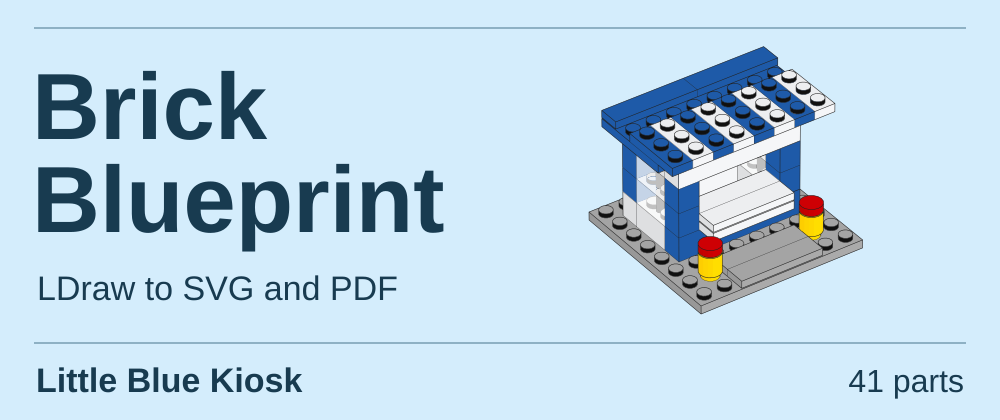](docs/portfolio/kiosk.svg)

[Quickstart](#make-your-first-render) · [Model gallery](#model-gallery) · [An illustrated step](#an-illustrated-build-step) · [Paper styles](docs/PRESETS.md) · [Research in brief](docs/RESEARCH-BRIEF.md) · [Documentation](docs/INDEX.md)

## Model gallery

Open any illustration to inspect the paths at full size. The kiosk above and the four models below use the **instruction** camera. The colors behind the models belong to the page.

| Harbor Pilot | Pocket Rangefinder |
|:---|:---|
| [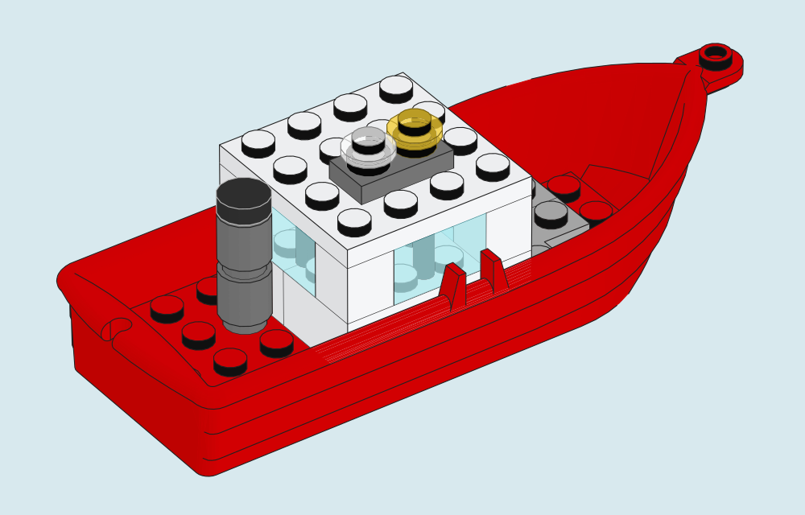](docs/portfolio/harbor-pilot.svg) | [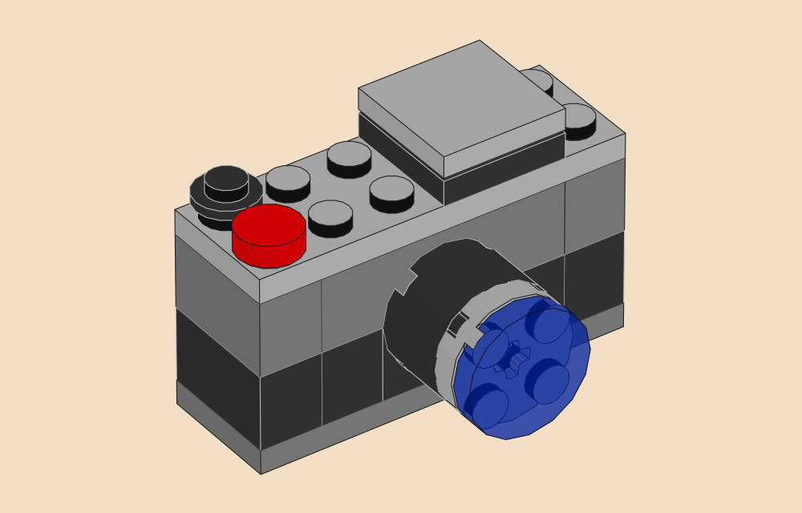](docs/portfolio/rangefinder.svg) |
| A curved hull wraps around the wheelhouse. [Model](examples/portfolio/harbor-pilot.ldr) | A stud on its side turns the lens toward the viewer. [Model](examples/portfolio/rangefinder.ldr) |

| Signal Rocket | Courtyard in Bloom |
|:---|:---|
| [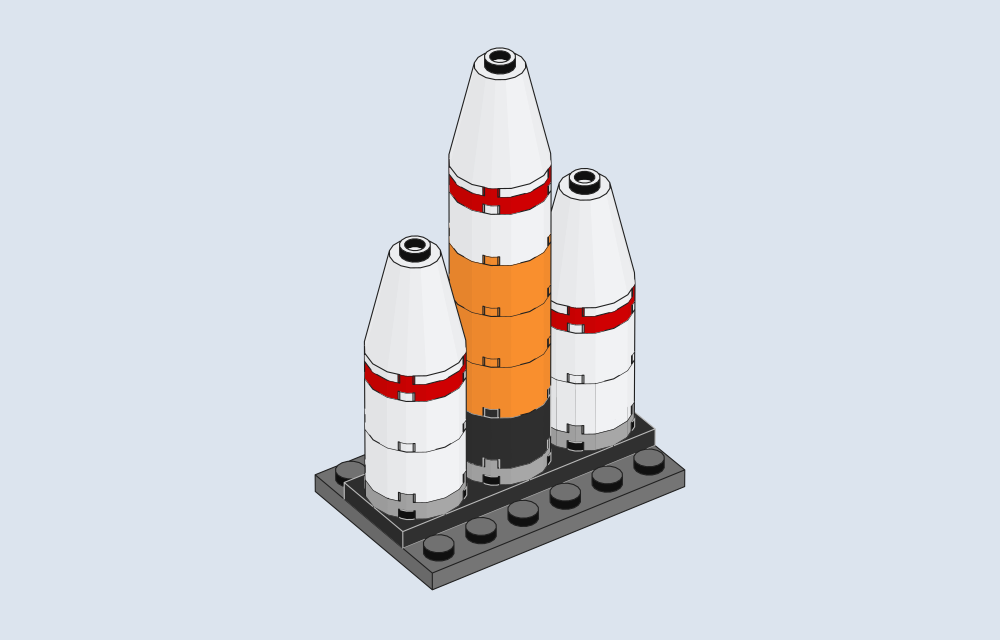](docs/portfolio/signal-rocket.svg) | [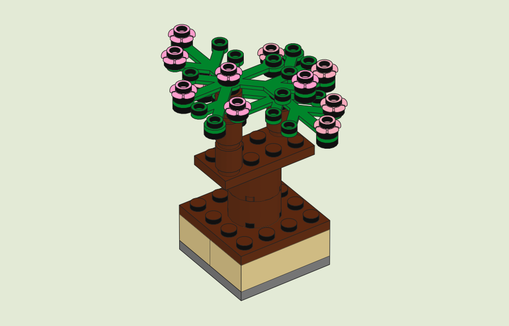](docs/portfolio/courtyard.svg) |
| Three cylinders show how the contours change where one body hides another. [Model](examples/portfolio/signal-rocket.ldr) | Thin leaves overlap beneath two canopies of blossoms. [Model](examples/portfolio/courtyard.ldr) |

The five arrangements were designed for this project with AI assistance. Each plate uses geometry from the external LDraw Parts Library. The gallery recipe records the model, camera, renderer version, file hashes and part authors. [See the kiosk take shape](docs/KIOSK.md#how-the-kiosk-fits-together) · [Look through the lighthouse lantern](docs/PART-ILLUSTRATION.md#4-look-through-the-lantern) · [Reproduce the gallery](docs/PORTFOLIO.md) · [Geometry credits](docs/portfolio/sources.json)

<details>
<summary>Open a larger scene · Lighthouse Point, 537 placements</summary>

[](docs/images/lighthouse-point.svg)

The LEGO Group designed Lighthouse Point (set 31051) and published its building instructions. This reconstruction uses parts drawn by LDraw contributors, with simplified details on the two minifigures. Anatolii Chepasov developed Brick Blueprint, the renderer used for this illustration. [Render the scene](docs/LIGHTHOUSE.md) · [Official instructions](https://www.lego.com/en-us/service/building-instructions/31051) · [LDraw part credits](docs/gallery/lighthouse-vector.json)

</details>

### One hinge, two poses

| Crossing Gate · lowered | Crossing Gate · raised 60° |
|:---:|:---:|
| [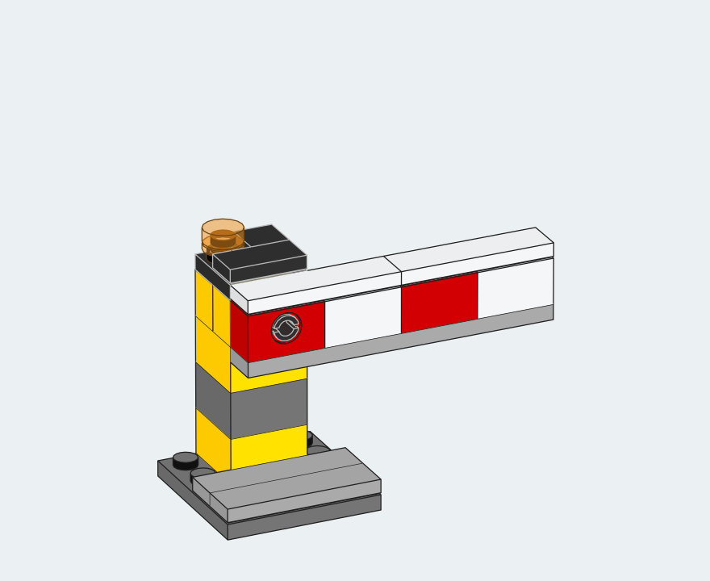](docs/images/crossing-gate-lowered.svg) | [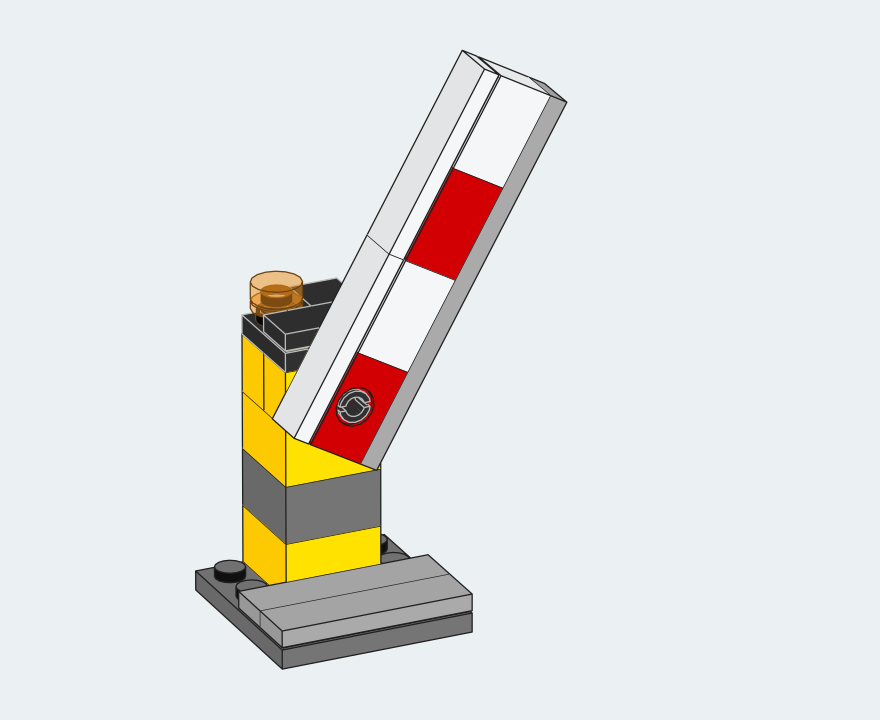](docs/images/crossing-gate-raised.svg) |

The pin, post and camera stay fixed. Rotating one seven-piece submodel lifts the arm. The two MPD files differ on one line. [Build the two views](docs/MOTION.md)

## Make your first render

Render the red boat from the gallery with Python 3.10 or newer, a C++17 compiler and a complete LDraw library. Run the commands from the checkout root. Replace `/path/to/complete.zip` with your library archive or its extracted directory. The first render builds the native core. [Get the parts library](docs/QUICKSTART.md#3-supply-real-ldraw-geometry)

```sh
python3 -m brick_blueprint doctor
python3 -m brick_blueprint render examples/portfolio/harbor-pilot.ldr \
  --library "/path/to/complete.zip" --output output/harbor-pilot \
  --camera-preset instruction --width 500 --height 320 \
  --line-width 0.55 --glass-opacity 0.75 --underpaint --background '#d8e9ee'
```

Open `output/harbor-pilot/model.svg` in a browser or `model.pdf` in a PDF viewer. Each new output folder also contains a `render.json` receipt with the camera, scale and inputs. To try editing a model, change one number to give the boat a yellow hull. [Illustrated editing example](docs/QUICKSTART.md#4-change-the-hull-color)

To save a PNG alongside the SVG and PDF, install the PNG extra once with `python3 -m pip install ".[png]"`. Add `--png` to the render command for 144 DPI, or `--png-dpi 300` for a higher resolution. The boat above produces a 1000 × 640 pixel image at 144 DPI. The same options work for parts trays.

<details>
<summary>Try the renderer without downloading a parts library</summary>

The small fixture in the checkout includes its own geometry. This command writes a separate pair of SVG and PDF files.

```sh
python3 -m brick_blueprint render examples/demo.ldr \
  --library examples/library --output output/first-render \
  --camera-preset instruction
```

</details>

[Installation and troubleshooting](docs/QUICKSTART.md) · [CLI](docs/CLI.md) · [Python API](docs/API.md)

## An illustrated build step

[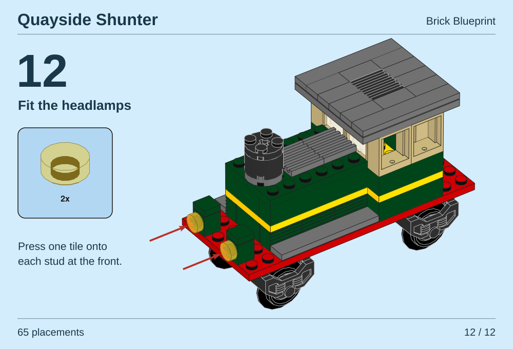](docs/images/shunter-step-12.svg)

The two lamp tiles are the last additions to this 65-placement model. Their positions in the LDraw file determine where the arrows point. [Make the SVG or printable PDF](docs/SHUNTER.md) · [Open the model](examples/shunter/shunter.ldr)

## Parts trays and print

Lay out a bill of materials at a shared scale, with quantities under each piece. Choose from 15 paper styles sampled from printed instructions. These three trays show the parts and quantities from individual steps.

<a href="docs/portfolio/modern-blue.svg">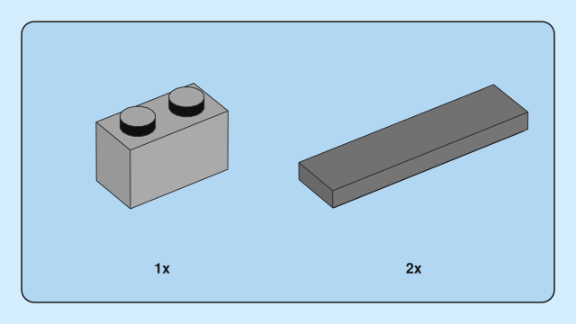</a>
<a href="docs/portfolio/speed-chamfer.svg">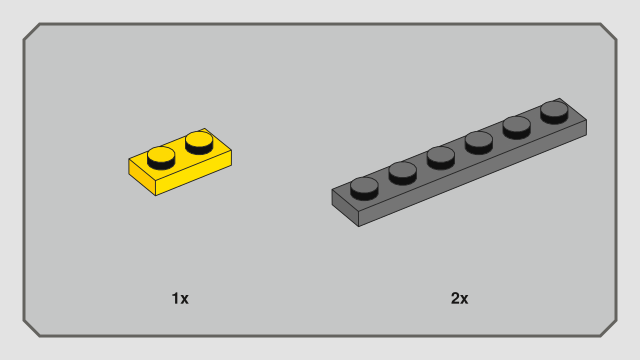</a>
<a href="docs/portfolio/botanicals-slate.svg">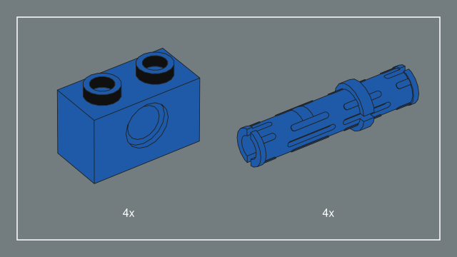</a>

The blue tray comes from Creator 31168, step 11. The clipped corners appear in Speed Champions 77242, step 5. The slate panel comes from Botanicals 11504, step 8. All three examples are on page 10 of their respective manuals. [Compare the parts and source pages](docs/PART-ILLUSTRATION.md)

```sh
python3 -m brick_blueprint tray examples/kiosk/bom-tray.json \
  --library /path/to/ldraw --output output/kiosk-parts \
  --preset modern-blue --columns 4 --width 780 --height 650 \
  --camera-preset instruction
```

RGB and grayscale PDF output use native paths. The optional CMYK workflow accepts a printer's ICC profile. [Parts and quantities](docs/PART-ILLUSTRATION.md) · [Paper styles and examples](docs/PRESETS.md) · [Print guide](docs/PRINTING.md)

## How close is the camera to a printed instruction?

On **13 illustrated assemblies from 12 sets**, perspective predicted withheld stud positions more accurately than parallel projection. The instruction preset uses a 35° azimuth and a 35° elevation with a narrow 2° field of view. Two small brick illustrations support that as a practical starting point. Compare the spacing of the studs at the near and far ends of a blue plate. [Three views of one plate](docs/GALLERY.md#one-plate-three-cameras) · [Camera measurements](docs/VOLUMETRIC-CAMERA.md) · [Camera presets](docs/CAMERA-PRESETS.md)

Surface color is a separate problem. Starting from a **measured left face**, two gains predict the top and right faces with average held-out errors of 1.56 and 1.22 RGB levels per channel. Starting from an **LDraw palette value** gives much larger errors. Brick Blueprint uses measured face colors for eleven materials. [Inspect the three faces of an orange brick](docs/MATERIAL-PROFILES.md) · [Download the 17-color data](docs/research/face-colors.csv) · [Research brief](docs/RESEARCH-BRIEF.md) · [Methods, results and source pages](docs/RESEARCH-PREPRINT.md) · [Print the paper](docs/REPRODUCIBILITY.md#print-the-english-paper)

## Development and credits

The renderer reads LDraw and assembly MPD files. A C++ visibility pass and Clipper2 produce the visible paths. [Architecture](docs/ARCHITECTURE.md) · [Supported inputs](docs/MULTIPART-MODELS.md) · [Contributing](CONTRIBUTING.md)

Anatolii Chepasov licenses the Brick Blueprint code under the [MIT License](LICENSE). When distributing copies or substantial portions of the software, include the copyright and permission notices. You can put them in an accompanying licenses file. Images you generate with the renderer need no Brick Blueprint watermark or credit. Clipper2 and LDraw geometry carry their own terms. LEGO® is a trademark of the LEGO Group. Brick Blueprint is an independent project. [Third-party notices](THIRD_PARTY_NOTICES.md) · [Licensing](docs/LICENSING.md)
