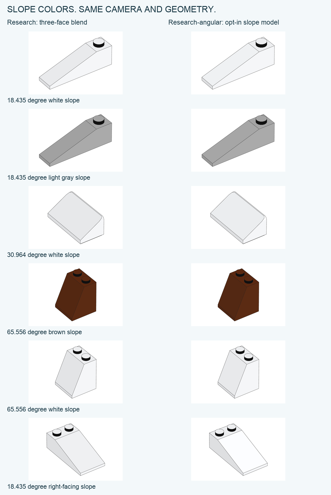

# Color between the measured faces

`--material-profile research-angular` adds an empirical slope-color model to the
measured opaque palette. It is opt-in; `research` retains the three-face blend.
The comparison below uses the same geometry, camera and frame within each pair.



```sh
python3 -m brick_blueprint render model.ldr --library /path/to/ldraw \
  --material-profile research-angular --output output/angular
```

The rule takes a material ID, its measured left/top/right colors and a surface
normal. It does not take an element number, source image or per-model override.
Library RGB alone is not a calibrated substitute for the measured palette.

## How it calculates a slope

Let θ be the surface inclination above the horizontal plane. The left-facing
sector has knots at 0°, 26.565°, 45° and 90°; the right-facing sector at 0°, 45°
and 90°. The horizontal and vertical endpoints retain the measured top and side
colors. At the intermediate knots, each encoded RGB channel is `clip(aL+b)`,
where L is the measured dark/left channel:

| Direction | a | b |
| --- | ---: | ---: |
| Left, 26.565° | 1.0825688073 | −0.5504587156 |
| Left, 45° | 1.0166342682 | −0.7151300438 |
| Right, 45° | 1.1192660550 | 4.8715596330 |

White has an explicit 26.565° calibration of `(237, 239, 240.5)`, measured on a
4286 slope in set 40765, PDF page 60. This is a material calibration, not evidence
that the neutral-color formula is exact at the bright end.

Between adjacent knots a and b, decode both endpoint colors with the standard
sRGB transfer function and calculate:

`I(θ) = I(a) sin(b−θ)/sin(b−a) + I(b) sin(θ−a)/sin(b−a)`

Clip linear I to 0…1, then encode to sRGB. The weights are **not divided by their
sum**: a sloped surface can be brighter than both endpoint faces. The formula is
equivalent to a directional-light solution within each interval. Different
intervals are calibrated separately; this is not one recovered physical light.
[sRGB transfer definition](https://www.w3.org/TR/2026/CRD-css-color-4-20261026/#predefined-sRGB).

## What was checked

Each source window is also shifted by ±1 pixel in both directions. A case passes
only if all nine windows have mean absolute channel error ≤3 and maximum channel
error ≤10. RGB error is evaluated before the vector export rounds channels.

| Cohort | Different images | Three-face blend passes | Angular passes |
| --- | ---: | ---: | ---: |
| Knot directions, including calibration and method development | 28 | 18 | 28 |
| Other inclinations used for method comparison | 38 | 33 | 38 |
| White 26.565° calibration and same-shape repeats | 3 | 0 | 3 |
| Prospective white 85984 shape controls | 4 | 4 | 4 |
| Prospective 60477 shape controls, three colors | 4 | 1 | 4 |

All 77 images pass the angular rule, versus 56 for the three-face blend. The first
69 are not independent validation of the selected rule. The eight prospective
controls cover two shapes and three materials, all left-facing. On three of the
white 85984 images the original blend has lower error; passing the threshold
does not imply improvement on every image.

The six displayed pairs are native SVG/PDF outputs. Actual visible fills, pure
vector output, identical geometry and cameras are checked separately from the
numeric predictions. No source pixels are part of the renderer or this gallery.

## Where it extrapolates

Measured principal sectors correspond to upward normals in X/Y or Z/Y. Between
them the renderer blends the two sector colors in encoded RGB, preserving the
existing vertical-wall colors. Diagonal azimuths and mirrored opposite faces
are illustration conventions. Lower-facing surfaces retain the three-face
blend. Receipts count these categories separately, by submitted triangles—not
visible area or a confidence percentage.

Transparent parts, unmeasured materials, explicit painted colors and stud-wall
rules retain their existing behavior. Right-facing multicolor controls,
diagonal directions, textures and reflections still need separate evidence.

[Numeric observations and cohort labels](research/ANGULAR-MATERIAL-CANDIDATE.json)
· [All 16 exploratory model variants](research/ANGULAR-MODEL-SELECTION.json)
· [Packaged rule and provenance](../brick_blueprint/angular-material.json)
· [Reproduce the checks](../tools/analyze_angular_material.py)
· [Reproduce the own render pairs](../tools/render_angular_material_examples.py)
