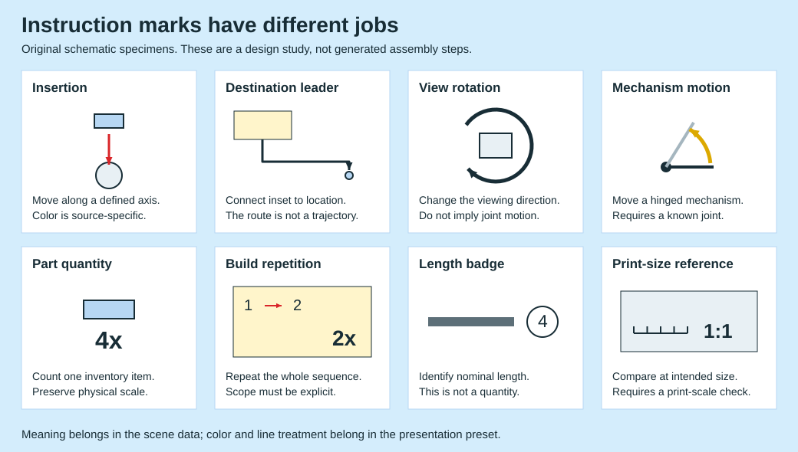

# Annotation grammar: meaning before color

The figure above is an original vector schematic generated by `tools/draw_annotation_specimens.py`. It contains no official illustrations or model geometry. It is a design guide; the renderer does not yet generate these annotation roles automatically. The ruler symbol is a legend icon, not a calibrated physical-size drawing.

## The source distinctions

| Role | Observed evidence | Meaning to preserve |
|---|---|---|
| Insertion | 42221 p32, red straight arrows; 71832 p120, green straight insertion arrow | Move a specific part along a known receiving axis |
| Destination leader | 42221 p32, thin black elbowed pointers from a cream inset to the model | Identify the attachment location; the routed screen line is not a physical travel path |
| Viewing rotation | 10343 p14 and 11508 p32, standalone rotation symbols | Reorient the model/view to expose the next operation |
| Mechanism movement | 77240 p72, yellow curved cues beside the front assembly, no new-parts tray on that page | Change the pose of existing articulated geometry |
| Inventory count | 42221 p32, small `2x`/`1x` labels under individual parts | Required quantity of the pictured item |
| Repeated sequence | 42221 p32, larger `2x` inside the cream card | Repeat the complete local operation, not just the nearest part |
| Length badge | 71832 p120, circled `4` beside an axle in the tray and in a comparison view | Identify nominal length; `1x` beside the part is its separate quantity |
| Physical-size reference | 71832 p120, axle comparison and a front assembly/alignment view labeled `1:1`; 11508 p10, full flower reference | Use the intended print size and the appropriate comparison view |
| Local step number | 42221 p32, `1`, `2` inside main step 54 | Sequence within a parent operation; local numbering is not a new global step |
| Context card | 31376 p10, pale whole hamster above the current operation | Show which larger object is being built without competing with the active geometry |
| Current addition | 10343 p14, blue boundary; 11508 p32 and 11504 p10, red boundary | Emphasize the relevant visible part/group while preserving its material colors |
| Function cue | 31051 p74, yellow star and separate red-framed close-up | Explain a function such as illumination; not an insertion or a material setting |

Official sources: [42221](https://www.lego.com/cdn/product-assets/product.bi.core.pdf/6621082.pdf), [71832](https://www.lego.com/cdn/product-assets/product.bi.core.pdf/6566338.pdf), [10343](https://www.lego.com/cdn/product-assets/product.bi.core.pdf/6555769.pdf), [11508](https://www.lego.com/cdn/product-assets/product.bi.core.pdf/6618829.pdf), [77240](https://www.lego.com/cdn/product-assets/product.bi.core.pdf/6598214.pdf), [31376](https://www.lego.com/cdn/product-assets/product.bi.core.pdf/6616307.pdf), [11504](https://www.lego.com/cdn/product-assets/product.bi.core.pdf/6618828.pdf), [31051](https://www.lego.com/cdn/product-assets/product.bi.core.pdf/6167581.pdf). Exact source hashes are in the [registry](STYLE-SOURCES.json). All cited pages were already in the sample; this study does not inflate the page count.

**A useful counterexample:** insertion is not universally red. The NINJAGO spring-mechanism example uses green on a red assembly. This establishes an exception, not the publisher's general color-selection algorithm. Likewise, a white-underlaid destination pointer can remain legible over dark geometry without changing its semantic role.

**Repetition needs a scope:** page 32 of 42221 separates 8 pt inventory labels from a 16 pt sequence repetition label. Multiplying all counts on the page by the largest `2x` would be wrong. Whether an inventory lists the total required quantity or the quantity for one repeated sequence must be explicitly established from the step, not guessed from typography alone.

## Proposed scene contract

This is a design proposal, not an accepted CLI input format. Assembly intent belongs to a separate layer above the finished model:

- `insert`: moving instance/group, start/end transforms, receiving connection and verified insertion axis. Page projection follows the selected camera.
- `place_leader`: inset identity, target instance/region, explicit routing or obstacle-aware routing in page coordinates. Its elbow path is a layout choice.
- `view_rotation`: before/after camera or rigid whole-model presentation transform. It must not modify internal joints.
- `joint_motion`: joint identity, allowed axis, source and target poses, direction and any known angle. A decorative arc must not invent a rotation limit.
- `repeat`: parent step/group and an integer multiplier. Inventory counting needs an explicit per-repeat versus total convention.
- `length_reference`: part identity, nominal length units and a distinct comparison view. A printed `4` is not inferred from a 4-pixel extent.
- `actual_size`: named geometry/view, defined physical unit conversion and export/print-size metadata. Fitting this view into a cell must not silently shrink it.
- `highlight` / `context`: selected instance/group and semantic state. Keep materials and hidden-surface visibility independent of the emphasis style.
- `function`: named function, anchor and an explicitly authored symbol; no claim of physical simulation.

Keep 3D attachment information and 2D editorial routing distinct. If the required connection or joint is unknown, preserve the ambiguity instead of generating a convincing arrow. An isolated completed model does not contain enough evidence to reconstruct an instruction sequence.

## Validation before a feature can be advertised

| Feature | Meaningful check |
|---|---|
| Insertion | End pose matches the accepted connection; arrow points toward the receiver; no inferred invisible attachment |
| Leader | Both anchors resolve, target remains visible, route does not cross quantities or unrelated geometry |
| View rotation | Model-relative transforms and joints remain unchanged |
| Joint motion | Named joint moves only on its permitted axis; endpoint poses are independently checked |
| Repetition | Counts reconcile at both local sequence and whole-step scope, without double multiplication |
| 1:1 | Physical reference extent survives export; a print proof at 100% confirms size before a precision claim |
| Current outline | Visible group boundary is emphasized; hidden edges and internal triangle seams are excluded |
| Context | Entire context group fades consistently; fading does not reveal occluded geometry |

Safety symbols in the sources are not decorative style assets. Do not reproduce a warning mark mechanically without knowing which actual function or hazard it describes.

## Current implementation boundary

The tool has quantities, one-model subassembly cards, common-scale inventories and per-item cameras. The SVG legend is documentation artwork. There is no general instruction scene parser, insertion solver, physical-size reference generator, joint animation or annotation router yet. The confirmed green and slate Botanicals variants are now implemented, including role-specific label/border contrast. Annotation generation remains a separate future feature.
