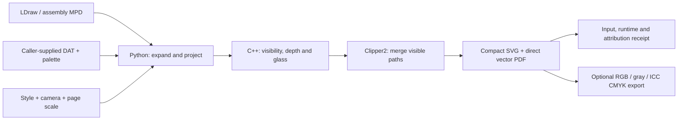

# Architecture

The pipeline is deliberately split so new formats, styles and layouts can be added without tying them to one model.

1. `ldraw.py`: explicit directory/ZIP library, color table, flat or assembly-only MPD model placements, validation, dependency access. No application calls or downloads.
2. `instruction_features.py`: recursive DAT traversal, BFC/mirror handling, explicit/conditional edges and stud feature classification.
3. `camera.py`, `project.py`, `style.py`, `instruction_style.py`, `detail_rule.py`: camera, physical page scale, material and outline rules, conservative small-detail filtering. Writes a projected scene.
4. `native/vector_render.cpp`: projected half-plane clipping, visible faces, nearest shell per transparent owner, ordered alpha composition and depth-tested ink. Floating-point tolerances apply; this is not exact arbitrary-precision geometry.
5. `native/union_q3_tiled.cpp` plus Clipper2: same-color polygon union with deterministic winding probes.
6. `optimize.py`, `compact_paths.py`: contour consolidation and shorter path syntax. Coordinates are quantized to 0.001 SVG units (0.0005 PDF points); the following compaction preserves those quantized coordinates. The pipeline is vector throughout, but quantization is not mathematically lossless.
7. `pdf.py`: writes our restricted SVG dialect as PDF paths, forms and alpha operators. It is not a general SVG converter.
8. `pipeline.py`, `cli.py`: compilation cache, temporary intermediate files, no-overwrite delivery, receipts and user-facing errors.

`render(model, library, output, **options)` in `pipeline.py` is the Python entry point. Output is a new directory containing `model.svg`, `model.pdf`, and `render.json`. Native binary caches are keyed by bundled sources and compiler version. Intermediates are temporary. Output receipts omit private input paths.

## Data flow

The library stays external. A parts tray runs the same projection/visibility
path for explicit items, then composes disjoint views at one physical scale.
The documentation's kiosk checks are separate diagnostics, not gates secretly
embedded in the renderer or a general-purpose assembly solver.

## Units and transparency

LDraw geometry is in LDU. UI dimensions, outline width and fixed scale are in PDF points. The inherited native scene format uses four projected coordinate units per page point; the SVG view box uses two. These conversion factors are explicit in projection and PDF output.

Transparent geometry is treated as one nearest surface layer per top-level physical owner. Rear faces from the same part do not darken the glass again. Separate transparent parts do accumulate opacity in depth order. This is an illustration rule, not refraction or a physically based renderer. Custom composite DAT files become one owner and can therefore differ from separately placed constituent parts.

## Boundaries and limitations

- Flat type-1 `.ldr` and assembly-only MPD placements. `STEP` is read, but the complete model is rendered; no step selection or instruction pagination yet.
- Referenced DAT files resolve only from the supplied library; assembly-only MPD blocks expand before DAT lookup. Separate local files, embedded custom geometry and TEXMAP fail explicitly.
- No automatic collision, connection, inventory-to-instruction, or physical build validation.
- The rendering API identifies geometry and material from the supplied model, library and style settings.
- The code is not a hardened service for untrusted public uploads. Entry-size limits, path checks, finite transforms, native timeouts and fragmentation guards reduce accidental failure; add whole-input resource budgets before exposing a server.
- Perspective by default, with explicit orthographic mode. [Camera equations, scale and near-plane policy](CAMERA.md). No shadows, physically based lighting, general text layout or UI yet.

The extraction manifest records the source modules and hashes. Existing rendering behavior is retained where portable; old scene-specific entry scripts, source PDFs, proprietary fonts, GUI launch paths, and raster conversion machinery were excluded.

## Presentation presets

`presets.json` stores source-linked page and panel values; `presets.py` resolves copies so overrides do not mutate shared data. `presentation.py` adds native rounded rectangles and quantity text. Role overrides distinguish a parts tray from a subassembly. The projection viewport reserves label space before rendering, and glass is composited against the panel fill. `pdf.py` exports those shapes and quantity labels directly. It remains a deliberately restricted exporter for our SVG dialect, not a general SVG library. Step/progress metadata is reserved for later composition and is not yet drawn.

`tray.py` reads an explicit JSON parts list, computes a common scale from all reserved grid viewports, renders disjoint model views against the panel color, namespaces SVG definitions, and combines native layers and labels. Failed preflight/render leaves no final output directory. The grid does not infer assembly instructions or part counts. Quantity text supports regular and bold standard Helvetica references; square and clipped-corner panels remain native vector geometry.

## Print export

`print_export.py` validates the renderer SVG dialect and its two-units-per-point convention, snapshots the source, and exports atomically to a separate directory. `print_colors.py` supplies unchanged RGB, linear-light luminance grayscale, or optional LittleCMS conversion from sRGB to a supplied CMYK output ICC profile. Only the optional CMYK branch imports Pillow. `pdf.py` switches paint operators and the page blending space; geometry, alpha and physical size are retained. CMYK is an embedded ICCBased space with a matching page group. It does not declare a PDF/X output intent or conformance. Profile bytes are supplied by the caller and are never included in the package.

Model expansion is bounded and preserves root-step ownership. [Supported MPD subset and limits](MULTIPART-MODELS.md).

## Source and palette provenance

Fresh render receipts also record the exact `LDConfig.ldr` bytes parsed for color and alpha definitions. Parts-tray items retain the same library-relative filename, SHA-256 and available author/license headers. This closes a gap left by geometry-only dependency hashes; it does not alter rendering. See [reproducibility](REPRODUCIBILITY.md) and the [checked source-export workflow](RELEASE-TOOLING.md).

## First-checkout diagnostics and original sample

`doctor.py` checks the running interpreter, compiler version and optional library
or model geometry without downloading or opening an application. Native compilation
is an explicit opt-in. The readiness result is structured JSON with a process exit
code; optional CMYK tooling is reported separately from core readiness.

Fresh native render/tray receipts bind the package source tree, native binaries
and selected runtime/toolchain details without recording private executable or
library paths. The cache key still depends on the compiler identity and native
sources; receipt-only changes do not alter vector geometry.

The [kiosk](KIOSK.md) is an original data sample and reproducible recipe, not
model-specific behavior in the renderer. `tools/check_kiosk.py` deliberately lives
outside the general API: its supported upright forms, conservative body envelopes,
nominal seats and controls are explicitly bounded. The core does not claim general
assembly validation. The generator and flat/MPD/BOM equivalence are tested without
an external parts library; the actual DAT audit requires a separately supplied one.

`tools/audit_kiosk_mesh.py` is an additional optional, model-bound diagnostic.
It uses actual BFC-oriented surfaces, two offset finite grids, signed winding
and an intentional body-intrusion control. Analytic solids/cavities qualify the
small scanner. It retains JSON evidence and removes temporary meshes; finite
sampling does not certify continuous collision freedom or physical stability.
