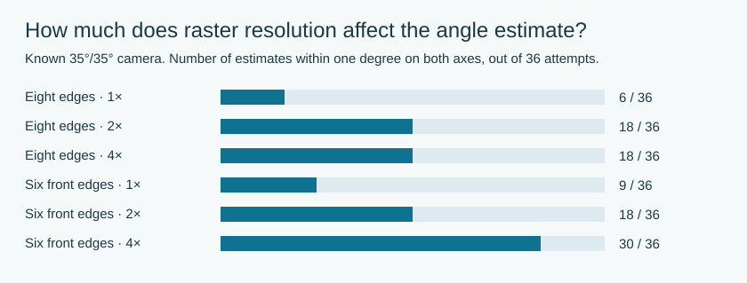

# How much precision can small part pictures support?

**35°/35° is a working view, not an established exact universal constant.**
Seven additional unique part images cover Architecture, Minecraft, City and
Friends. Their measured camera differences cannot be treated as theme settings:
the edge estimator itself shows substantial bias on small images rendered with
a known camera.

The targeted sample contains eight occurrences in five books from 2024–2025.
Minecraft 21269, PDF pages 5 and 28, reuses exactly the same decoded image. It is
counted once. Different color variants are not assumed to represent independent
camera settings either. Architecture 21062 and 21063 provide a same-theme,
same-year pair. Selection followed a screen of ten books, before camera residuals
were inspected.

## Source controls

The geometry is an ordinary 24-LDU-high 2×6 or 2×10 brick. Camera fitting uses
eight visible body edges; the cropped right vertical edge is never replaced by
the image border. Stud-cap interiors are held out. PDF placement determines the
known pixel-aspect correction. Threshold combinations are sensitivity checks,
not additional independent images.

| Source | Resolved caps at three thresholds | Free perspective RMS | Fixed local 35°/35° RMS | Orthographic RMS |
| --- | --- | --- | --- | --- |
| [21062, PDF 37](https://www.lego.com/cdn/product-assets/product.bi.core.pdf/6566168.pdf#page=37) | 0 / 0 / 6 | 0.45–0.67 | 0.74–0.94 | 0.84–0.89 |
| [21062, PDF 60](https://www.lego.com/cdn/product-assets/product.bi.core.pdf/6566168.pdf#page=60) | 4 / 12 / 12 | 0.50–0.77 | 0.55–0.92 | 0.78–0.94 |
| [21063, PDF 55](https://www.lego.com/cdn/product-assets/product.bi.core.pdf/6592611.pdf#page=55) | 2 / 8 / 11 | 0.56–0.80 | 0.66–1.07 | 0.87–1.08 |
| [21269, PDF 28](https://www.lego.com/cdn/product-assets/product.bi.core.pdf/6556015.pdf#page=28) | 3 / 9 / 12 | 0.42–0.75 | 0.65–0.94 | 0.78–1.01 |
| [21269, PDF 75](https://www.lego.com/cdn/product-assets/product.bi.core.pdf/6556015.pdf#page=75) | 0 / 5 / 6 | 0.51–1.08 | 0.87–1.04 | 0.93–1.08 |
| City 60405, PDF 63 | 12 / 12 / 12 | 0.87–0.97 | 1.07–1.12 | 1.04–1.09 |
| Friends 42604, PDF 17 | 1 / 8 / 12 | 0.51–0.77 | 0.66–1.01 | 0.81–1.05 |

Errors are native-x-equivalent pixels. The set of resolvable caps can change
between thresholds; each paired model comparison uses the same points. The full
data also retain the common cap intersection, incomplete measurements, all
optimizer starts and boundary solutions. These descriptive errors do not prove
different original camera angles.

## Check the measuring method against known truth



Twelve native vector PDFs use exactly 35°/35°: two colors, three line widths and
two distances. Each PDF is rasterized afresh at 72, 144 and 288 dpi. Three contour
thresholds give 36 attempts per resolution. This is not interpolation of a
low-resolution source image.

| Edges | Resolution | Successful fits | Recovered azimuth | Recovered elevation |
| --- | --- | --- | --- | --- |
| Eight | 72 dpi | 18/36 | 33.57–39.76° | 33.63–35.73° |
| Eight | 144 dpi | 34/36 | 34.09–39.92° | 33.48–35.23° |
| Eight | 288 dpi | 36/36 | 34.89–40.27° | 33.37–34.69° |
| Six front/side | 72 dpi | 36/36 | 13.96–43.22° | 32.49–39.61° |
| Six front/side | 144 dpi | 36/36 | 13.91–37.91° | 34.25–39.71° |
| Six front/side | 288 dpi | 36/36 | 34.87–36.66° | 34.53–35.18° |

The two far top edges can mix with stud contours. Removing them avoids that
occlusion but leaves fewer stable constraints, especially at low resolution.
Both methods recover exact noiseless projected lines; the problem arises when
measuring raster contours. Higher resolution alone does not remove occlusion
bias in the eight-edge method.

This calibration concerns the new short-edge estimator, not the nine-contour
corner method used for the two larger Classic bricks. It is not a confidence
interval for official LEGO images. The separate thirteen-assembly perspective
result is unchanged.

## What changes in the renderer?

No camera preset changes follow from these measurements. Seven fitted cameras
were replayed in the actual vector engine; coordinate disagreement is below
1e-8 page points. Those replays verify implementation, not angle recovery.
They use a shared neutral material and do not evaluate color similarity.

Numerical inputs, all source links and hashes, and camera receipts are in
[CAMERA-EDGE-STUDY.json](research/CAMERA-EDGE-STUDY.json). No official pixels or
fonts are included. To recompute the source fits and held-out predictions:

```sh
python3 tools/analyze_edge_camera.py --refit --output output/edge-camera.json
```

The tool requires NumPy. It preserves limitations and failed measurements;
it does not turn threshold repeats into a p-value for an exact camera angle.
