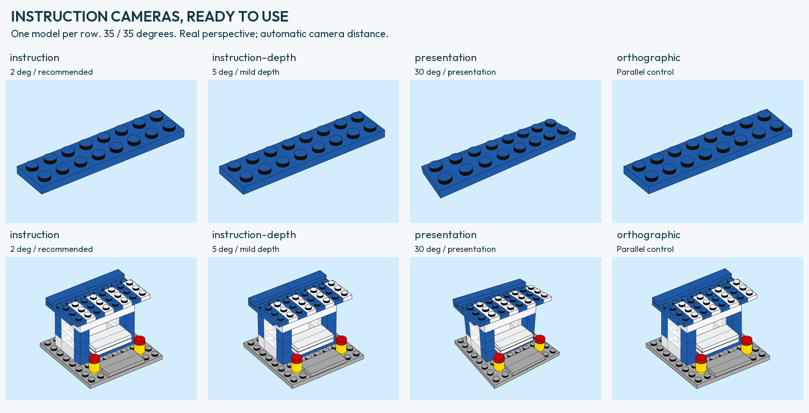

# Ready-to-use instruction cameras

Start with **`--camera-preset instruction`**. This selects a real perspective
camera with 35° azimuth, 35° elevation and a narrow 2° vertical field of view.
The renderer calculates focal length and distance from the frame and model.
You do not need to guess a distance for every differently sized model.

```sh
python3 -m brick_blueprint render examples/parts/blue-plate-2x8.ldr \
  --library /path/to/ldraw --output output/instruction-plate \
  --preset creator-blue --camera-preset instruction
```

`--preset` chooses the paper design. `--camera-preset` chooses the camera.
Either camera can be combined with any paper style and material profile.

| Camera preset | Azimuth / elevation | Vertical FOV | Use |
| --- | --- | --- | --- |
| `instruction` | 35° / 35° | 2° | Recommended starting point for small parts; weak perspective |
| `instruction-depth` | 35° / 35° | 5° | Slightly stronger depth when the reference calls for it |
| `presentation` | 35° / 35° | 30° | General illustration and the previous camera behavior |
| `orthographic` | 35° / 35° | None | Parallel-projection comparison control |

These are **working recipes**, not recovered exact LEGO settings or theme-specific
constants. We do not have evidence that, for example, Friends and Creator need
different focal lengths. The 30° view visibly overemphasizes the near
end of the 31051 step-8 plate. The 2° recipe reduces that effect.



## Measured support

The [two-brick study](VOLUMETRIC-CAMERA.md#perspective-strength-is-separate-from-direction)
uses seven body corners to align only uniform size and position; stud tops are
kept out of that alignment. Angles and FOV are not fitted per source in this
comparison. Errors below are RMS at each source's original pixel resolution:

| Setting | Brown 2×8, 11038 PDF 19 | White 2×4, 11037 PDF 8 |
| --- | ---: | ---: |
| Orthographic | 1.022 px | 0.867 px |
| `instruction`, 2° | 0.654 px | 0.705 px |
| `instruction-depth`, 5° | 1.487 px | 0.659 px |
| `presentation`, 30° | 10.802 px | 3.446 px |

These two sources helped select the recipes, so they are not a new independent
test. The 31051 plate provides an additional visual check, but its 112×59 source
pixels cannot establish an exact FOV. Source-specific fitted cameras remain
separate from presets: [volumetric camera reconstruction](VOLUMETRIC-CAMERA.md).

## What the focal length means

For page height `h` and vertical FOV `v`, the focal length is
`f = h / (2 tan(v/2))`, in the same page-point units. At 2°, `f/h ≈ 28.645`;
at 5°, `f/h ≈ 11.452`; at 30°, `f/h ≈ 1.866`.
With a hypothetical 24 mm image height these would be about 687, 275 and 45 mm.
That is only an optical analogy: no physical sensor or LEGO lens was measured.

By default, the camera looks at the model's geometric centre, has no roll, and
uses the drawing viewport's centre as its principal point. Distance is fitted
so the geometry stays within the viewport. For a 400×300 page, a 24-point margin,
and our blue 2×8 plate, the 2° recipe gives about 3786 LDU eye-to-target distance.
Larger geometry needs proportionally more distance. Focal length is tied to the
**full page**, so changing aspect ratio or the occupied part of a page also
changes perspective strength. A FOV number without its frame is not a complete
camera specification.

## Overrides and trays

Explicit camera options override the selected recipe. For example:

```sh
python3 -m brick_blueprint render examples/kiosk/kiosk.mpd \
  --library /path/to/ldraw --output output/kiosk-low \
  --camera-preset instruction --elevation 25

python3 -m brick_blueprint tray examples/kiosk/bom-tray.json \
  --library /path/to/ldraw --output output/parts \
  --preset modern-blue --camera-preset instruction
```

Trays retain one shared target-plane scale and camera distance. Per-item angles
in the manifest override the recipe. Each receipt records the preset, revision,
explicit overrides and actual focal length, distance and camera basis. An
explicit orthographic projection drops the preset's implicit FOV; explicitly
supplying a FOV to orthographic mode is an error.

Omitting `--camera-preset` selects the general 30° camera.
For instruction-like output, choose the recommended preset explicitly.
List recipes with `python3 -m brick_blueprint camera-presets`.
Reproduce the eight vector examples with
`python3 tools/render_camera_presets.py --library /path/to/ldraw --output output/camera-presets`.
