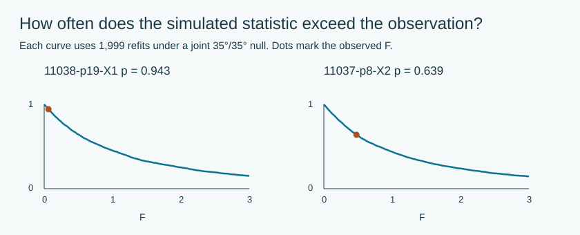

# Conditional p-values for a 35°/35° perspective view

**The two selected brick images give bootstrap p-values 0.943 and 0.640.**
Under the specified independent Gaussian corner-error model, neither calls for
departing from the fixed local 35°/35° direction. This is not a probability that
the camera is exactly correct, a population test, or an equivalence test.

| Source | Approximate F(2,5) p | Parametric bootstrap p |
| --- | ---: | ---: |
| [11038 PDF 19](https://www.lego.com/cdn/product-assets/product.bi.core.pdf/6509312.pdf#page=19) | 0.941 | 0.943 |
| [11037 PDF 8](https://www.lego.com/cdn/product-assets/product.bi.core.pdf/6497651.pdf#page=8) | 0.646 | 0.640 |

H0 fixes both local eye angles; H1 frees them. Optical rotation, roll, focus and
framing remain nuisance parameters. Each image contributes seven body corners
(14 coordinates), with nine free or seven restricted camera parameters. Stud caps are not
fitted. The source coordinates and their known pixel-aspect corrections are
unchanged. Middle contour thresholds 50/145 are the primary observations; three
thresholds of one image are sensitivity variants, not independent images.

The statistic is `F=((RSS0-RSS1)/2)/(RSS1/5)`. Scale, roll and translations are
eliminated by linear least squares (variable projection). Inverse distance is
stable at zero, admitting the orthographic limit in both fitted families.
This is an angle test, not a perspective-versus-orthographic test. Because the
camera is nonlinear, F(2,5) is approximate. The main check simulates 1999 coordinate sets per source
under the fitted null, using independent normal errors and `sigma²=RSS0/7`.
Both models are refitted on each set. `p=(1+count(F*>=F_observed))/2000`.
[Hanson, parametric bootstrap with nuisance parameters](https://people.stat.sc.edu/hansont/stat740/bootstrap.pdf#page=10).



The original corner constructions share fitted edges, so their errors can be
correlated. JPEG, geometry and estimator bias are not calibrated by the Gaussian
model. Two Classic 2024 illustrations do not establish universal camera angles.
The Monte Carlo intervals describe numerical tail-probability uncertainty,
not uncertainty of the true LEGO angles. No exact-angle or equivalence claim
follows from a large p-value.

[All six observed fits and 3998 simulation records](research/CAMERA-PVALUES.json) ·
[Numerical audit](research/CAMERA-PVALUES-CHECKS.json) ·
[Analysis protocol](research/CAMERA-PVALUES-PROTOCOL.md).

```sh
python3 tools/check_camera_pvalues.py
python3 tools/analyze_camera_pvalues.py --draws 1999 --output output/camera-pvalues.json
```
