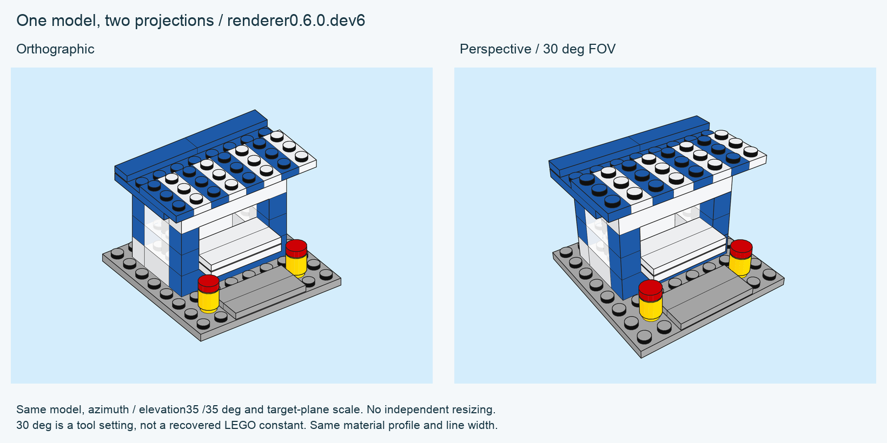

# Perspective camera

For instruction-like output, choose `camera_preset="instruction"` in Python or
`--camera-preset instruction` in the CLI. [Built-in recipes and evidence](CAMERA-PRESETS.md).

[CLI](CLI.md) · [API](API.md) · [Architecture](ARCHITECTURE.md)

Since **0.5.0.dev1**, model rendering and parts trays default to a **pinhole
perspective camera**. Projection happens on the 3D geometry before visibility,
line clipping and transparent-layer composition. SVG and PDF still contain
native vector paths. There is no image warp or raster visibility pass.



The illustration uses 35° azimuth and 35° elevation, with the same scale at the
camera target plane. The model and materials are unchanged. Since 0.6.0.dev1 the ordinary render and tray defaults are also **35°/35°**.
They align the examples with the working research approximation. Neither these
angles nor the **30° vertical field of view** are claimed as recovered exact LEGO
camera constants. Both panels use the same measured material profile.

The two vector outputs can be reproduced with `python3 tools/render_perspective_examples.py --library /path/to/ldraw --output output/camera-comparison`.

## Controls and reproducibility

```sh
python3 -m brick_blueprint render examples/kiosk/kiosk.mpd \
  --library /path/to/ldraw --output output/perspective-kiosk \
  --projection perspective --field-of-view 30 \
  --azimuth 35 --elevation 35
```

| Option / Python keyword | Meaning |
| --- | --- |
| `--projection` / `projection` | `perspective` (default) or `orthographic` |
| `--field-of-view` / `field_of_view` | Vertical FOV across the full page, degrees; 0.1–120; default 30 |
| `--camera-distance` / `camera_distance` | Eye-to-target distance in LDU; render only; default fits geometry |
| `--camera-target=x,y,z` / `camera_target=(x,y,z)` | World-space look-at point; render only; default centre of geometry bounds in camera axes |
| `--scale` / `scale` | Points/LDU **at the target plane**; mutually exclusive with camera distance |
| `--camera-roll` / `camera_roll` | Image-axis rotation in degrees, -180..180; render only |
| `--principal-point=x,y` / `principal_point=(x,y)` | Optical center in page points; render only; requires explicit distance; may lie outside crop |
| `--near-clip` / `near_clip` | Minimum eye distance, LDU; default 0.1 |

LDraw up is negative Y. By default there is no roll and the principal point is the centre of
the reserved viewport, including an offset when a callout reserves label space.
Since 0.6.0.dev2 explicit `camera_roll` and `principal_point` are available for
source-specific calibration replay; see [the volumetric study](VOLUMETRIC-CAMERA.md).
FOV sets focal length using the full page height, not the viewport height. With
an explicit shifted principal point it is a centered-equivalent angle; the receipt
separately records the shifted page angular spans.
Auto-fit changes the distance only. It does not resize or stretch the projected
image. Receipts record position, target, distance, basis vectors, principal point,
focal length, FOV and the meaning of scale.

The illustrator draws whole models: geometry crossing the near plane, behind the
eye or outside an explicitly requested frame is rejected with an error. No model
slicing or silent cropping is implemented. Near-plane-crossing conditional-line
**control points** are different: they are not drawn geometry; their uncertain
edges are conservatively preserved.

## Depth and glass

Let `(x,y,z)` be coordinates relative to the target in camera axes, with positive
`z` toward the eye. For eye-to-target distance `d`, focal length `f` in PDF points,
and principal point `(cx,cy)`:

```text
q = d - z
screen = (cx + f*x/q, cy + f*y/q)
f = page_height / (2*tan(vertical_FOV/2))
visibility_depth = d*z/q = d*d/q - d
```

Inverse eye distance, and therefore `visibility_depth`, is affine on a projected
triangle. Interpolating ordinary world depth there is wrong. The native kernel
uses this transformed depth for surfaces, line intervals and ordered glass
layers. Its existing numerical tolerances and small ink depth bias still apply;
this is floating-point illustration, not exact symbolic geometry.

The optional tiny-crease filter checks visibility direction at each edge midpoint
and uses a conservative upper bound on projected detail size. It cannot remove a
crease merely because its old orthographic scale looked small. Outline thickness
remains in page points. Transparent-shell opacity remains an artistic rule; this
change adds no refraction, physical light transport or color calibration.

## Parts trays and the orthographic control

All tray items share a focal length and eye-to-target distance. Their target
planes share points/LDU; their local centres and orientations may differ. Apparent
size naturally changes with depth inside an item. Use orthographic projection
when a strictly uniform size-per-LDU over every depth is required.

```sh
python3 -m brick_blueprint render examples/kiosk/kiosk.mpd \
  --library /path/to/ldraw --output output/orthographic-control \
  --camera-preset orthographic
```

Change only the projection to isolate perspective while retaining the same
material profile and viewing direction. Match target-plane scale explicitly
when making a controlled comparison. Perspective-only parameters are rejected
in orthographic mode rather than ignored.

## Validation

Ten added tests cover pinhole magnification, affine inverse depth, fit, conditional
edges, input rejection, old-scene identity, shared tray camera distance, opaque
surface crossings, glass order and line occlusion. The last three compare actual
native vector polygons against independent ray/plane intersections, including
reversed face input order. The perspective release had 94 passing tests and one optional ICC integration
test skipped without a supplied CMYK profile. Current suite results are recorded
in [verification](VERIFICATION.md).

A separate **LDView 4.7** check uses a finite 30° FOV, the same 35°/35° direction,
world target, camera distance, square pixels and 800×600 frame. No image
registration or separate cropping is fitted afterward. Thirty-two noncoplanar
colored markers across four models yield a maximum position discrepancy below
**0.13 px** at 800 px width. A counterfactual orthographic camera misses by
7.25–15.15 px RMS. This validates our projection convention; it does not recover
the original LEGO camera or establish superiority of our materials.

[Portable check measurements](research/PERSPECTIVE-IMPLEMENTATION.json)

## Weak perspective in the parts gallery

The source-step gallery explicitly uses `--field-of-view 2` with 35°/35° for
parts trays, while the full-model foldout keeps 30°. A two-source descriptive
sweep found the generic 30° view too strong for those small inventory bricks.
This is an exploratory recipe tied to frame/occupancy, not a recovered universal
LEGO FOV. [Study and all comparisons](VOLUMETRIC-CAMERA.md#perspective-strength-is-separate-from-direction).
