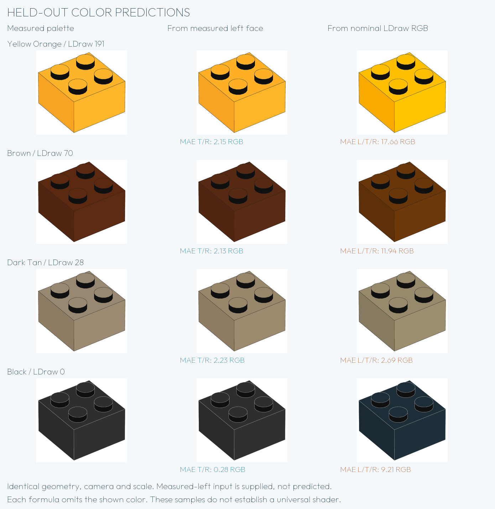

# A shared law for face colors

**A useful approximate face-to-face law is supported. An acceptable complete
[LDraw RGB → three-face conversion](LDRAW-COLOR-TRANSFER.md) has not been found
among the tested models.** The law below requires the measured left face as input.

At the sampled view, the measured dark face predicts the other two faces much
better than nominal LDraw RGB. The primary empirical approximation is, for each
encoded RGB channel on the 0–255 scale:

```
top         = min(255, 1.08 * dark left)
light right = min(255, 1.1144 * dark left)
```

Each input channel must lie in 0–255. Round after clipping when integer drawing
values are needed. For left `(105,105,105)`, the rounded outputs are top
`(113,113,113)` and right `(117,117,117)`.

The summary refits **all 17 known distinct colors**, one source brick image per
color. The unrounded gains are 1.0800177926073675 and 1.1144403974842383. A single
gain is shared by R, G and B for each target face. The fit minimizes squared
residuals with clipping included; the reported metric is mean absolute error
(MAE), after clipping and before integer rounding.

| Metric on 17 colors | Left → top | Left → right |
| --- | ---: | ---: |
| Fitted MAE per RGB channel | 1.52 | 1.17 |
| Maximum fitted channel error | 5.58 | 4.56 |
| Leave-one-color-out MAE | 1.56 | 1.22 |
| Per-channel gains, leave-one-color-out MAE | 1.60 | 1.26 |

Each target MAE averages 51 channel errors. In each validation fold, a complete
color is excluded and its gain is fitted on the remaining 16 colors. Separate
R/G/B gains do not improve this check. Using the displayed rounded coefficients
keeps the first two rows unchanged to two decimals.

This is a retrospective summary of the supplied data, not a new independent
test or an exact illumination law for arbitrary views and materials. The frozen
ten-color coefficients used by the separate new-material experiments below stay
1.079700869235415 (top) and 1.1134746948812608 (right). Their test results must not
be attributed to the refitted 17-color coefficients. The renderer retains its
measured material palette.

[All rows, predictions and omitted-color fits](research/FACE-LAW-17.json).

```sh
python3 tools/analyze_face_law_17.py --check
```

## Work with the 17 measured colors

[Download the color measurements as CSV](research/face-colors.csv) · [View the four RGB columns](research/MEASUREMENT-TABLES.md#nominal-rgb-and-measured-faces)

Each row describes one colored 2 × 2 brick, LDraw part `3003.dat`. The first four columns are the nominal LDraw RGB and the measured left, top and right RGB from one image. Each triplet also has three numeric columns for calculations. The source page, image identifier, PDF and pixel hashes, embedded profile and measurement rectangles follow the color fields. Rectangle coordinates begin at the upper left and exclude the far edge.

The `cohort` column identifies ten colors in the original sample, three additional controls and four colors reserved for a later test. The coefficients fitted to all 17 are retrospective. The separate four-color evaluation used coefficients frozen before those four colors were measured.

To reproduce the fitted error with just Python, run this from the checkout root. The calculation clips channels at 255 and keeps the fractional prediction until after the error is measured.

```python
import csv
from statistics import mean

with open("docs/research/face-colors.csv", newline="", encoding="utf-8") as stream:
    rows = list(csv.DictReader(stream))

for target, gain in [("top", 1.08), ("right", 1.1144)]:
    errors = []
    for row in rows:
        for channel in "RGB":
            predicted = min(255, gain * float(row[f"left_{channel}"]))
            observed = float(row[f"{target}_{channel}"])
            errors.append(abs(predicted - observed))
    print(target, round(mean(errors), 2))
```

The result is `top 1.52` and `right 1.17`. Each mean covers 51 channels. To check the table against the saved measurements, run `python3 tools/check_color_samples.py`. Add `--library /path/to/ldraw --manuals /path/to/manuals` to read the LDraw color definitions and repeat the pixel measurements in the ten original PDF editions. PDF replay requires pypdf and Pillow.



The reference column supplies measured colors. The middle column supplies measured
left as input and predicts only top/right; the last column predicts all faces
from nominal LDraw RGB. Each formula omits the shown color. All three use the
same DAT geometry, camera, line width and frame. The source illustrations remain
in the private research PDF; links and hashes are in the numerical dataset.

## Seven model families on the ten-color calibration sample

Errors are encoded-RGB mean absolute errors, not percentages or perceptual Delta E.
This separate experiment uses ten colors: each validation fold fits the other
nine. Four repeated source images do not add independent colors.
The family comparison is exploratory: selecting a family from these scores is
not an untouched validation on additional colors.

| Model | Left → right | Left → top | Right → left |
| --- | ---: | ---: | ---: |
| Identity | 12.23 | 8.77 | 12.23 |
| Shared clipped gain | **1.32** | **1.75** | 3.43 |
| Shared clipped gain + offset | 1.36 | 1.87 | 3.66 |
| Gain in linear RGB | 1.40 | 1.91 | 4.26 |
| Gain + offset in linear RGB | 2.21 | 2.84 | 8.25 |
| Per-channel gain + offset | 2.71 | 2.75 | 3.34 |
| Full 3×3 matrix + offset | 3.23 | 3.63 | 3.12 |

Maximum held-out channel errors for the primary left→right and left→top gains
are **3.84 and 5.77**. Added parameters do not consistently improve prediction.
Shared gain and shared affine fits minimize squared residuals with clipping
included, using bounded global piecewise solutions. Per-channel and matrix fits
use ordinary least squares followed by clipping. Linear variants decode sRGB,
fit there, and re-encode before evaluating RGB errors; see the
[W3C conversion specification](https://www.w3.org/TR/css-color-4/#color-conversion-code).

The direction matters. The yellow left face is `(253,202,1)` and the right face
is `(255,226,0)`. Under a clipped model, 255 loses information about how far above
255 an unclipped channel lay. The inverse cannot recover that information
uniquely. This explains the behavior of the tested approximation; it does not
establish LEGO's actual shader or clipping pipeline.

## Starting from nominal LDraw RGB

The input is `VALUE` from the pinned LDConfig dated 2026-05-29. `CODE` identifies
a material and `VALUE` supplies its RGB; see the
[LDraw colour-definition specification](https://ldraw.org/article/299.html).
That RGB is not a promise about the official instruction's output colors.

| Model from LDraw | Left MAE | Top MAE | Right MAE |
| --- | ---: | ---: | ---: |
| Identity | 8.50 | 11.90 | 14.07 |
| Shared clipped gain | 10.04 | **8.12** | **7.43** |
| Shared clipped gain + offset | 9.72 | 8.33 | 7.88 |
| Gain in linear RGB | 10.99 | 9.24 | 7.56 |
| Gain + offset in linear RGB | 13.63 | 10.61 | 8.83 |
| Per-channel gain + offset | 9.81 | 10.50 | 10.23 |
| Full 3×3 matrix + offset | 14.54 | 13.70 | 14.07 |

For the simple gain controls, the full-data coefficients are 0.9836951,
1.1036891 and 1.1368513 for left, top and right. Their maximum held-out channel
errors reach 36, 42 and 43. These are documented weak controls, not suggested
replacement defaults.

Bright Light Orange 191 is `(252,172,0)` in the pinned LDraw configuration, while
the measured right face is `(254,182,43)`. A gain cannot create 43 from a zero
blue channel. Black 0 is `(27,42,52)` in that configuration while the observed
faces are neutral. A matrix can mix channels, but generalizes poorly in this
small dataset. This does not disprove every possible global mapping.

Material identity is checked before fitting. LEGO element 4255416 is Sand Yellow
in the [official catalogue](https://www.lego.com/en-us/pick-and-build/pick-a-brick?query=4255416&selectedElement=4255416).
LDConfig associates LEGO ID 138 with **Dark Tan 28**, `(137,125,98)`. Its measured
anchors belong to 28. Tan 19 is a different material with separate measured anchors
and a new-shape validation described below.
[Identity evidence and pinned configuration hash](research/COLOR-IDENTITY-AUDIT.json).

## Transfer and sensitivity

With coefficients frozen from the 2×2 calibration colors, the measured left face
of each of twelve 2×4 images predicts right/top with MAE **0.98/1.60**. This tests
a different form, not unseen colors: its eight colors and source books overlap
calibration. It supplies the target image's measured left face, unlike the
separate measured-palette transfer test. Do not compare their errors as if their
inputs were identical.

Independently shifting input and output measurement windows by ±1 native pixel
gives 81 combinations per target:

| Target from left | Fitted gain range | Held-out MAE range |
| --- | ---: | ---: |
| Right | 1.1114–1.1156 | 1.09–1.43 |
| Top | 1.0711–1.0830 | 1.25–1.96 |

These are processing-sensitivity ranges, not confidence intervals or 81 new
observations. The ten calibration colors are neutral or warm. The independent extension
below adds green, medium azure and tan; the subsequent four-color test adds lime,
lavender and two bright materials. No glass, lines, arbitrary
surface orientations, background interactions or physical illumination law is
calibrated by this test. The coefficients apply to encoded output RGB at the
sampled view.

## Frozen predictions on three new materials

Before reading the new face colors, we fixed both gains, the source screen,
measurement windows and an engineering tolerance: target MAE ≤3 RGB and maximum
channel error ≤10. Across 34 books, 73 unique 63×59 image objects yielded 30
visually selected opaque, unprinted 2×2 bricks; 29 share the baseline ICC profile.
Only three newly identified materials form the primary holdout: Tan 19, Green 2
and Medium Azure 322. Repeated known colors are descriptive controls.

The unchanged left→right/top formula gives **MAE 1.33/1.62 RGB**. All 81 input/output
window-shift combinations pass the right-face tolerance. For the top, MAE ranges
from 0.90 to 3.18, so not every shift passes. These shifts are sensitivity checks,
not independent renders or confidence intervals. The three colors do not test
saturation at 255.

All seven previously fitted nominal-LDraw model families were also evaluated
without refitting. None predicts these materials closely: MAE spans 22.40–29.89
for left,24.22–36.26 for top, and 23.00–36.55 for right. Do not select a new model
from these holdout scores and then describe it as an untouched validation.
Green 2 has nominal red 0 but measured left red 44; a scalar gain alone cannot
explain that difference. Palette mapping and face shading remain separate tasks.

Measured 2×2 anchors were then tested on three 2×4 source images. Tan 19 passes
all nine window shifts (MAE 1.39, maximum channel 5) across Botanicals 11509 and
Architecture 21063. Medium Azure 322 passes the center (MAE 1.72) but fails two
shifts (maximum channel 12), so its top anchor needs further investigation.
No same-material2×4 control was found for Green 2. Repeated tan face values do
not create independent new colors. The current profile includes **Tan 19 only** after its other-geometry gate.
Green 2 and Medium Azure 322 retain nominal fallback. The ten-color formulas and
coefficients stay frozen; their original material metadata is preserved in
[an explicit snapshot](research/COLOR-LAW-SOURCE-ARCHIVE.json).

[New-color data, source URLs and hashes](research/NEW-COLOR-HOLDOUT.json) ·
[Other-geometry protocol and results](research/NEW-COLOR-GEOMETRY-TRANSFER.json).
The numerical records identify each original illustration by page and source hash.

## Four additional materials

A second frozen extension uses four additional materials from Classic 2025:
Lime 27, Medium Lavender 30, Vibrant Coral 353 and Vibrant Yellow 368. With the same
ten-color coefficients, **top/right MAE is 1.20/1.14 RGB**. All 81 separately
varied input/target ROI shifts pass the predefined tolerance; maximum channel
errors across those shifts are 6.34 and 4.43. The three-color test above and this
four-color test remain separate; neither repeat images nor window variants are
counted as additional colors. The corresponding complete prediction from RGB
LDraw fails with 17.75 RGB MAE. See the
[illustrated palette test](LDRAW-COLOR-TRANSFER.md#four-new-colors-coefficients-fixed-before-measurement).

## Reproduce

The numerical analysis needs NumPy, no part library or official artwork:

```bash
python3 tools/analyze_color_law.py \
  --data docs/research/COLOR-LAW-DATA.json \
  --output output/color-law-results.json
```

Generate native held-out controls and the own-artwork board with an external
LDraw library, Pillow, Poppler and a locally supplied font:

```bash
python3 tools/render_color_law.py --library /path/to/ldraw \
  --output output/color-law-renders
python3 tools/compose_color_law.py --renders output/color-law-renders \
  --output output/color-law-previews --font /path/to/Outfit.ttf
```

[Protocol](research/COLOR-LAW-PROTOCOL.json) ·
[Inputs, source pages, hashes and ROI shifts](research/COLOR-LAW-DATA.json) ·
[All 63 relation/model results, folds and transfer rows](research/COLOR-LAW-RESULTS.json) ·
[Math controls](research/COLOR-LAW-MATH-CHECKS.json) ·
[Twelve native render receipts](gallery/color-law-renders.json).

Replay the frozen extension from recorded medians (not pixel extraction):

```sh
python3 tools/check_new_color_holdout.py
```
