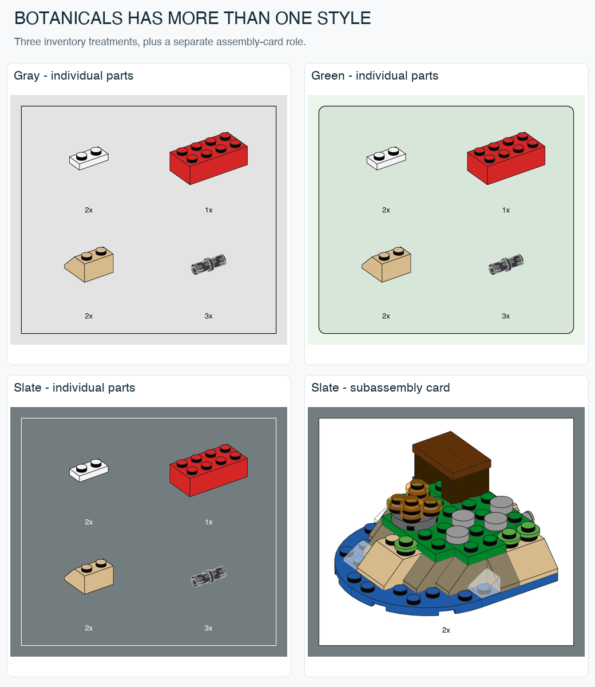

# Same theme, different instruction system: 2026 follow-up

Research date: 2026-10-25. Five additional official PDFs, twenty-four sampled build pages (plus the Creator cover for model identification). Twenty pages have native object extraction; four further Botanicals pages have visual inspection only. Text is not extractable in the two adult Botanicals files. Exact file hashes and page lists are in [STYLE-SOURCES.json](STYLE-SOURCES.json). These are observations of named books, not a claim that every 2026 set follows them.

## The important counterexample: Botanicals is not always gray

| Property | 10343 Mini Orchid, 2025 | 11508 Daisies, 2026 |
|---|---|---|
| Page | Gray `#E3E3E3` | Pale green `#EBF5EC` |
| Parts panel | Gray, square corners | Darker green `#D8E6D9`, rounded corners |
| Quantity font metadata | CeraPro-Light, 8 pt | CeraPro-Medium, 8 pt |
| Main step font metadata | CeraPro-Light, 26 pt | CeraPro-Medium, 26 pt |
| Current-addition emphasis | Blue in inspected examples | Red contours in inspected examples |
| Extra cues | White repeat/assembly cards | Green progress line, flower marker, red 1:1 comparison frame |

Sources: [10343 official PDF](https://www.lego.com/cdn/product-assets/product.bi.core.pdf/6555769.pdf), pages 10, 14, 20, 30, 36; [11508 official US PDF](https://www.lego.com/cdn/product-assets/product.bi.core.pdf/6618829.pdf), pages 8, 10, 12, 16, 24, 28, 32, 34. The 11508 page color is also present as a native RGB fill `(0.922, 0.959, 0.925)`; tray fill is `(0.847, 0.903, 0.85201)`. Hex values are rounded sRGB preview observations, not a print color specification.

The rounded inventory outline on 11508 page 10 is represented by filled contours rather than a simple stroked rectangle. Its outer-to-inner straight-edge thickness is about 0.75 pt; outer corner extent is about 7.09 pt. A zero `linewidth` field therefore does **not** mean the visible frame has no thickness. Rounded shape and Medium typography distinguish this book from the square, Light-type Botanicals examples already sampled.

The large flower views on pages 10, 16 and 24 are explicitly labeled **1:1**, inside red frames. They coexist with smaller assembly drawings. Page 32 uses rotation symbols, red insertion arrows and red outlines on the newly handled part. Page 28 connects a small numbered stem sequence to the complete flower with a black pointer across a vertical separator. Page 34 shows a four-operation sequence on one page, with quantities in one inventory above it.

**Implication:** theme alone cannot select the whole style. Preserve `botanicals-gray` as the named source approximation it is; the green rounded variant is a separate opt-in preset. Do not silently change existing renders. These observations also refute an axle-only interpretation of 1:1 reference drawings. Physical print accuracy still requires correct page sizing and a measured print proof.

**Unresolved:** this small sample cannot tell whether the difference is driven by product age/complexity, sub-line or an editorial team. The same-year adult comparison below rules out a single universal 2026 Botanicals page format, but does not establish the cause of the split.

## Same-year control: adult Botanicals uses a third format

Two additional 18+ sets from 2026 were checked against 9+ Daisies:

- [11501 Tulip Bouquet, first available US booklet](https://www.lego.com/cdn/product-assets/product.bi.core.pdf/6618826.pdf), pages 10, 16, 24, 32. [Official age/year source](https://www.lego.com/en-us/service/building-instructions/11501).
- [11504 Peace Lily, US booklet](https://www.lego.com/cdn/product-assets/product.bi.core.pdf/6618828.pdf), pages 10, 16, 24, 32. [Official age/year source](https://www.lego.com/en-ie/service/building-instructions/11504).

Both have a **dark slate page**, matching slate inventory fill, **square white inventory outlines and white quantity/step labels**. White local assembly cards use dark labels; red contours emphasize current additions. Thin destination pointers have contrasting light/dark treatment. Both show a bottom progress line. This is neither the green rounded 11508 system nor the light-gray 10343/10281 system.

The dominant rendered background is `#737D7F` in our CoreGraphics sRGB preview. The native background is **CMYK approximately `(0.15, 0.05, 0.05, 0.50)`**, so that hex is a renderer-dependent preview value rather than the original color-space definition. Page 10 in both files has zero extractable characters. Do not label its typeface or point size as established from metadata: the light-looking glyphs are only a visual observation. Extraction also finds 17 image placements on 11501 page 10 and 16 on 11504 page 10. The source PDFs mix raster illustrations with native page/panel elements; a PDF container alone is not evidence of all-vector artwork.

On Peace Lily page 10, the two inventory parts, current subassembly and larger model include 8-bit CMYK image placements. The first inspected small part image is 175 by 147 pixels over approximately 42 by 35.28 PDF points, corresponding to about **300 pixels/inch** at the intended page size. The larger 671 by 772 image over 161.04 by 185.28 points also gives about 300 pixels/inch. This is evidence for those placements, not a universal LEGO raster resolution. Our own output should remain vector as requested; these observations explain why some official PDFs do not expose model outlines as editable vector paths.

**Supported conclusion:** at least two different Botanicals systems coexist in sampled 2026 books, with age labels correlated with the observed split. **Not established:** age alone determines the style, all adult books use slate, or the gray style has been universally retired. Both variants are now implemented as `botanicals-green` and `botanicals-slate`. Slate uses light quantity text and white inventory borders, with dark text/borders on white assembly cards. Its 8 pt regular Helvetica and 0.75 pt frame are explicit normalizations; the exact source font and model ink are not claimed.

## Creator retains its modern blue system

[31376 Cute Hamster with a Flower, main-model PDF](https://www.lego.com/cdn/product-assets/product.bi.core.pdf/6616307.pdf), pages 10, 16, 24, 32; cover confirms the selected booklet is the hamster. Set year is 2026 on the [official download page](https://www.lego.com/en-us/service/building-instructions/31376).

The sampled pages retain `#D4EDFC` page blue, `#B2D7F3` inventory blue, rounded dark outlines, CeraPro-Medium 8 pt quantity text and 26 pt steps. These measurements agree with the earlier 31139 and 31169 examples. Page 10 combines a faded white context card with an underside assembly view; pages 16 and 24 divide independent steps with a vertical rule. Page 32 uses red insertion arrows. This extends the evidence for `modern-blue`; it does not justify a duplicate preset named only for the year.

## Technic retains gray, but its annotations have distinct roles

[42221 NASA Artemis Space Launch System Rocket, US PDF](https://www.lego.com/cdn/product-assets/product.bi.core.pdf/6621082.pdf), pages 10, 16, 24, 32. [Official download page](https://www.lego.com/en-us/service/building-instructions/42221) identifies the 2026 set. This US file differs from other regional PDF identifiers; measurements refer to this exact hash.

The page remains `#E3E3E3`, the inventory is white, and local assembly cards are pale cream near `#FFF5CB`. Quantities use CeraPro-Medium 8 pt and main steps 26 pt. CeraPro-Regular 8 pt is also present around length-reference labels; this is a separate role, not evidence that all quantities are Regular.

- Page 10: a cream local assembly card, red insertion arrow, thin black placement leader and a separate 1:1 beam view with length badge.
- Page 16: four small numbered operations, a bottom 1:1 axle reference and a colored motion cue at the gear mechanism.
- Page 24: bag-transition artwork can share a page with the next numbered operation. Circular bag callouts are not inventory panels.
- Page 32: cream cards contain local operations; `2x` repetition uses 16 pt text, whereas raw part counts above use 8 pt. Thin black leaders relate completed small assemblies to their destination.

**Implication:** a single generic count style or arrow style loses meaning. Inventory count, repeat count, length badge, 1:1 label and main step number are separate semantic roles. The current tool supports inventory/repetition quantities as configurable presentation, but does not yet generate instruction steps, length references, routing, rotation or movement icons.

## What this changes now

This five-book follow-up brought the corpus from 15 books / 61 pages to 20 books / 85 pages. The subsequent [theme controls](THEME-CONTROLS.md) bring the current total to **23 books / 97 sampled pages**, with 82 pages carrying native object extraction (including negative text-extraction results). The original ten preset definitions remain unchanged; two source-specific variants brought the total to twelve; the subsequent controls add two more, for fourteen current presets. Five own vector outputs validate the new inventory/subassembly contrast and shared-scale trays. Source illustrations and font programs are not included in this repository.

Next research should measure camera choices with uncertainty and distinguish transparent material rendering from editorial fading and highlighting. The same-year Botanicals comparison is complete for this bounded sample.

## Own-render comparison

The model, camera and physical size are unchanged across these four views. Green supports a measured parts panel only. Slate changes label/border contrast with the panel role. These are our vector renders, with PNG previews for browsing.
