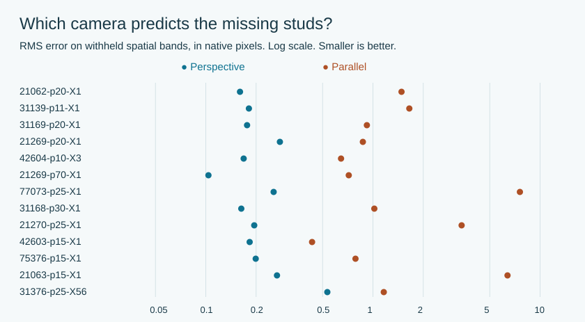
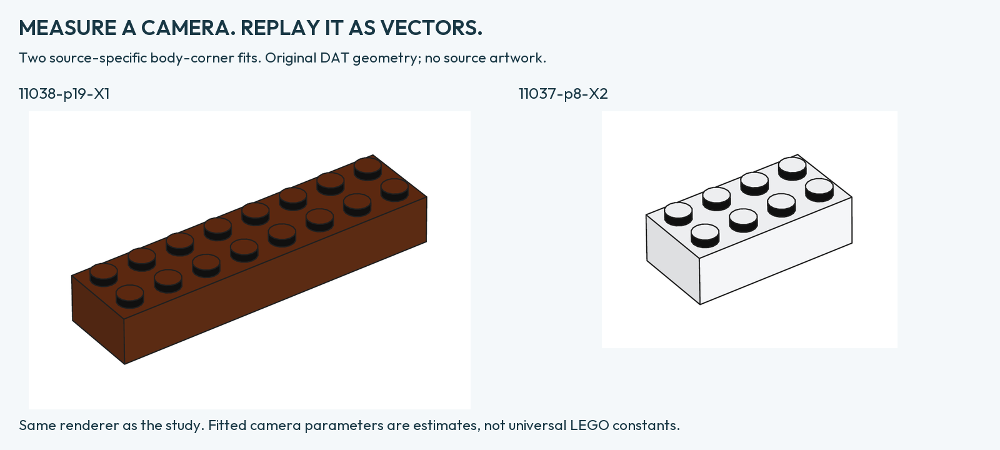
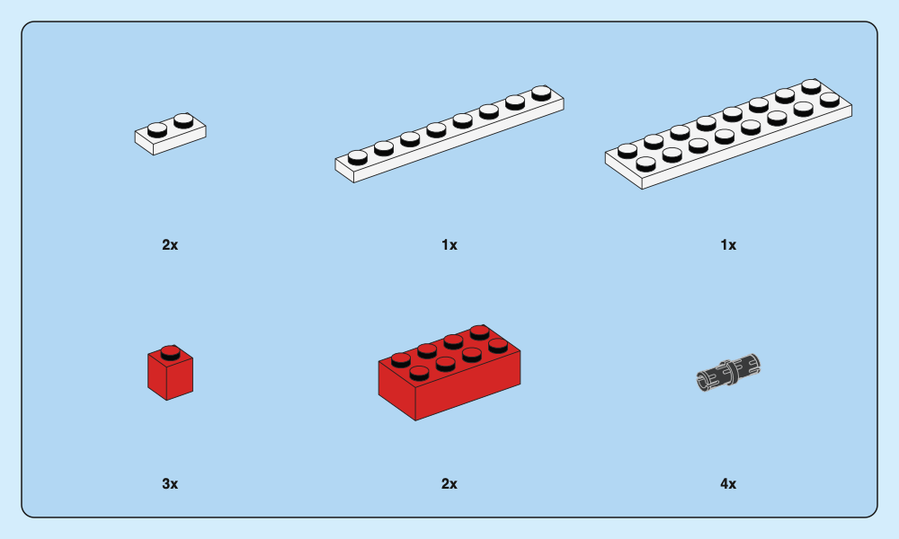
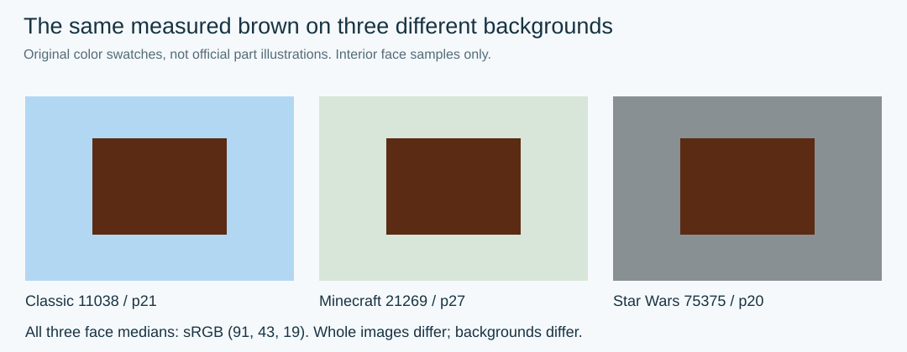
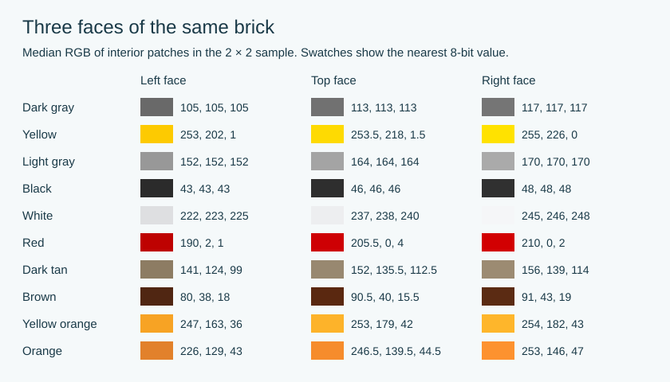
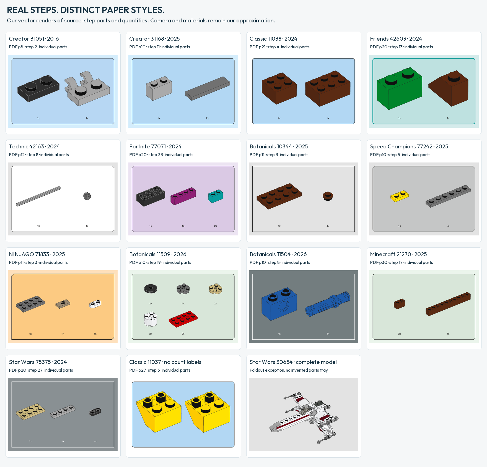
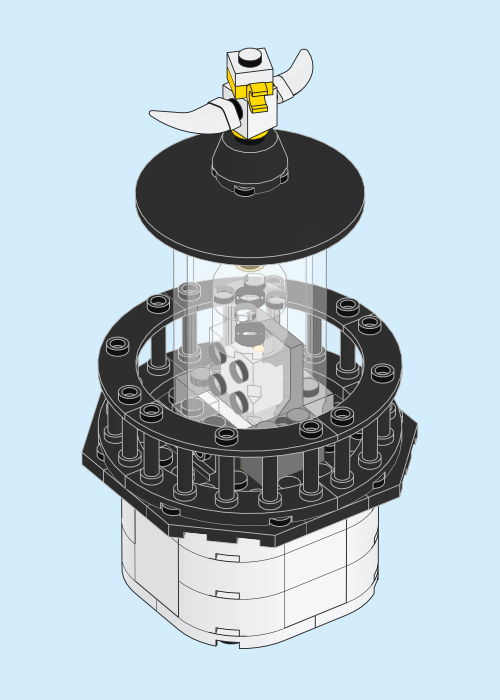
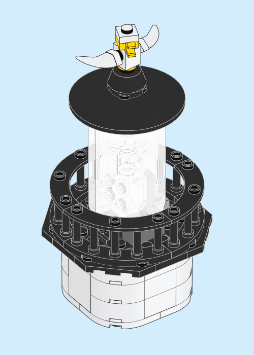

# The mathematics of brick instructions

What can be measured on a finished instruction page? These thirteen answers give the observed result, the way it was measured and the scope of the evidence. PDF page numbers start at one. For a shorter introduction, read the [research brief](RESEARCH-BRIEF.md). For the methods and individual observations, see the [research paper](RESEARCH-PREPRINT.md) and [measurement tables](research/MEASUREMENT-TABLES.md).

## 1. Parallel projection or perspective?

**Perspective predicted held-out stud centers more accurately in every one of 13 selected assembly views.** On the long chassis in set 77073, two five-interval spans measured 143.4 and 156.5 native pixels along the same beam. The opposite beam showed a similar difference. Equal physical intervals at different depths can have different lengths in the image. [Fortnite 77073, PDF page 25](https://www.lego.com/cdn/product-assets/product.bi.core.pdf/6541111.pdf#page=25)

We assigned grid coordinates only to points on the same physical plane. Each model predicted centers omitted from its fit. We withheld both dispersed grid positions and contiguous bands. The result held under three detection thresholds. The 793 primary centers come from 12 sets across six themes. The extra thresholds are measurements of the same images. On a small piece the change in scale can be too weak to measure reliably. [Methods and sources](RESEARCH-PREPRINT.md#1-perspective)

## 2. What are the camera angles?

**The instruction preset uses 35° around the brick and 35° above the grid.** A planar stud grid can constrain the horizontal direction of the optical axis. A brick of known height also constrains the direction from its center to the camera. Those are distinct directions if the brick is away from the center of the original frame.

| Known-height source | Azimuth from brick center | Elevation from brick center |
|---|---:|---:|
| [Classic 11038, p. 19](https://www.lego.com/cdn/product-assets/product.bi.core.pdf/6509312.pdf#page=19) | 34.876° | 35.102° |
| [Classic 11037, p. 8](https://www.lego.com/cdn/product-assets/product.bi.core.pdf/6497651.pdf#page=8) | 34.884° | 34.669° |

Using only body corners to fit those two cameras gave held-out stud errors of 0.65–0.81 native pixels. A separate study of 30 inventory pictures from eight books gave median local orthographic equivalents of 35.13° and 35.01°. Image selection, crop and pixel resolution limit the precision of both studies. [Body-corner fits](VOLUMETRIC-CAMERA.md) · [Catalogue data](research/CAMERA-CATALOGUE-DATA.json)

## 3. Do parts within a tray share one scale?

**Two measured plates in one tray are consistent with a common scale.**

At [75375 p20, step 27](https://www.lego.com/cdn/product-assets/product.bi.core.pdf/6509377.pdf#page=20), the projected stud pitch is **9.13 pt** for a 2×4 plate and **9.09 pt** for a 1×4 plate. We measured three intervals along matching directions and accounted for PDF image placement.

The ratio is **1.004**, but this does **not** establish 0.4% accuracy: the tested endpoint uncertainty gives a ratio range of approximately **0.88–1.15**. The sample is two parts in one tray. [Measurement details](SCALE-STUDY.md).

The tray uses one target-plane scale and one camera distance for all items in perspective. In orthographic mode the scale is uniform at every depth.

## 4. Which color spaces are used?

**The sampled Creator 2016 images use CMYK with ISO Coated v2; the modern matched images use sRGB.**

We read image color spaces and embedded ICC profiles, rather than guessing from appearance. The matched-element sample covers sets **31051, 11038, 21269, 21062 and 75375**; this is not a claim about every object in those books.

CMYK must be converted through its profile before comparison. Otherwise conversion errors can masquerade as theme differences. An embedded profile describes saved colors, not the original 3D lighting. [Pages and profile hashes](PART-COLOR-STUDY.md).

## 5. Does the same part change color with the theme?

**Two measured face medians match in all three checked step trays for one brown brick. No theme-specific recoloring was found in this control.**

| Theme and set | PDF page / step | Left face, sRGB | Right face, sRGB |
|---|---|---|---|
| Classic 11038 | 21 / 4 | 80, 38, 18 | 91, 43, 19 |
| Minecraft 21269 | 27 / 29 | 80, 38, 18 | 91, 43, 19 |
| Star Wars 75375 | 20 / 26 | 80, 38, 18 | 91, 43, 19 |

The 63 × 59 pixel illustrations have the same embedded sRGB profile. Corresponding patches on the left are pixel-identical in this comparison. The right patches share the same median but individual pixels differ by up to five levels. [Regions, hashes and sources](PART-COLOR-STUDY.md)

A separate control, the dark-gray 1×3 brick at **21062 p218 / 75375 p182**, has identical decoded RGB pixels and profile. Overall, four elements were checked across five books. Saturated, transparent and printed parts still need controls.

## 6. How are the top and side faces shaded?

**For the 14 sampled 2×2-brick illustrations, the horizontal top is brighter than
the left face and darker than the right face.** Dark gray gives 105 / 113 / 117
and light gray 152 / 164 / 170 (left / top / right).

We added a fixed 30-pixel top patch and an 18-pixel stud-cap control to the same
ten colors and six books; verified the native pixels and shared sRGB profile;
and shifted every ROI by one pixel in nine directions. The luminance ordering
survives every shift. These shifts are sensitivity checks, not independent images.

**A useful approximate transfer from measured left to the other faces exists:**
for each channel, top ≈ min(255, 1.08 × left), right ≈ min(255, 1.1144 × left).
On 17 known colors, MAEs are **1.52 / 1.17 RGB**; leave-one-color-out MAEs are
**1.56 / 1.22**. Each target uses one gain shared by R, G and B. This is an
empirical approximation at the sampled view. Stud caps are checked separately;
their largest primary difference from the top patch is 6.5 levels.
[Equations, predictions and scope](COLOR-LAW.md).

[All sources, three-face values and limits](SHADING-STUDY.md) · [Exact data and ROI shifts](THREE-FACE-SHADING.json).

**Implemented:** renderer 0.6.0.dev7 now uses those three-face measurements for eleven opaque colors. On twelve held-out 2×4-brick images, mean absolute face-patch error against the official sources is 1.01 RGB levels. The same source camera is not recovered by that color test. [Profile, examples and limits](MATERIAL-PROFILES.md).

**No acceptable LDraw RGB → three-face conversion was found among the tested models.** MAE is 15.75 RGB on 13 omitted colors and 17.75 on four new materials. The declared precision target is not met. A useful law starting from a measured left face does not solve this palette conversion. [RGB-only study](LDRAW-COLOR-TRANSFER.md).

## 7. Which background colors vary by theme or edition?

**Backgrounds vary by edition; one theme does not imply one palette.** Creator and City share blue examples, while Botanicals includes gray, green and slate systems.

We compared full pages, PDF color objects and color-managed page renders. The table gives our source-linked RGB preset representations; colors converted from other processes are not universal print-ink constants.

| Edition or style | Page | Parts tray |
|---|---|---|
| Creator blue / 2016 | `#D4EDFC` | `#B7D7F3` |
| Modern blue / Creator + City / 2023–25 | `#D4EDFC` | `#B2D7F3` |
| Classic white / 2024 | `#FFFFFF` | `#B2D7F3` |
| Friends aqua / 2024 | `#D5EBEB` | `#BEE1E0` |
| Technic gray / 2024 | `#E3E3E3` | `#FFFFFF` |
| Fortnite lilac / 2024 | `#ECE4F2` | `#DAC9E4` |
| Star Wars foldout / 2023 | `#E3E3E3` | — |
| Botanicals gray / 2021–25 | `#E3E3E3` | `#E3E3E3` |
| Speed Champions / 2025 | `#E3E3E3` | `#C5C6C6` |
| NINJAGO peach / 2025 | `#FEE0BC` | `#FCCA82` |
| Botanicals green / 2026 | `#EBF5EC` | `#D8E6D9` |
| Botanicals slate / adult 2026 | `#737D7F` | `#737D7F` |
| Minecraft green /2025 | `#EBF5EC` | `#D8E6D9` |
| Display slate /Architecture and Star Wars 2024-25 | `#899093` | `#899093` |
| Classic Space / 11037 / 2024 | `#FFFFFF` | `#B2D7F3` |

The dash for the Star Wars foldout is intentional: no ordinary parts tray was observed. Its orange subassembly panel is a different role. Textured Classic 2015 was not reduced to one flat color. [Exact sets, pages and exceptions](INSTRUCTION-ATLAS.md) · [Roles and measurements](STYLE-RESEARCH.md).

**Same-theme/year check:**16 presentation pairs show that a theme/year alone does not determine all settings. Creator 31050/31051 differ in page/frame/font; Classic 11037 omits quantity labels unlike 11038; StarWars30654 foldout differs from 75345 booklet. Botanicals 2026 has both green 9+ and slate18+ pairs. Clipped-corner dimensions repeat in Speed/NINJAGO counterparts. [All pairs, measurements and limits](PAIRED-THEME-STUDY.md).

## 8. How thick are frames and how rounded are corners?

**These parameters vary between sampled styles.**

| Source | Frame | Measured radius |
|---|---:|---|
| 31051, Creator 2016 | ≈0.5 pt | Inner contour ≈7.09 pt |
| Modern Creator / Classic / Technic / Fortnite samples | ≈0.75 pt | Outer ≈7.09, inner ≈6.71 pt where measurable |
| 42604, Friends | ≈2 pt | Outer ≈7.09, inner ≈6.09 pt |

We measured PDF vector contours, including filled outer/inner boundaries, rather than screenshot pixels. Speed Champions and NINJAGO have clipped corners, approximately **7.85 pt** and **6.65 pt** deep in the observed examples. Some Botanicals frames are square.

Our normalized **7.087 pt** radius and **14.17 pt** padding are implementation choices, not recovered universal LEGO spacing. [Source measurements](STYLE-RESEARCH.md).

## 9. How thick are outlines on the parts themselves?

**The exact original stroke setting is not established.** Light edges on dark parts and dark edges on light parts provide contrast.

At **31051 p74**, model lines are already inside raster images. The inset is only **211 pixels wide**, placed at approximately **151.92 pt**. A roughly one-pixel line cannot reveal the exact authoring setting. This differs from the measurable vector panel frame above. Our **0.32 pt** default is a tool choice. [Forensics](MATERIALS-AND-EMPHASIS.md).

## 10. What opacity does the glass use?

**The original glass opacity is unknown. The sampled effects are baked into opaque images.**

Across **43 image placements on five pages**—31051 p74, 31376 p10, 10343 p14, 11508 p32 and 11504 p10—we found no image transparency masks or non-default object alpha. These are not all glass images: the sample includes faded context and step highlights.

The visible effect does not reveal how glass opacity, white tint and subdued internal lines were combined. A claimed universal glass percentage would be unsupported. [Object-level audit](MATERIALS-AND-EMPHASIS.md).

The mechanism inside the lantern shows what the setting changes in Brick Blueprint. These two vector drawings use the same model and camera.

| 0.35 opacity per surface | 0.90 opacity per surface |
|:---:|:---:|
|  |  |

[How the two layers combine and how to render these views](PART-ILLUSTRATION.md#4-look-through-the-lantern)

## 11. Which fonts and label sizes are known exactly?

**All six specifically compared quantity labels are exactly 8 pt. Their font family differs by edition.**

| Source | Labels | PDF font metadata | Size |
|---|---|---|---:|
| 31051 p8 and p13 | 1x, 2x, 4x | LEGOChalet60-Bold | 8 pt |
| 31376 p5, p6 and p8 | 1x, 2x, 4x | CeraPro-Medium | 8 pt |

We read text-object metadata. The **1x** advance is **7.312 pt** in the older example and **7.256 pt** in the modern one. This is a measurement, not font identification from visual resemblance.

Main step numbers vary: **38 pt** at the lighthouse, **32 pt** in Classic 2015, and commonly **26 pt** in sampled modern pages. [Source table](STYLE-RESEARCH.md).

Among four open font families, **Outfit Bold** was the closest candidate for **LEGOChalet60-Bold** and **Jost Medium** for **CeraPro-Medium**. The comparison used three quantity labels per original font. [Specimens and method](FONT-STUDY.md).

## 12. Does a 1:1 reference measure correctly in millimeters?

**One measured beam reference is consistent with an 8 mm hole pitch. A part-length label is not its silhouette length.**

At [Technic 42221 p10](https://www.lego.com/cdn/product-assets/product.bi.core.pdf/6621082.pdf#page=10), thirteen hole centers give twelve intervals. Native pixels were converted through the PDF placement to millimeters:

- Main pitch estimate: **8.009 mm**; tested endpoint sensitivity: **7.980–8.037 mm**.
- The axle labeled **3** on p16 measures **23.21 mm** in yellow fill, **23.36 mm** including black ink, rather than exactly 24 mm.
- Both pages measure **195×259 mm**. Scaling their width to 210 mm enlarges everything by **7.7%**.

These are digital-document measurements, not validation of a particular printer. [Coordinates and calculation](SCALE-STUDY.md).

## 13. What are the p-values for a 35°/35° direction?

**Parametric bootstrap gives p = 0.943 for 11038 PDF 19 and p = 0.640 for 11037 PDF 8.**
Both local eye angles are tested jointly within each image. Primary contour
thresholds are 50/145; 1999 simulations per source are not additional illustrations.
Under independent Gaussian corner errors, neither rejects 35°/35° at 0.05.
This does not establish exact equality or a universal camera. Shared edges,
JPEG and estimator bias can invalidate the error model.
[Test statistic, all simulations and limitations](CAMERA-PVALUES.md).

## What is not yet a recovered constant

An exact lens and camera distance, a universal pose for all parts, a complete shading formula, original glass opacity, and exact model-outline width from raster images. Their status is **not established**. Tool defaults must not substitute for source measurements.
