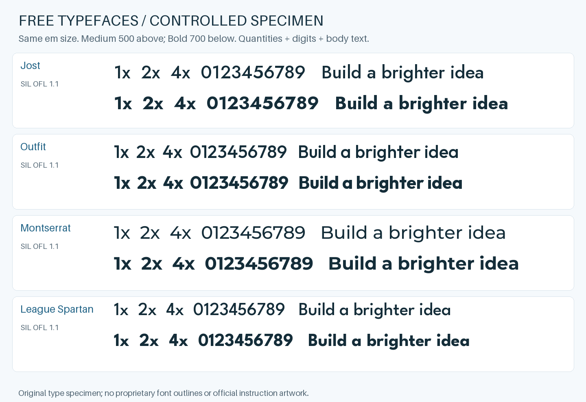

# Free font substitutes, measured on quantity labels

**Provisional shortlist: Jost Medium (500) for modern CeraPro-Medium labels; Outfit Bold (700) for older LEGOChalet60-Bold labels.** These are the closest candidates in this four-family, three-label screening—not clones, metric-compatible replacements, or a ranking of every free font. Jost and Outfit are close in the modern comparison. A whole paragraph or Cyrillic text needs its own review.



## What did we actually compare?

The source font names and 8 pt sizes come from native PDF text metadata. We rasterized the existing `1x`, `2x`, `4x` labels at 720 dpi; we did **not** extract their font programs. Source labels and comparison crops stay in private research storage. The public specimen above contains only text we set in OFL fonts.

| Reference | Exact PDF pages, one-based | `1x` advance | `2x` advance | `4x` advance |
|---|---|---:|---:|---:|
| LEGOChalet60-Bold, 8 pt | [31051 / 6167581](https://www.lego.com/cdn/product-assets/product.bi.core.pdf/6167581.pdf), p8 / p8 / p13 | 7.312 pt | 8.784 pt | 8.552 pt |
| CeraPro-Medium, 8 pt | [31376 / 6616307](https://www.lego.com/cdn/product-assets/product.bi.core.pdf/6616307.pdf), p5 / p6 / p8 | 7.256 pt | 8.896 pt | 8.680 pt |

These five additional pages were inspected at the labels only; they are separate from the 106-page style/color sample. Full hashes, positions expressed as label advances, sizes, and candidate measurements: [FONT-MEASUREMENTS.json](FONT-MEASUREMENTS.json). The references do not establish the exact style of all Chalet or Cera releases. TypeMates describes [Cera Pro](https://www.typemates.com/fonts/cera-pro) as a geometric family; our selection nevertheless uses the actual PDF labels, not that description alone.

| Free family | Cera reference: weight 500 | Chalet reference: weight 700 | Visual difference worth noticing |
|---|---:|---:|---|
| **Jost** | **0.691** | 0.691 | Close sloping flag on modern `1` and rounded `2`; closed `4` differs visibly |
| **Outfit** | 0.681 | **0.714** | Open `4` is closer; flat flag on `1` differs from both source faces |
| Montserrat | 0.620 | 0.689 | Wider shapes and a different `2`; its medium weight appears lighter here |
| League Spartan | 0.621 | 0.695 | Compact quantities, but size proportions and the `1` flag differ |

Numbers are mean **binary ink intersection-over-union**, not “percent font similarity.” We rendered each candidate at the same 80 px em (8 pt at 720 dpi), compared the two largest connected source-ink components, and allowed integer registration ±3 px around their centered bounding boxes. No stretch or size fitting. Source threshold: gray <80; candidate threshold: coverage >128. That source/candidate threshold asymmetry, hinting, optical size, and different rasterizers limit the ranking; the narrow Jost/Outfit gap is not decisive. We did not optimize variable weight or spacing to maximize the score. The two-component isolation removes adjacent illustration pixels, including a small fragment above the Chalet `2x`.

The qualitative conclusion is more useful than a hundredth of a score: **Jost is a good modern starting point; Outfit gives a useful older bold alternative. None reproduces the Chalet `1` flag exactly.** The samples do not test all letters, language coverage or paragraph rhythm. Quantities use a literal lowercase `x`, not the multiplication sign `×`.

## Can these be used without buying a license?

Yes. The downloaded copies of all four families carry **SIL Open Font License 1.1**. It permits commercial design and use in documents. If a future release redistributes the font files, retain the copyright notices and license; modified fonts must respect any reserved names. Font licensing does not force the document or renderer code to adopt OFL. See the [official OFL usage FAQ](https://openfontlicense.org/ofl-faq/) and the licenses for the exact families:

| Family | Official distribution | License |
|---|---|---|
| Jost | [Google Fonts repository](https://github.com/google/fonts/tree/main/ofl/jost) | [OFL.txt](https://github.com/google/fonts/blob/main/ofl/jost/OFL.txt) |
| Outfit | [Google Fonts repository](https://github.com/google/fonts/tree/main/ofl/outfit) | [OFL.txt](https://github.com/google/fonts/blob/main/ofl/outfit/OFL.txt) |
| Montserrat | [Google Fonts repository](https://github.com/google/fonts/tree/main/ofl/montserrat) | [OFL.txt](https://github.com/google/fonts/blob/main/ofl/montserrat/OFL.txt) |
| League Spartan | [Google Fonts repository](https://github.com/google/fonts/tree/main/ofl/leaguespartan) | [OFL.txt](https://github.com/google/fonts/blob/main/ofl/leaguespartan/OFL.txt) |

[FONT-SOURCES.json](FONT-SOURCES.json) records download URLs, Git blob IDs and SHA-256 hashes for each TTF and license, checked 2026-10-25. Use those hashes to reproduce this specimen: the `main` branch may change. This study distributes the rendered specimen, not font binaries. The project's own software uses the [MIT License](../LICENSE).

## Does the renderer use the recommended fonts already?

No. Current SVG/PDF quantity output still uses the documented Helvetica substitutes. This is a research recommendation; implementing font selection and embedded PDF subsets is a separate task. Merely naming Jost in an SVG without making it available on the viewing machine would not give reliable output.

## Reproduce

`tools/study_fonts.py` requires Pillow, numpy, pdfplumber and Poppler, all optional research dependencies. Put the four official TTFs in `FONT_DIR/jost`, `outfit`, `montserrat`, `leaguespartan`; keep their OFL files alongside them. Supply the two source PDFs independently, checked against the JSON hashes.

```sh
python tools/study_fonts.py --work /tmp/font-study \
  --font-dir /tmp/free-fonts \
  --chalet-pdf /path/to/6167581.pdf --cera-pdf /path/to/6616307.pdf \
  --preview-dir /tmp/font-specimens
```

`--work` contains official-label crops and must remain outside the public repository. The preview directory contains `faq-fonts.png`, the four-family specimen shown above. Compare the generated measurements with the [recorded label measurements](FONT-MEASUREMENTS.json).
