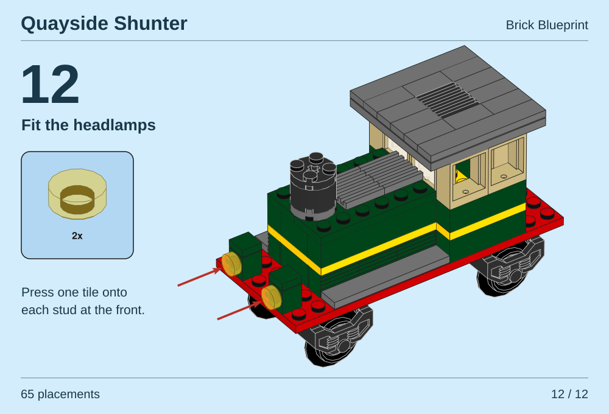
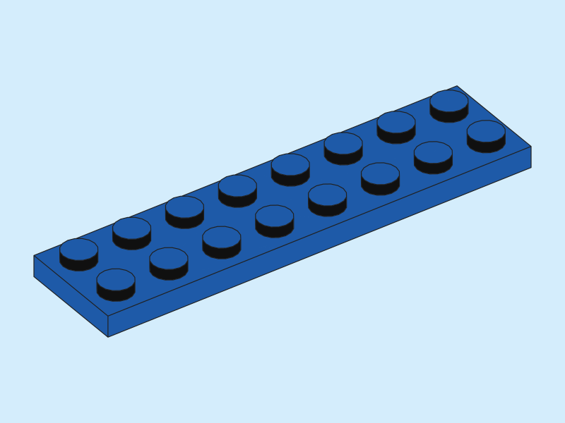
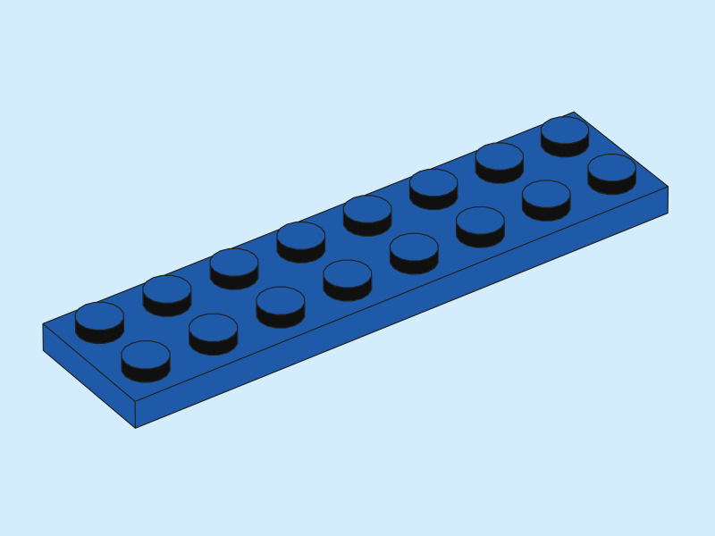
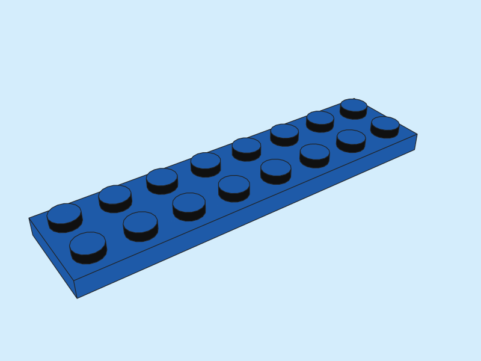
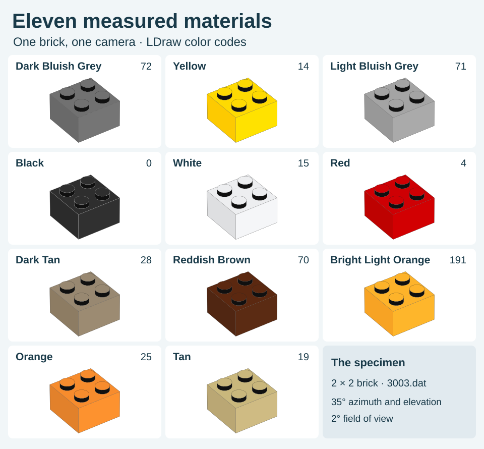
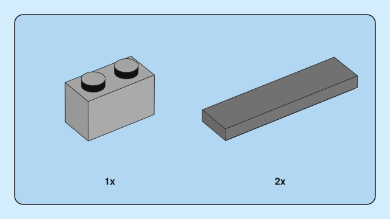
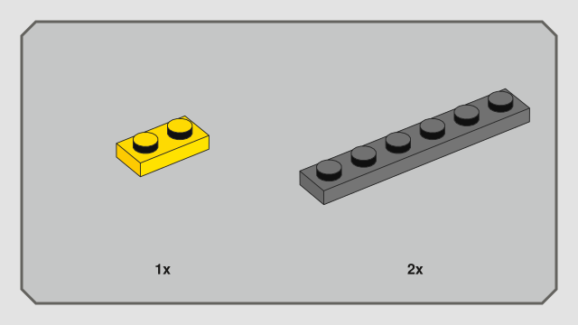
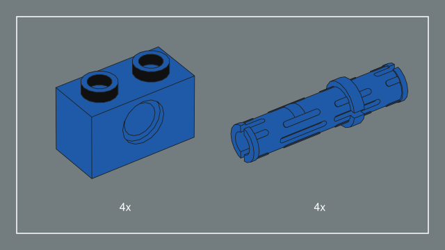

# Gallery

Five original models show what the renderer does with transparent walls, circular parts, overlapping leaves and small details. Every illustration in the [README model gallery](../README.md#model-gallery) opens as an editable SVG. The [portfolio guide](PORTFOLIO.md) gives the source model, part count and camera settings for each one. The [kiosk in three stages](KIOSK.md#how-the-kiosk-fits-together) shows where its counter, glass and roof belong.

A red boat hull shows how a viewer samples adjoining shapes at screen size. [Compare the same model with and without underpaint](PORTFOLIO.md#opaque-surfaces-at-screen-size).

The [crossing gate](MOTION.md) uses two poses of an original 21-piece assembly to show a different operation. The seven pieces in its striped arm rotate as a single unit.

## On the instruction page

[](SHUNTER.md)

[Render the final step as a printable sheet](SHUNTER.md) · [Model and wheel geometry credits](gallery/shunter-step.json)

## One plate, three cameras

Follow the two long rows of studs toward the far end of this blue 2 × 8 plate. The gap between studs stays constant along each row in the parallel view. In perspective, the far gaps get smaller. The difference is subtle at 2° and easy to see at 30°. Click a view to inspect the vector paths.

| View | Gap ratio |
|:---|:---|
| <a href="images/plate-orthographic.svg"></a><br>Parallel | 1.000× |
| <a href="images/plate-instruction.svg"></a><br>Instruction · 2° | 1.030× |
| <a href="images/plate-presentation.svg"></a><br>Presentation · 30° | 1.546× |

The ratio divides the nearest center-to-center interval by the farthest interval in the front row of eight studs. We projected the center of each stud cap through the recorded render camera. Both intervals span 20 LDU in the model. The nearest gap appears 3.0% wider at 2° and 54.6% wider at 30°. The centers read back from the three drawings agree with the calculated ratios to within 0.001. [Coordinates and projected gaps](gallery/plate-spacing.json)

All three use the same DAT 3034 geometry, material, 35° azimuth, 35° elevation and 400 × 300 pt page. The perspective camera adjusts its distance to fit that frame. Each image includes its full page. [Model](../examples/parts/blue-plate-2x8.ldr) · [Camera measurements](CAMERA-PRESETS.md) · [Render records](gallery/camera-presets.json)

Rebuild these plates and the matching kiosk views with a complete LDraw library. Each output folder contains a native SVG, a vector PDF and the resolved camera.

```sh
python3 tools/render_camera_presets.py --library /path/to/ldraw --output output/camera-views
```

## A brick in eleven colors

[](images/material-palette.svg)

On the Orange brick, the right face is brighter than the left. The [annotated brick](MATERIAL-PROFILES.md) points to each sample on the native render and traces its RGB values to an instruction page.

## Parts on the page

These three panels take their parts and quantities from individual printed steps. Each panel uses one scale for all its pieces. The blue panel has a rounded border, the gray panel has clipped corners and the dark panel uses a light outline and quantity labels.

<a href="portfolio/modern-blue.svg"></a>
<a href="portfolio/speed-chamfer.svg"></a>
<a href="portfolio/botanicals-slate.svg"></a>

Blue is Creator 31168, step 11. Gray is Speed Champions 77242, step 5. Slate is Botanicals 11504, step 8. Each comes from page 10 of its instruction PDF.

The [paper-style atlas](PRESETS.md) has a full-size SVG for each of the fifteen presets. The Star Wars foldout depicts an assembly across the page. Its specimen uses a complete model. [Source steps](ACTUAL-STEP-EXAMPLES.json) · [Rebuild these three trays](PORTFOLIO.md#three-independent-parts-trays)

<details>
<summary>Render the full paper-style collection</summary>

```sh
python3 tools/render_gallery.py --library /path/to/ldraw \
  --output output/preset-vectors --group presets --appearance current
```

The optional contact sheet uses Pillow, Poppler and a caller-supplied font. [Sheet and rendering records](gallery/current-presets.json) · [Editorial font](FONT-SOURCES.json)

```sh
python3 tools/compose_preset_gallery.py --input output/preset-vectors \
  --output output/preset-previews --font /path/to/editorial-font.ttf \
  --pdftoppm /path/to/pdftoppm
```

</details>

## Lighthouse Point

[](images/lighthouse-point.svg)

This scene has 537 placements. The drawing retains the panes around the beacon, the white outlines on the whale and the two figures on the island. Open the SVG to see the small features. [Full-precision render and web plate recipe](LIGHTHOUSE.md) · [Model](../examples/lighthouse.ldr)

## Larger assemblies and print

| Example | What to inspect |
|---|---|
| [Little Blue Kiosk](KIOSK.md) | 41 placed parts, a separate roof subassembly, an inventory and eight assembly stages. The guide includes the build recipe and a surface intersection check. |
| [Garden module](../examples/garden.ldr) | A 41-part subassembly used for callouts and tray-scale comparisons. |
| [Lighthouse lantern](images/lantern-clear.svg) | A 66-part lantern with a visible axle behind the glass. [Compare two shell opacities](PART-ILLUSTRATION.md#4-look-through-the-lantern). |
| [Kiosk print samples](images/kiosk-print-comparison.png) | RGB, grayscale and profile-based CMYK exports from one view. The [printing guide](PRINTING.md) explains how to supply an output profile. |

## Compare with an instruction

The paper compares LDView 4.7 and Brick Blueprint using the same blue 2 × 8 plate, full frame and camera. Eight independent markers check the alignment. The [comparison figure](RESEARCH-PREPRINT.md#6-comparison-with-ldview) links to the official instruction between the two renders. The [comparison record](gallery/plate-ldview-control.json) includes the camera distance, LDView settings and marker errors.

```sh
python3 -m brick_blueprint render examples/parts/blue-plate-2x8.ldr \
  --library /path/to/ldraw --output output/plate-control \
  --camera-preset instruction --width 400 --height 300 \
  --line-width 0.6 --background '#BDDBF0'
```

For fitted brick cameras, measured face colors and predictions on held-out materials, see the [camera study](VOLUMETRIC-CAMERA.md), [material profiles](MATERIAL-PROFILES.md) and [color-transfer study](COLOR-LAW.md). The [image index](gallery/images.json) ties each PNG to the render or print records that produced it.

## Geometry and credits

The drawings project and shade geometry from the external LDraw Parts Library. The gallery and portfolio indexes list the contributors, original license headers and source file hashes. Original models for this project were designed with AI assistance. [Gallery geometry credits](gallery/LDRAW-ATTRIBUTION.json) · [Portfolio geometry credits](portfolio/sources.json) · [Third-party notices](../THIRD_PARTY_NOTICES.md)
