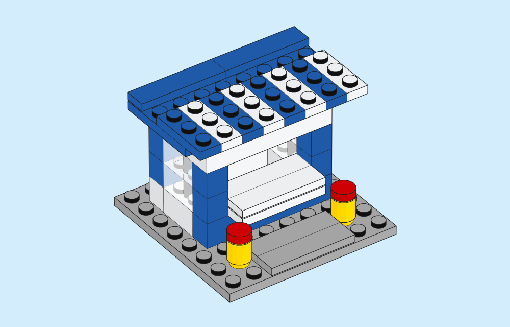
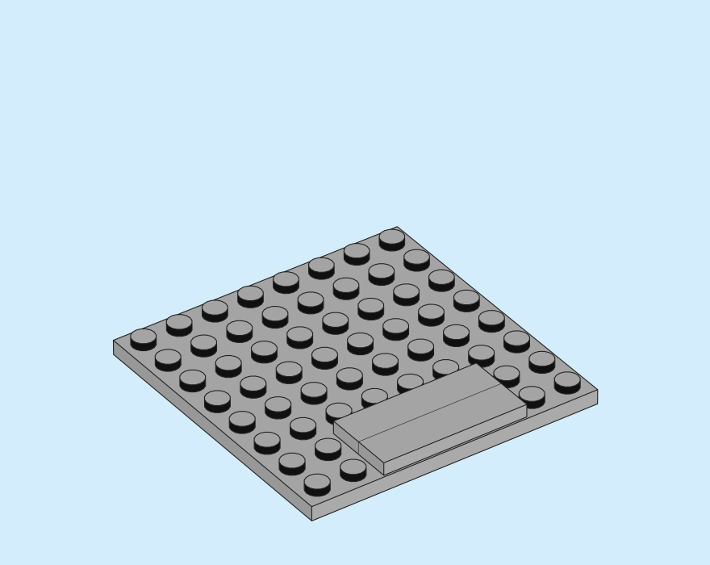
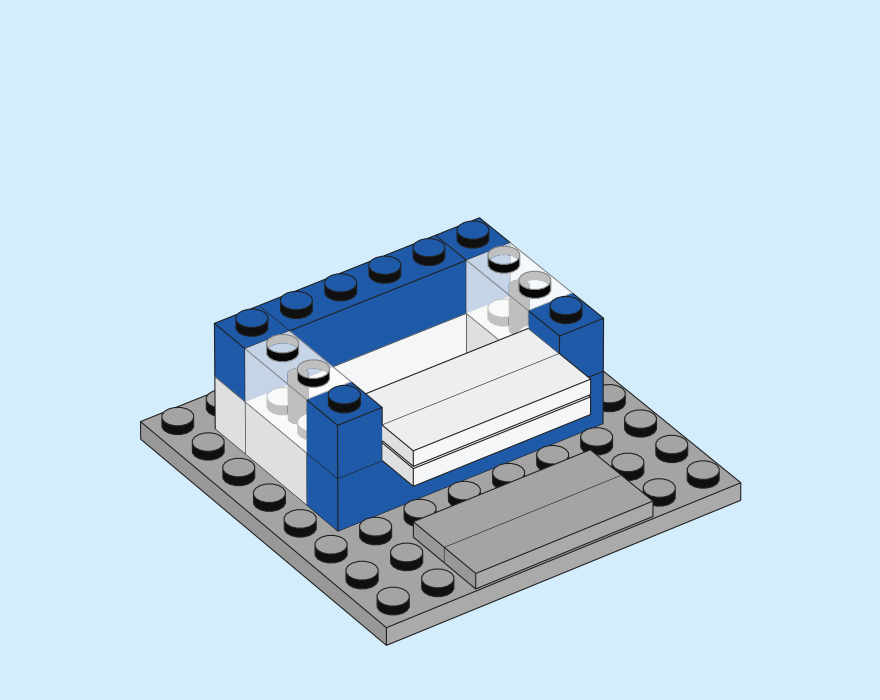
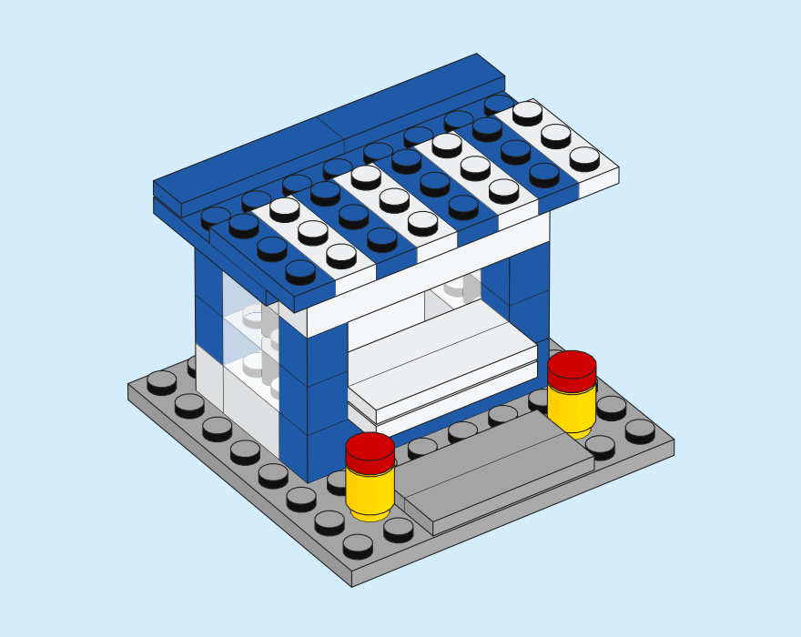
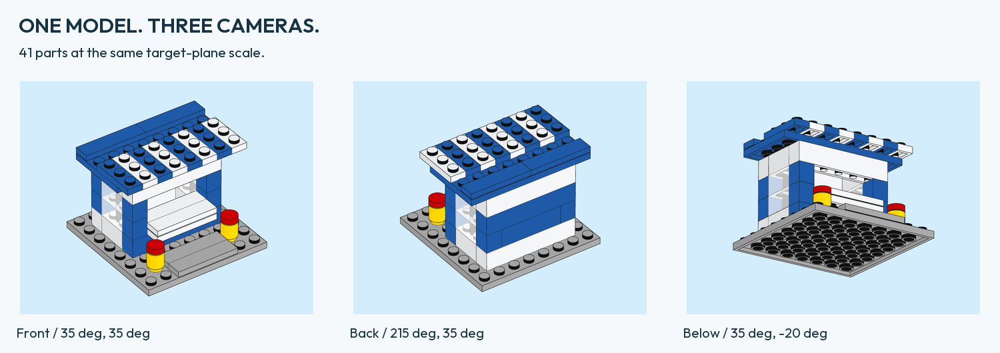
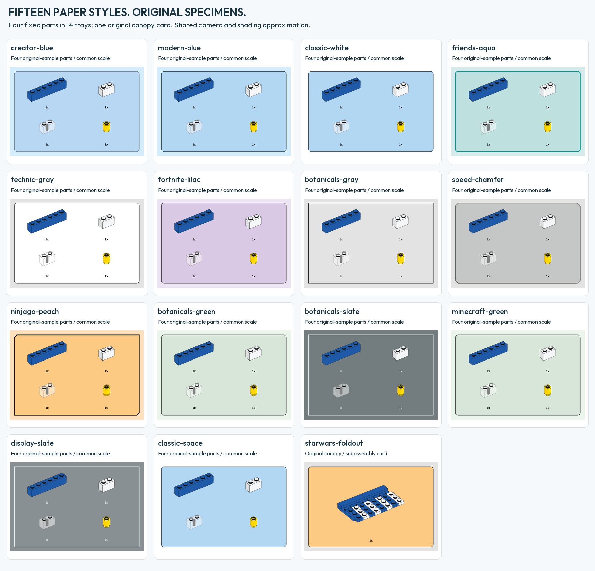
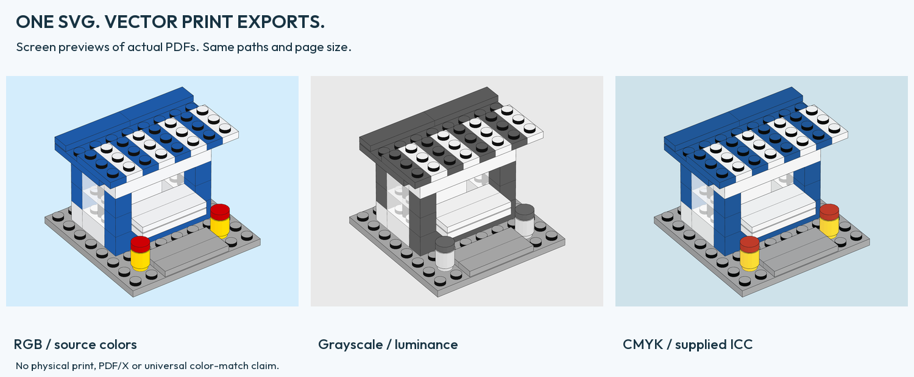

# Little Blue Kiosk

[Project](../README.md) · [Quickstart](QUICKSTART.md) · [Gallery provenance](GALLERY.md)

[](portfolio/kiosk.svg)

## How the kiosk fits together

The model has eight saved stages. At stage 1 two smooth paving tiles sit on the baseplate. The clear walls enclose the counter by stage 4. The canopy and two bollards complete the stall. These three native SVGs use the same camera position, field of view and scale. A stud that appears in two views stays at the same point on the page.

| Stage 1 · 3 parts | Stage 4 · 17 parts | Stage 8 · 41 parts |
|:---:|:---:|:---:|
| [](images/kiosk-stage-01.svg) | [](images/kiosk-stage-04.svg) | [](images/kiosk-stage-08.svg) |

The LDraw and MPD files describe the same 41 placements. In the MPD, two bollards share a submodel, and the canopy can be opened on its own. The design uses a 20 LDU stud grid, with the counter facing +Z and up along −Y. This original arrangement was created for Brick Blueprint with AI assistance. [Parts, stages and axes](../examples/kiosk/design.json) · [External geometry credits](portfolio/sources.json)

| File | Role |
| --- | --- |
| [kiosk.ldr](../examples/kiosk/kiosk.ldr) | Flat, step-marked editable placements |
| [kiosk.mpd](../examples/kiosk/kiosk.mpd) | Same model using reusable stage blocks and two instances of one bollard |
| [design.json](../examples/kiosk/design.json) | Origin, axes, eight stages, per-placement roles, BOM and model hashes |
| [bom-tray.json](../examples/kiosk/bom-tray.json) | Complete 16-row part/color inventory, totaling 41 placements |
| [generate_kiosk.py](../examples/generate_kiosk.py) | Deterministic source generator and single-part wrappers |

The floor is an 8 × 8 plate. A plate is 8 LDU high and a brick is 24 LDU high.

## Recreate the editable files

```sh
python3 examples/generate_kiosk.py --output output/regenerated-kiosk
```

The generator requires no external library and refuses an existing output folder.
Tests compare every generated file with the included version, the flat/MPD
placements and root stages, and the inventory against the model. No DAT part
geometry is generated or bundled by this script.

## Render the model and inventory

Supply your own complete LDraw directory or ZIP:

```sh
python3 -m brick_blueprint render examples/kiosk/kiosk.mpd \
  --library /path/to/ldraw --output output/kiosk \
  --camera-preset instruction --underpaint --preset modern-blue --width 760 --height 600 \
  --line-width 0.55 --glass-opacity 0.75

python3 -m brick_blueprint tray examples/kiosk/bom-tray.json \
  --library /path/to/ldraw --output output/kiosk-parts \
  --preset modern-blue --width 780 --height 650 --columns 4 --gap 16 \
  --camera-preset instruction --underpaint --line-width 0.4
```

## Render the eight stages

```sh
python3 tools/render_showcase.py --library /path/to/ldraw \
  --output output/kiosk-showcase --stages
```

The command makes fourteen scenes. Two render the flat and multipart source, three show the whole model at different angles, one shows the inventory and eight show the saved stages. The scene files contain native SVG and PDF paths. The generator checks that the flat model and MPD give identical output. The eight stages share the front camera at 1.35 pt/LDU. [Render records](gallery/kiosk-showcase.json)

PNG previews and editorial sheets are optional. They require Python 3.11+, Pillow 13+, Poppler's
`pdftoppm` and a local font. The example previews use Outfit (SIL OFL 1.1), supplied
separately; [font source and hash](FONT-SOURCES.json). Font programs are not bundled.

```sh
python3 tools/render_showcase.py --library /path/to/ldraw \
  --output output/kiosk-showcase-previews --stages --previews \
  --font /path/to/Outfit.ttf --pdftoppm /path/to/pdftoppm
```

The hero, camera strip, stage board and complete parts grid are derived from the
actual PDF output. Image font hash, preview runtime and DPI are recorded. A
different font or rasterizer may change preview pixels while the vector model
remains unchanged. [Recorded showcase recipe](gallery/kiosk-showcase.json).



## What was checked

The example-specific audit reads recursive DAT surfaces and actual stud frames
from the supplied library. It admits only the explicitly reviewed upright regular
forms used here. Conservative body envelopes exclude the protruding stud regions;
nominal underside grid seats classify the intended contact zones. Round 1x1
parts use conservative square envelopes. Unsupported forms fail.

```sh
python3 tools/check_kiosk.py --library /path/to/ldraw > output/kiosk-check.json
```

The saved check has 116 nominal stud-to-grid seat records, no conservative body
overlaps, no unclassified full-bound overlaps and one connected component at
each of eight checkpoints. A known wrong front sill displaced 10 LDU into both
side sills produces two body-overlap failures. A cap lifted by 8 LDU is rejected
as disconnected. Controls run on copies in memory; no model is changed.
[Exact model/dependency-bound check](gallery/kiosk-geometry.json).

A separate optional finite-grid diagnostic uses the actual BFC-oriented DAT
triangles and signed solid-angle winding, rather than those conservative body
boxes:

```sh
python3 tools/audit_kiosk_mesh.py --library /path/to/ldraw \
  --output output/kiosk-mesh-audit
```

The [saved surface diagnostic](gallery/kiosk-mesh-audit.json) screens all 820
part pairs over 21,612 oriented triangles. Two offset grids at 0.75 LDU spacing
probe 906,369 points in the candidate overlap boxes, with no overlap witnesses.
The deliberately intruding front sill produces over 10,000 witnesses in each
grid. Analytic closed-cube, touching, multiple-solid and hollow-cavity controls
qualify the winding implementation. The diagnostic is bound to this exact model;
it refuses changed placements. Temporary meshes are removed, and only JSON
proofs are retained. A C++17 compiler is required for the small scanner.

These are bounded digital checks. Finite sampling can miss a small or
poorly aligned intersection; it is not a continuous collision certificate.
There is no physical clutch-force or stability measurement, catalog verification
that every chosen color/form combination was manufactured, or official
source-instruction acceptance. The renderer itself does not perform assembly
validation. The model was designed independently of commercial-set instructions.

## Attribution and release status

The [per-file LDraw record](gallery/LDRAW-ATTRIBUTION.json) retains authors,
license headers and exact geometry hashes. Geometry was transformed, projected,
shaded and composited into our illustrations. The recorded dependency terms are
separate from the [MIT License](../LICENSE) for the project-owned software.

The model is an original illustrative sample for an independent tool. It is not
an official LEGO set or an endorsed product.

## Original-specimen preset controls



Four individual kiosk parts appear at 0.95 pt/LDU in fourteen paper styles. The foldout shows one canopy subassembly. The camera and geometry are fixed across the fourteen parts trays, so differences in borders, paper and quantity labels are easy to see. The [paper-style atlas](PRESETS.md) also shows the parts used in specific instruction steps.

```sh
python3 tools/render_kiosk_presets.py --library /path/to/ldraw \
  --output output/kiosk-presets --previews \
  --font /path/to/Outfit.ttf --pdftoppm /path/to/pdftoppm
```

Omit preview arguments for vector-only output. The [recorded recipe](gallery/kiosk-presets.json)
binds every scene and the editorial font. [Presentation manifest](../examples/kiosk/presentation-tray.json)
and [canopy subset](../examples/kiosk/canopy.ldr) are recreated by the same generator.

## Print controls



The [comparison receipt](gallery/kiosk-print-comparison.json) links RGB, gray and
caller-profile ICC CMYK exports from one model SVG. Use `tools/render_print_proof.py`
with a new output folder, optional `--profile`, and preview font/Poppler arguments
to reproduce the editorial sheet. No physical-printer or universal color-match
claim follows from these screen previews.

## Check a reproduced gallery without rendering again

```sh
python3 tools/verify_gallery.py --showcase output/kiosk-showcase \
  --presets output/kiosk-presets
```

Run the showcase with `--stages` to generate all fourteen scenes. The reference uses the complete 2026-10 LDraw library. The checker compares the recipe, geometry, palette, runtime sources and vector files. It reports environment differences separately. An unchanged drawing can still come from a different palette file. [Library editions and download](PORTFOLIO.md#which-parts-library-reproduces-the-pictures) · [Verification details](REPRODUCIBILITY.md)

Add `--previews` for exact PNG bytes; this requires the same editorial font,
rasterizer and preview recipe. Add `--print-proof output/kiosk-print-proof` only
when reproducing the full RGB/gray/CMYK reference with the identical supplied
ICC profile. A deliberately different profile or reduced mode set is expected
to differ. Without that profile, verify the other groups and review your own
print condition separately. Hash consistency does not authenticate arbitrary
receipts or replace visual/physical review.
