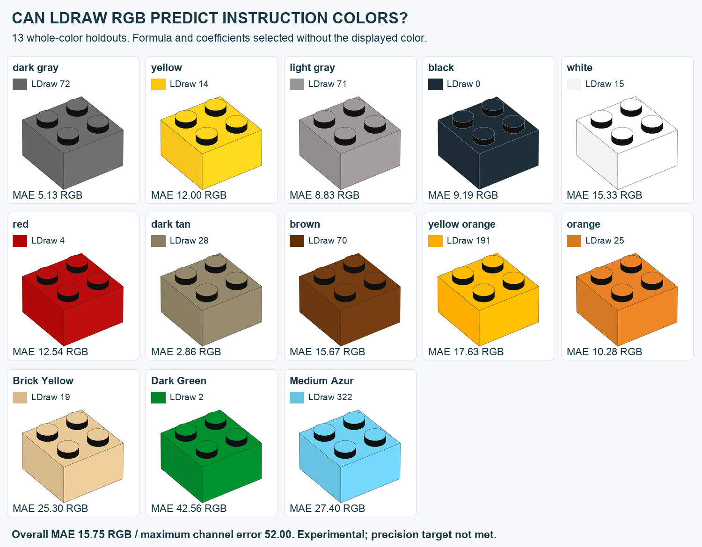
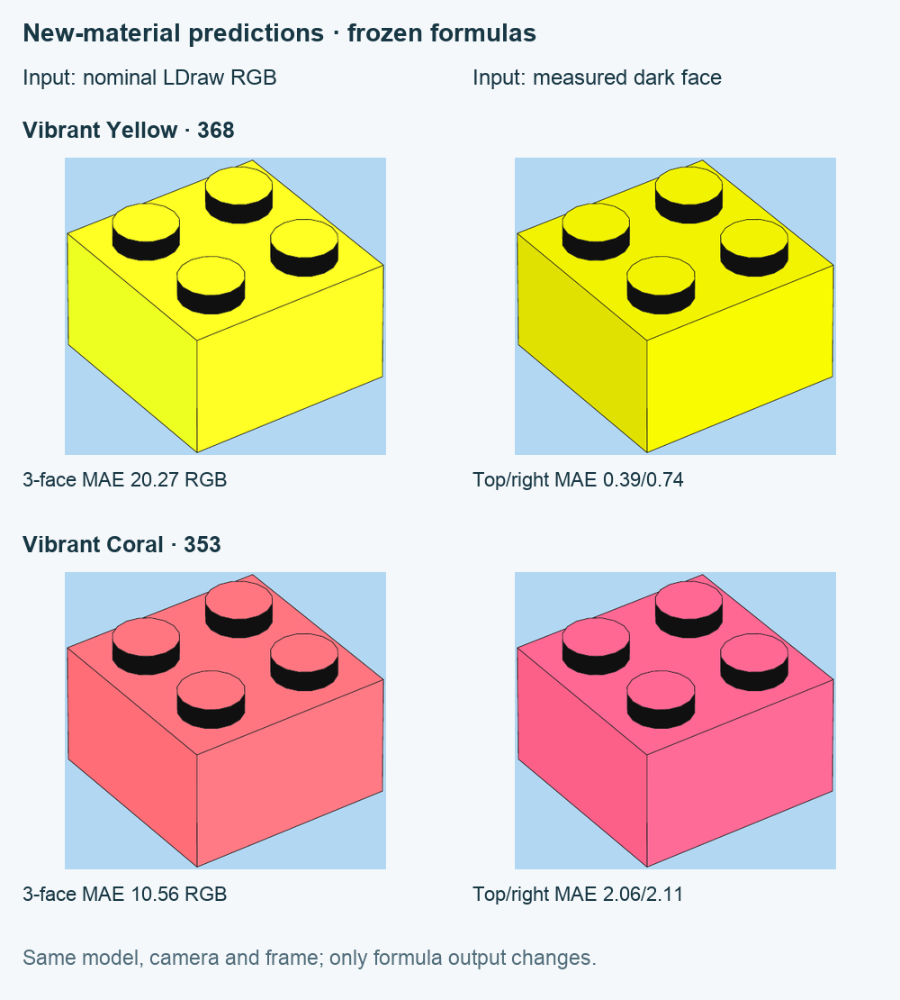
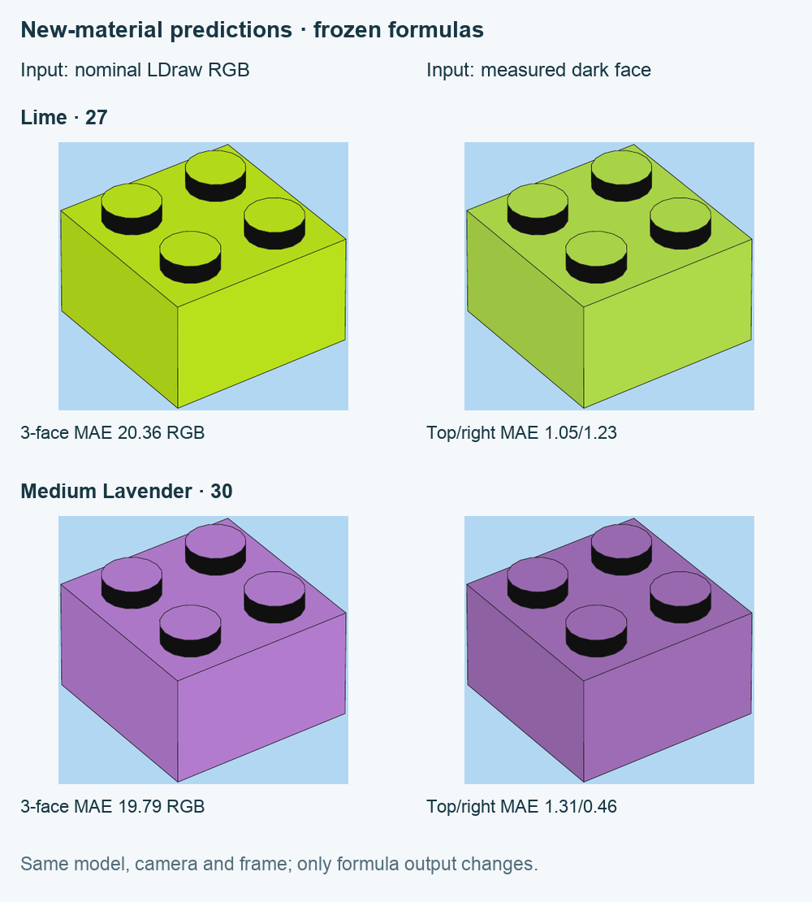

# From LDraw RGB to instruction face colors

**The research target is one RGB-only function predicting left, top and right
face colors, including materials not used to fit it. That target is not yet met.**
The current measured material table is a calibration of individual colors;
its accuracy does not validate a general LDraw-to-instruction transform.

**Conclusion: no acceptable RGB-only conversion was found among the tested
models.** This is a result of the stated tests and precision criterion, not a
proof that every possible mathematical function must fail. In contrast, the
[measured-left face law](COLOR-LAW.md) is a useful approximation: a shared gain
of about 1.08 predicts top and 1.1144 predicts right. Its 17-color omitted-color
MAEs are 1.56 and 1.22 RGB. It requires an observed face color as input.

The nested whole-color test gives **MAE 15.75 RGB**, maximum channel error **52**.
The declared target was MAE≤3 for each face and maximum channel error≤10.
No renderer default is changed by this study.

A separate frozen test on **four newly measured materials** gives **MAE 17.75 RGB**
and maximum channel error 48.23. Supplying a measured left face instead predicts
top/right with MAE 1.20/1.14. The input-palette mismatch remains the main unresolved
step. These are different input conditions, not competing scores for the same task.



Each picture uses a formula fitted and selected without that color. The source
illustrations and their pages appear alongside the predictions in the private
source edition. This public board contains only our own vector renders.

## What enters the formula

Only the `VALUE` RGB from the pinned LDConfig dated 2026-05-29 enters the model.
`CODE`, material name, set/theme and measured face RGB are not input features.
The 13 colors comprise all ten prior calibration colors and all three verified
new-color controls (Tan 19, Green 2, Medium Azure 322). These are existing data;
the analysis is retrospective, not a prospective test on newly collected colors.
Sources use the same verified embedded sRGB profile. Repeat images do not add
independent colors.

LDraw specifies `CODE` as the material identifier and `VALUE` as 24-bit RGB; it
does not specify three instruction output colors. [LDraw specification](https://ldraw.org/article/299.html).

## Models and validation

Seven families are tested in two architectures: predict all three faces directly,
or predict a dark left face then apply common learned left-to-top/right gains.
Five families have five fixed ridge penalties:0.001,0.01,0.1,1,10. The identity
and shared clipped gain need no penalty. This gives 54 candidates, with no
per-color exceptions or lookup-table features.

For every outer fold, exclude one whole color. Inside the other 12 colors,
leave-one-color-out selection chooses the family, architecture and penalty.
Only then predict the outer color. Its values cannot influence selection.
The table fixes each family/architecture and chooses its penalty internally;
the full selection procedure has the separate 15.75 result.

| Family | Direct three faces MAE | Through dark face MAE |
| --- | ---: | ---: |
| Identity | 14.77 | 13.66 |
| Shared clipped gain | 15.44 | 14.99 |
| Shared channel quadratic | 15.51 | 14.63 |
| RGB affine matrix | 15.99 | 14.06 |
| Linear-light RGB affine matrix | 14.59 | 14.15 |
| RGB quadratic | 15.36 | 15.20 |
| RGB root-polynomial degree 2 | 16.04 | 13.88 |

Choosing the smallest displayed score after reading this table is not an
independent validation of that winner. The nested procedure includes the
uncertainty of model selection. All 54 scores, fold models, coefficients and
predictions are retained in [results](research/LDRAW-TRANSFER-RESULTS.json).

The RGB quadratic uses R,G,B,R²,G²,B²,RG,RB,GB and an intercept. The root basis
uses R,G,B,√RG,√RB,√GB and an intercept. We fit residual corrections relative to
identity with all coefficients penalized; this is our regularized application,
not the exact camera-calibration procedure of
[Finlayson et al.](https://doi.org/10.1109/TIP.2015.2405336).
Linear-light variants use the documented
[sRGB transfer functions](https://www.w3.org/TR/css-color-4/#color-conversion-code).
These methods do not establish the manufacturer’s rendering pipeline.

## Results and the missing step

Outer MAE by left/top/right is **15.19/15.96/16.09**. All 13 per-color errors,
including the poor Green/Tan/Azure results, are retained and illustrated.
The best full-data choice in this candidate pool retains nominal RGB as its
dark-face input, then multiplies it by 1.08049 for top and 1.11542 for right,
clipping to 0..255. It does not solve the base-palette mismatch and is not shipped
as a replacement material default.

When the actual measured dark face is supplied instead, gains fitted on the
other 12 colors predict top/right with MAE **1.71/1.24**. This diagnostic uses
additional measured information; it is not an RGB-only LDraw prediction.
The distinction explains why the face-to-face law can work while the complete
conversion remains inaccurate.

Nine joint one-pixel ROI shifts rerun the complete nested procedure: MAE spans
15.75–15.91. These are sensitivity controls, not confidence intervals. A final
model fitted on all 13 colors gives MAE 8.85 on twelve 2×4 images of already known
colors; that geometry check is not a test on unseen materials. A failure of these
candidates does not prove no general mapping exists. The separate frozen test
below adds independently identified colors. A broader sample is still needed
before claiming general accuracy.

## Does the palette revision explain the mismatch?

LDraw palette values change. We repeated the **same 54-candidate nested procedure**
on the same 13 measured colors, substituting the complete 2016 input palette,
without choosing a different palette per material. Its MAE is **17.46**, versus
**15.75** for the current inputs. This historical control does not solve the mismatch.
It does not imply that every historical palette or color pipeline has been tested.

The historical file is the original LDConfig artifact in the
[Debian source archive](https://sources.debian.org/data/non-free/l/ldraw-parts/1601%2Bds-1/LDConfig.ldr),
dated 2016-12-28; the current file is the
[official LDraw configuration](https://library.ldraw.org/library/official/LDConfig.ldr),
dated 2026-05-29. Exact hashes are recorded. All 17 RGB inputs used here match the
project's pinned library, although the complete configuration files differ.

## Four new colors, coefficients fixed before measurement

An automated search of 300 pages in five Classic 2025 books (11041, 11042,
11044) finds 23 unique image objects of exactly 63×59 pixels. Geometry screening retains 17 opaque, unprinted 2×2 brick objects,
representing 11 distinct decoded images. Four newly identified materials are the
primary test; repeats and known colors do not increase that count. All retained
images have the same verified sRGB profile. Printed element IDs and official
LEGO catalogue metadata establish material identities before measuring face RGB.

| Material | LDraw code | Element | Source, PDF page | RGB-only MAE |
| --- | ---: | --- | --- | ---: |
| Vibrant Yellow |368|6427903|[11042,14](https://www.lego.com/cdn/product-assets/product.bi.core.pdf/6555453.pdf#page=14)|20.27|
| Vibrant Coral |353|6422920|[11042,18](https://www.lego.com/cdn/product-assets/product.bi.core.pdf/6555453.pdf#page=18)|10.56|
| Bright Yellowish Green |27|4220632|[11042,28](https://www.lego.com/cdn/product-assets/product.bi.core.pdf/6555453.pdf#page=28)|20.36|
| Medium Lavender |30|6545844|[11044,11](https://www.lego.com/cdn/product-assets/product.bi.core.pdf/6569389.pdf#page=11)|19.79|

The final RGB-only model selected and fitted on the preceding 13 colors is frozen:
`left=RGB`, `top=clip(1.0804928×RGB)`, `right=clip(1.1154164×RGB)`.
No value of these four test materials enters fitting or model selection.
MAE across left/top/right is **18.42/17.67/17.15**; the aggregate is 17.75.
The engineering target (each face≤3, maximum channel≤10) fails.





The second column in these public boards supplies the **measured left face** and
uses the separate ten-color gains 1.0797009 and 1.1134747. It predicts top/right
with MAE **1.20/1.14**, maximum errors 3.34/4.43. All 81 combinations of separate
input/target window shifts pass the declared tolerance: MAE ranges 1.16–2.35
for top and 0.98–1.68 for right. These are processing choices on four materials,
not 81 independent measurements or a universal lighting law. The official
original is placed between both render variants in the private preprint.

The historical palette has no Coral 353 or Neon Yellow 368. Its frozen model gives
MAE 38.34 for Lime and 12.24 for Lavender; absent colors are left missing, not
filled from the current palette. Those two scores are not a four-material comparison.

[Frozen protocol, measurements and all source hashes](research/PALETTE-HOLDOUT-2025.json) ·
[372 arithmetic and data-flow checks](research/PALETTE-HOLDOUT-CHECKS.json).

```sh
python3 tools/check_palette_holdout.py --rerun-palette-control
python3 tools/render_palette_holdouts.py --library /path/to/ldraw \
  --output output/palette-holdouts
```

The eight native SVG/PDF examples contain no raster images. Formula values are
rounded to integer RGB for drawing (at most 0.5 per channel); reported mathematical
errors use the unrounded predictions. The source camera is not individually fitted.
[Exact render settings and provenance](gallery/palette-holdout-renders.json).

## Does another color space help?

A separate **retrospective** comparison uses all 17 known materials. It adds
channel-specific RGB affine corrections and an affine correction in Oklab,
each with five ridge penalties and both direct/chain architectures. The input
still contains only RGB. A whole outer color is excluded from fitting and from
all inner selection. The original 54 candidates and the expanded 74 candidates
use exactly the same 17 folds:

| Procedure on the same 17 colors | MAE RGB | Maximum channel |
| --- | ---: | ---: |
| Selection among 54 candidates |18.68|68.78|
| Selection among 74 candidates |19.35|68.78|

Holding each new family fixed, with its penalty selected internally, gives
MAE 14.49/16.75 for direct/chain channel-affine and 16.63/17.75 for direct/chain
Oklab-affine. Picking the best family after reading these scores is not an
independent validation. None meets the declared precision target. These 17-color
results must not be compared with the 13-color result as if the test set were
unchanged, and they do not replace the separate frozen four-material test.

Oklab conversion uses the D65 matrices in
[CSS Color 4, section 19](https://www.w3.org/TR/2026/CRD-css-color-4-20261027/#color-conversion-code).
The learned affine residual operates on L,a,b scaled by 1, 0.4, 0.4; coefficients
are regularized toward identity. Predictions are converted back to sRGB and
clipped. Model selection and reported errors remain encoded RGB MAE, not ΔE.
An independent direct-sRGB implementation from
[Ottosson's reference](https://bottosson.github.io/posts/oklab/) agrees within
3.73×10⁻⁸ in Oklab on 125 fixed colors. All 34 outer-fold predictions were replayed.

[Protocol, all folds, coefficients and checks](research/COLOR-SPACE-TRANSFER.json).

```sh
python3 tools/analyze_color_space_transfer.py --output output/color-space-study
```

## Reproduce

```sh
python3 tools/analyze_ldraw_transfer.py \
  --data docs/research/LDRAW-TRANSFER-DATA.json \
  --output output/ldraw-transfer-results.json

python3 tools/render_ldraw_transfer.py --library /path/to/ldraw \
  --data docs/research/LDRAW-TRANSFER-DATA.json \
  --results docs/research/LDRAW-TRANSFER-RESULTS.json \
  --output output/ldraw-transfer-renders
```

The numerical study uses NumPy and no external artwork or library. The render
command produces 13 native vector examples with the current `instruction` camera;
its custom style entries contain formula outputs, not measured per-color anchors.
Receipts retain exact model/camera/style/data hashes.

[Protocol](research/LDRAW-TRANSFER-PROTOCOL.json) ·
[Inputs and all ROI shifts](research/LDRAW-TRANSFER-DATA.json) ·
[Arithmetic, source and data-flow checks](research/LDRAW-TRANSFER-CHECKS.json) ·
[Measured-left diagnostic](research/LDRAW-TRANSFER-DIAGNOSIS.json) ·
[Native render receipts](gallery/ldraw-transfer-renders.json) ·
[Face-to-face law](COLOR-LAW.md) · [Measured material calibration](MATERIAL-PROFILES.md).
