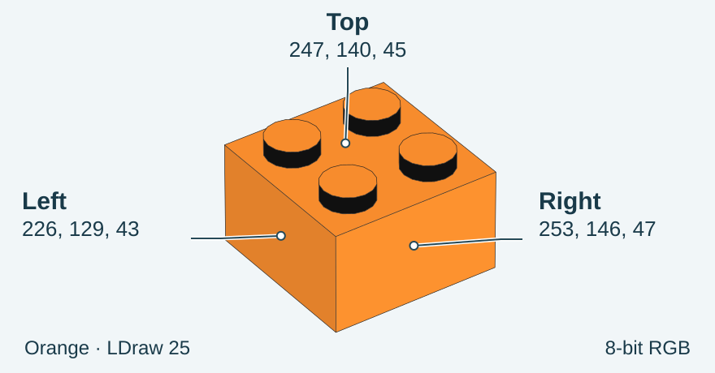
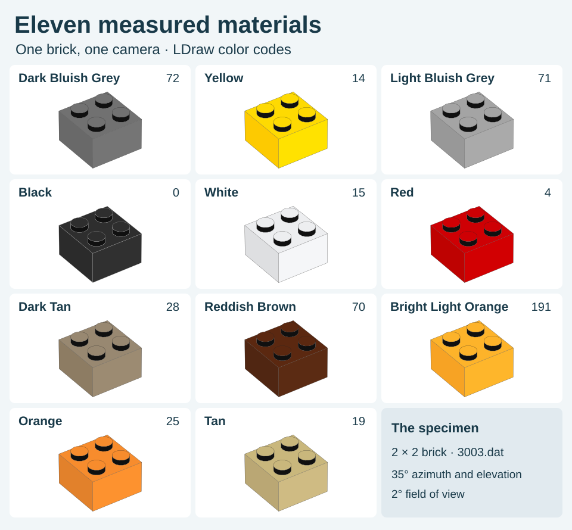
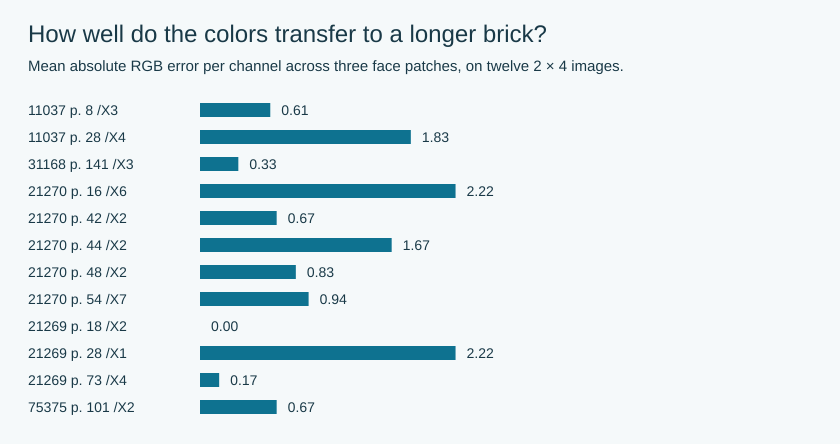
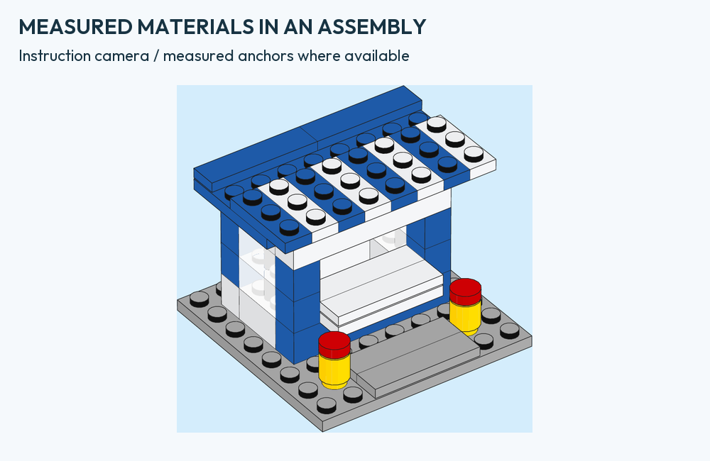

# Material profiles tied to measurements

The instruction camera shows three faces of an ordinary brick. The renderer uses a measured RGB value for each face of eleven opaque materials. The table below gives the source measurements, and the collection shows what they look like on the same 2 × 2 brick. [Research preprint](RESEARCH-PREPRINT.md) · [Native material renders](gallery/material-current-examples.json)

[](images/brick-face-guide.svg)

LDraw color **25** identifies Orange. The palette supplies **214, 121, 35**. For this color the renderer looks up three values measured in an instruction. The median for the flat top, sampled between the studs, was **246.5, 139.5, 44.5**. The SVG paints **247, 140, 45** because each RGB channel is a whole number. Click the illustration to see where each label points. [Minecraft 21269, page 27](https://www.lego.com/cdn/product-assets/product.bi.core.pdf/6556015.pdf#page=27) · [Source windows and medians](THREE-FACE-SHADING.json)

<details>
<summary>Open the eleven-color vector collection</summary>

[](images/material-palette.svg)

All eleven use the same geometry, 35° azimuth, 35° elevation and 2° field of view. The 33 face interiors were checked in both SVG and PDF at 600 × 480 pixels. Each 9 × 9 sample yielded the recorded color rounded to 8-bit RGB. [Sample coordinates, per-format results and source pages](gallery/material-vector-guide.json)

</details>

## Choose the material and camera

```sh
python3 -m brick_blueprint render examples/kiosk/kiosk.mpd \
  --library /path/to/ldraw --output output/research-kiosk \
  --material-profile research --camera-preset instruction

python3 -m brick_blueprint tray examples/kiosk/bom-tray.json \
  --library /path/to/ldraw --output output/instruction-parts \
  --camera-preset instruction
```

`research` is the default material profile. `research-angular` changes the
interpolation on sloped surfaces; see [the angular study](ANGULAR-MATERIALS.md).
Projection and material parameters are separate controls. A custom `--style`
file is mutually exclusive with a named profile. Both render and tray accept them.
The receipt records style/evidence/data hashes, used bindings, fallback colors
and limitations. Coverage counts submitted triangles, not visible area.

This table is a per-material calibration, not a general RGB conversion.
[The RGB-only conversion study comes first](LDRAW-COLOR-TRANSFER.md): its nested
holdout errors are reported separately from the accurate table replay.

## Reproduce the illustrated color guide

Render the material examples with a complete LDraw library. The second command arranges the resulting native paths and adds the face labels.

```sh
python3 tools/render_material_examples.py --library /path/to/ldraw --output output/materials
python3 tools/compose_material_guide.py output/materials output/material-guide
```

The guide checks the three face fills in every brick. If a compiler produces different SVG bytes, the composer verifies the drawing against its own receipt and checks the model, projected scene, renderer source and style against the reference. For an exact replay of the reference SVG files, add `--require-reference-bytes` to the second command.

## What is measured?

The native 63×59 RGB source images contain ordinary 2×2 bricks. Their shape/color
was associated with the printed element ID in the same books' final inventories.
We map those associations to LDraw color names. This is an explicit authoring
mapping; the source PDFs do not reveal internal LEGO shader identifiers.

| LDraw color | Name | Left | Horizontal top | Right |
| ---: | --- | --- | --- | --- |
| 72 | Dark Bluish Grey | 105,105,105 | 113,113,113 | 117,117,117 |
| 14 | Yellow | 253,202,1 | 253.5,218,1.5 | 255,226,0 |
| 71 | Light Bluish Grey | 152,152,152 | 164,164,164 | 170,170,170 |
| 0 | Black | 43,43,43 | 46,46,46 | 48,48,48 |
| 15 | White | 222,223,225 | 237,238,240 | 245,246,248 |
| 4 | Red | 190,2,1 | 205.5,0,4 | 210,0,2 |
| 28 | Dark Tan | 141,124,99 | 152,135.5,112.5 | 156,139,114 |
| 70 | Reddish Brown | 80,38,18 | 90.5,40,15.5 | 91,43,19 |
| 191 | Bright Light Orange | 247,163,36 | 253,179,42 | 254,182,43 |
| 25 | Orange | 226,129,43 | 246.5,139.5,44.5 | 253,146,47 |
| 19 | Tan | 186,167,116 | 200.5,182.5,124 | 207,187,131 |

Left/right refer to the standard view. In the adapter these are the absolute
world X/Y/Z normal anchors, respectively left/top/right. A rotated part is
shaded using its transformed world normal. Camera rotation does not rotate the
material system. Half-levels are medians from even pixel counts, not a claim of
half-level physical precision.

## A new-shape check, without refitting

After freezing the anchors, we selected twelve ordinary 2×4-brick images from
five already sampled books. Eight mapped colors are represented. Sloped bricks
and unmapped colors were excluded before residual measurement; all selected
images are reported. Fixed half-open native pixel windows were left
`[13,47,20,53]`, top `[47,22,52,26]`, right `[50,46,65,53]` in 98×73 images.
All have the same embedded sRGB profile as the original sample. There is no
rescaling or conversion before channel-wise medians are computed.

| Face | Current MAE | Largest channel error |
| --- | ---: | ---: |
| Left | 0.76 | 3.5 |
| Top | 1.89 | 8.0 |
| Right | 0.39 | 2.0 |
| All three | **1.01** | **8.0** |

MAE averages absolute errors in encoded RGB levels, with equal channel/face/image
weights. Equal color weighting gives 1.05 RGB levels. One-pixel ROI shifts change channels by at most 3 on the left, 10.5 on top
and 1 on the right. The small top patch is the least stable. These are
sensitivity checks, not confidence intervals.



[Full measurements, source pages, hashes and shifted patches](MATERIAL-VALIDATION.json).
This is transfer to another shape, not independence from the publishing pipeline:
books and colors are reused. It does not measure whole-image similarity or
establish a universal shader. No palette value was refitted to this check.

Separately, our native PDF outputs reproduce all thirty-three measured face anchors
within 0.5 RGB levels after 8-bit rasterization. That validates implementation,
not generalization. Geometry/camera/ink equality and zero PDF image XObjects are
also checked.

## Where the renderer still approximates

- Intermediate normals use a weighted blend of the three anchors. The function
  is an illustration choice; it has not been recovered from official sources.
- Opposite faces reuse absolute-axis weights. The source experiment measured
  only three visible faces.
- Stud caps use the top anchor; two source examples differ from the nearby flat
  top by at most one median RGB level. Opaque vertical walls now use the bounded
  neutral gray `#101010` described below. Transparent and sideways stud walls use `#070707`.
- Colors outside the eleven bindings, including kiosk blue and ordinary green,
  retain nominal library RGB on body surfaces; the bounded opaque-stud rule is
  shared. No unmeasured per-theme material palette is invented.
- Transparent surfaces bypass opaque measured anchors and retain nominal RGB.
  Glass opacity, highlights and compositing remain the documented shell rule.
- Line thickness, contours, camera FOV and print reproduction are separate from
  the face-color experiment.



## Reproduce the shipped profile and examples

```sh
python3 tools/build_research_style.py --check
python3 tools/render_material_examples.py --library /path/to/ldraw \
  --output output/material-examples
```

The first command verifies that packaged style and evidence exactly reproduce
from the numerical study. The second creates thirteen current examples (eleven materials, a 2×4 brick and a kiosk),
native SVG/PDF and receipts. Add `--previews --font /path/to/font.ttf` to generate
editorial preview boards with Poppler and Pillow. No official artwork, font
program or parts library is bundled.

[Camera](CAMERA.md) · [Custom styles](CUSTOM-STYLES.md) · [Three-face study](SHADING-STUDY.md)

## Larger upper surfaces: geometry-only transfer check

The fitted cameras also locate visible top surfaces in a brown 2×8 brick
(11038, PDF 19) and a white 2×4 brick (11037, PDF 8). We cast rays to the known
top plane, exclude stud cylinders/caps, then erode the remaining mask by two
native pixels. No RGB threshold selects the surface.

| Source | Pixels | Observed top RGB | Reference |
| --- | ---: | --- | --- |
| Brown 2×8 | 2422 | 89, 41, 17 | 90.5, 40, 15.5 |
| White 2×4 | 1149 | 236, 239, 240 | 237, 238, 240 |

Maximum channel discrepancy is 1.5 levels. Erosion margins 1/2/3 pixels alter
each median by at most one level. On our known-color native renders, every
selected pixel reproduces the top anchor within 8-bit rounding. Both official
images use the same hashed sRGB IEC 61966-2.1 profile as the earlier study.

Initial narrow gap patches were unstable (up to 19/53 levels for a one-pixel
shift); those results remain in the data. The geometry-only method was declared
before its measurements. The white image is a different XObject on the same page as an earlier 2×4
control (X2 versus X3). Independence of their rendering is not assumed. No palette values were changed after validation.

[Numeric observations, initial results, profiles and controls](research/LARGE-TOP-TRANSFER.json)

To repeat the top measurement, supply the exact native image to
`python3 tools/measure_visible_top.py --source 11038-p19-X1 --image native.png --output output/top-measurement`.
The tool verifies the decoded RGB hash, then writes a numeric report and an
analytic geometry mask. It needs NumPy and Pillow; it does not download artwork.

## Stud caps and walls (0.6.0.dev5)

Geometry-only masks separately sample the cap interior and the middle of the
vertical wall in the same two Classic images. The brown cap median is 88,41,17
versus 89,41,17 on the flat top; the white cap and top both give 236,239,240.
The wall medians are 15,16,19 (74 pixels) and 16,16,16 (37 pixels).

The median of those six channels fixes the achromatic working reference at
**16,16,16**, before a new-color holdout: a pink plate from 11037, PDF 6, X1.
All eight 7×3-pixel wall windows are retained. Their MAE improves from **7.33
with (7, 7, 7) to 2.17 with (16, 16, 16)**; every window and every one of 72 one-pixel shifts
improves. These are repeated measurements of one held-out illustration.
One window changes by up to 41 levels under shifts, and erosion of 2 pixels
leaves no wall interior in the brown/white source masks. This is limited evidence,
not a universal lighting constant.

The `research` profile uses (16, 16, 16) on opaque vertical stud walls. Transparent and sideways stud walls use (7, 7, 7). In the native-render controls, all 111 selected wall pixels have the expected RGB value. The 1,051 sampled cap pixels are within 0.5 RGB levels of their anchors.
Older 31051 images are CMYK/ISO Coated v2 and require an explicit conversion before
comparison; they are not pooled into this modern sRGB calibration.

[Protocol, source identities, hashes and held-out observations](research/STUD-SURFACE-STUDY.json) ·
[Native implementation control](research/STUD-NATIVE-CONTROL.json).

## Common color-law study

A clipped dark-face-to-light-face gain achieves whole-color-held-out MAE 1.32
for the light face and 1.75 for the top across ten measured colors. This is
a research approximation, not the default material palette.
[All seven model families, LDraw input controls and reproducible examples](COLOR-LAW.md).

Element 4255416 is Sand Yellow in LEGO Pick a Brick, matching LEGO ID 138 /
LDraw Dark Tan 28. The Sand Yellow anchor belongs to 28. Tan 19 has its own independently
measured Brick Yellow anchor; the two must not be interchanged. [Identity evidence and pinned LDConfig](research/COLOR-IDENTITY-AUDIT.json).

## Tan 19: bounded promotion from the new-color holdout

Element 4114306 (Brick Yellow 5) identifies the measured 2×2 source in
[Architecture 21062, PDF 64](https://www.lego.com/cdn/product-assets/product.bi.core.pdf/6566168.pdf#page=64).
Its fixed anchors predict 2×4 bricks in Architecture 21063 and Botanicals 11509
with three-face MAE **1.39 RGB**, versus **13.39** for nominal-library fallback.
All nine predeclared one-pixel window shifts meet MAE≤3 and maximum-channel≤10;
the actual largest channel error is 5. The two output triples repeat, so they
are not two independent colors or proof of a universal material law.

Green 2 has no matching 2×4 control in this extension. Medium Azure 322 fails
two of nine shifted-window gates. Both retain nominal-library fallback.
Transparent Tan also bypasses these opaque anchors. The ten-color formula
coefficients and holdout measurements remain frozen; the original material
metadata is retained in [the experiment snapshot](research/COLOR-LAW-SOURCE-ARCHIVE.json).
