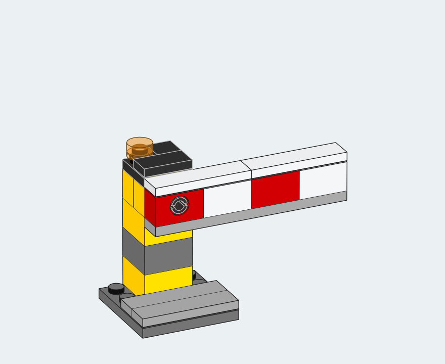
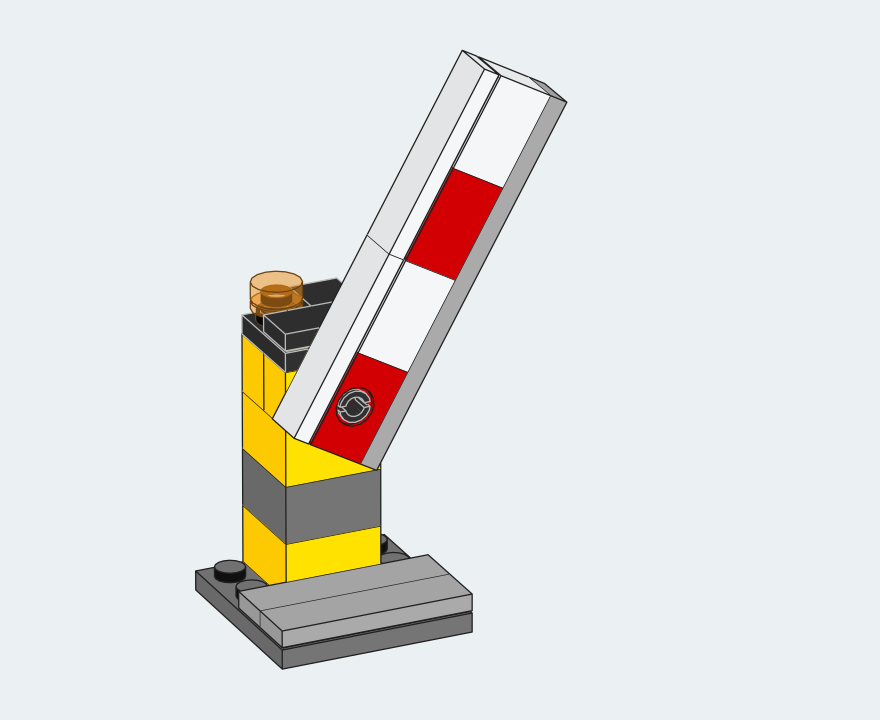

# Draw a moving assembly

The red and white arm of this crossing gate is a seven-piece submodel. Turn it through 60° and its tip rises while the yellow post stays in exactly the same place. Open either drawing to inspect the pin at the hinge.

| Lowered · 0° | Raised · 60° |
|:---:|:---:|
| [](images/crossing-gate-lowered.svg) | [](images/crossing-gate-raised.svg) |

## Put the origin on the hinge

The pin points along Z. In `arm.ldr`, the red brick's pin hole is centered at `(0, 0, 0)`. The main model places that origin at `(0, -86, 20)` in both poses. Only the nine numbers in the arm's rotation matrix change. Each model has the same 21 placements. [Lowered MPD](../examples/crossing-gate/lowered.mpd) · [Raised MPD](../examples/crossing-gate/raised.mpd)

```text
1 16 0 -86 20  1 0 0  0 1 0  0 0 1  arm.ldr
```

```text
1 16 0 -86 20  0.5 -0.866025403784 0  0.866025403784 0.5 0  0 0 1  arm.ldr
```

The first line places the lowered arm. The second rotates it about its local Z axis. LDraw uses negative Y for up. Here the end of the arm extends toward negative X, so this rotation lifts it.

## Keep the camera still

A camera fitted independently to each pose would recenter the gate as it opens. Use the same target, distance, field of view and page size to compare the movement. This view looks down at 24° so the hole and the top of the arm are both visible. Run from the checkout root with a complete LDraw library.

```sh
for pose in lowered raised
do
  python3 -m brick_blueprint render "examples/crossing-gate/$pose.mpd" \
    --library /path/to/ldraw --output "output/gate-$pose" \
    --projection perspective --azimuth 25 --elevation 24 --field-of-view 2 \
    --camera-target=-46,-88,8 --camera-distance 7900 --width 440 --height 360 \
    --line-width 0.65 --underpaint --background '#ebf1f2'
done
```

## What holds the arm

One Technic friction pin passes through the post and the red brick at the base of the arm. Each brick has a narrow cylindrical bore 16 LDU long. The pin spans both. The deck clears the base throughout the 60° sweep by at least 48.2 LDU. In the two illustrated poses, sampled mesh overlaps occurred only at the pin's contact surfaces. Moving the pin sideways by 4 LDU produced clear intersections outside them. These digital checks cover placement and clearance. Holding force would require a physical test. [Measurements, render hashes and geometry credits](gallery/crossing-gate.json)

The crossing gate is an original model created for this project with AI assistance. The part surfaces come from the external LDraw Parts Library. Both poses reproduced the same native SVG and PDF bytes with the 2026-08 and 2026-10 library editions.
