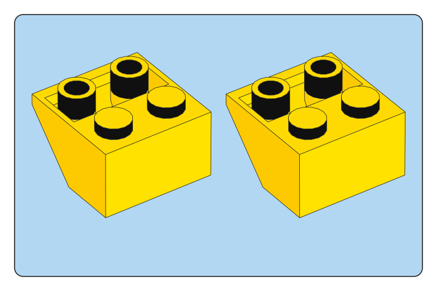
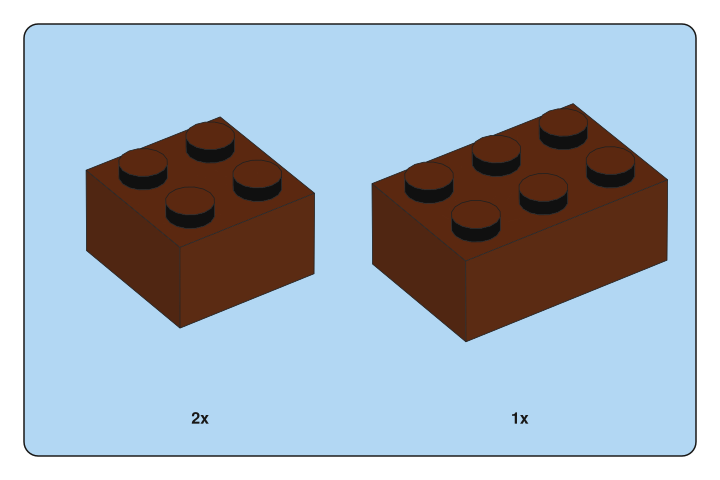

# Which styles repeat within a theme and year?

Two Creator books from 2016 give different answers to a simple question. Set 31051 has a thin frame around its parts list. Set 31050 puts a borderless list on a more saturated blue page. The age of the set and its theme alone are insufficient to select the frame.

The study compares **16 pairs**. Adding 15 books to the 23-book base atlas brought the collection to 38. The additional page survey covers 43 build pages and two introductory pages. Individual inventory images form a separate comparison below. [Base atlas](INSTRUCTION-ATLAS.md) · [Source editions](STYLE-SOURCES.json)

## Page and panel comparisons

The observations refer to the sampled pages. A match in this table describes the page design, tray or label indicated. Camera direction and part color are separate measurements.

| Theme and year | Sets | What the sampled pages show |
|---|---|---|
| Creator 2016 | 31051 / 31050 | **Different page and tray.** 31050 uses saturated blue `#6BB8E7`, a yellow outer field `#FFD500`, a borderless light-blue tray and LEGOChalet7080-80Regular. 31051 uses pale blue, a thin tray frame and LEGOChalet60-Bold. Both use 8 pt counts and 38 pt step numbers. |
| Creator 2025 | 31169 / 31168 | Both use a blue page and tray, a rounded 0.75 pt frame, 8 pt CeraPro-Medium counts and 26 pt step numbers. |
| City 2024 | 60404 / 60405 | Both use blue page and tray fields, a rounded 0.75 pt frame, 8 pt CeraPro-Medium counts and 26 pt step numbers. |
| Classic 2024 | 11038 / 11037 | **Different counting convention.** Both have white pages, rounded blue trays and 26 pt step numbers. The sampled pages in 11037 repeat the part icon for each piece. Set 11038 uses labels such as `1x` and `2x`. |
| Friends 2024 | 42604 / 42603 | Both have an aqua page and tray with a teal 2 pt frame. The outer corner radius measures 7.087 pt and the fill radius 6.087 pt. Counts use CeraPro-Medium at 8 pt. |
| Technic 2024 | 42167 / 42163 | Both have a gray page, a rounded white tray with a 0.75 pt border, 8 pt counts and 26 pt step numbers. Set 42163 also shows a 1:1 length guide on page 12. |
| Fortnite 2024 | 77073 / 77071 | Both use lilac for inventory and green for subassemblies. The inventory has a rounded 0.75 pt frame and 8 pt counts. |
| Botanicals 2025 | 10343 / 10344 | Both use gray page and tray fields, square corners and a black 0.75 pt border. Counts use CeraPro-Light at 8 pt. Step numbers are 26 pt. |
| Speed Champions 2025 | 77240 / 77242 | Both trays have four clipped corners. Each cut begins 7.845 pt from the corner along the fill contour. The border has several tones and the counts use CeraPro-Medium at 8 pt. |
| NINJAGO 2025 | 71832 / 71833 | Both trays clip two opposite corners. The cut begins 6.647 pt from the corner along the fill. The border is black and 1.5 pt wide. Counts use CeraPro-Medium at 8 pt. |
| Botanicals 2026 | 11508 / 11509 | Both use rounded green trays with a 0.75 pt frame and 8 pt counts. Page 10 of 11509 also establishes a cream subassembly panel. |
| Botanicals 2026 | 11501 / 11504 | The adult books use slate pages, white inventory borders and square corners. The type is outlined, so the PDF does not identify its font. The green 9+ books in the row above give a second treatment in the same theme and year. |
| Minecraft 2025 | 21269 / 21270 | Both use rounded green trays with 0.75 pt frames, 8 pt counts and 26 pt steps. Completion bursts repeat. Local callouts use the color for their particular role. |
| Architecture 2025 | 21062 / 21063 | Both use slate fields, square white inventory borders and 8 pt CeraPro-Light counts. The expanded contour on page 20 of 21063 measures 1 pt across. |
| Star Wars 2024 | 75375 / 75376 | Both use slate fields, square white inventory borders and 8 pt CeraPro-Light counts. On page 20 of 75376 the frame takes the PDF default of 1 pt. The 0.2 pt commands occur later. |
| Star Wars 2023 | 30654 / 75345 | **Different page formats.** The foldout for 30654 shows the assembly without an ordinary parts tray. The booklet for 75345 has a rounded gray inventory with 8 pt counts. |

### Two ways to count pieces in Classic 2024

| 11037 · page 27 · step 3 | 11038 · page 21 · step 4 |
|:---:|:---:|
|  |  |
| One image for each piece | One image for each part type, with its count |

Brick Blueprint rendered the pieces and panels for these two source steps. The yellow example repeats the same brick twice. The brown example needs two of one size and one of another. [Parts and quantities](ACTUAL-STEP-EXAMPLES.json)

## Can the same catalogue piece look different in two books?

**Yes.** Seventeen of the 19 selected comparisons match exactly in decoded pixels and embedded color-profile bytes. The other two, both from Architecture 21062 and 21063, have matching dimensions and profiles but different pixel values.

| Catalogue ID | Native image size | RMS across all RGB channel values (0–255) | Largest channel difference |
|---|---:|---:|---:|
| 383226 | 151 × 76 px | 9.85 | 76 |
| 4113917 | 39 × 27 px | 2.31 | 15 |

For each pair of books, we selected up to two shared catalogue IDs in the order obtained by sorting the printed IDs as text, before comparing the images. Four of 14 pair searches yielded no shared readable ID on the inspected pages. The other ten yielded the 19 comparisons. Nine of those ten pairs contain exact image matches. The two differences above persist with matching JPEG quantization tables. The data identify a difference in the final image. They do not isolate the cause.

To associate each number with an image, the analysis used the printed catalogue cell and the image above its label. Where word extraction split the label, the individual character boxes preserved its sequence. Indexed images required following the base color space to its embedded ICC profile. [Selected catalogue IDs](PAIRED-PARTS.json) · [Character boxes and pixel comparisons](PAIRED-ASSOCIATION-RECHECK.json) · [Embedded profiles](PAIRED-PROFILES-RECHECK.json)

## How the presets use these measurements

- `classic-space` draws repeated icons on the sampled 11037 pages. Each icon gets a separate entry in the tray manifest.
- `speed-chamfer` and `ninjago-peach` use the measured cut lengths. The Speed Champions preset approximates the tonal border with a flat stroke.
- `display-slate` uses a 1 pt inventory frame. `botanicals-green` uses cream for the subassembly role observed on page 10 of 11509.

Camera settings, illustration outlines, font substitutes and padding have their own controls. [Open the fifteen vector specimens](PRESETS.md)

## Sources and exact pages

All page numbers are PDF ordinals. 21063 p10 and 75376 p10 are introduction/bag pages; they are retained as role controls, not treated as ordinary step trays.
- [Botanicals 10344 (2025), pp. 10, 20, 30](https://www.lego.com/cdn/product-assets/product.bi.core.pdf/6555770.pdf) — SHA-256 `1adf450129b009d9e89eba83b6cd6344f19c01c724369a72a2a1a022408bb93d`.
- [Classic 11037 (2024), pp. 10, 20, 30](https://www.lego.com/cdn/product-assets/product.bi.core.pdf/6497651.pdf) — SHA-256 `1eae62ea786d29fe43479f19e138812335a19e5235f44766faf5c23d8b769c95`.
- [Botanicals 11509 (2026), pp. 10, 20, 30](https://www.lego.com/cdn/product-assets/product.bi.core.pdf/6618824.pdf) — SHA-256 `2508ae7c476caad75e6b0f2b9e898e2cb7307d66adc2b2d675acdf83adc86c23`.
- [Architecture 21063 (2025), pp. 10, 20, 30](https://www.lego.com/cdn/product-assets/product.bi.core.pdf/6592611.pdf) — SHA-256 `8843d50ba19d03d24f3eaf30c00947e31b2ad71789a1955c85781c9162262f4b`.
- [Minecraft 21270 (2025), pp. 10, 20, 30](https://www.lego.com/cdn/product-assets/product.bi.core.pdf/6586735.pdf) — SHA-256 `10860fb9d10a433431db8072c312e9125b2bc4e23b56fb087facc0f56b4aad60`.
- [Creator 31050 (2016), pp. 10, 20, 30](https://www.lego.com/cdn/product-assets/product.bi.core.pdf/6150560.pdf) — SHA-256 `c4938e06a06b054cde0f19285c17c8d17a8467d645ed5cab7fed448db657fb20`.
- [Creator 31168 (2025), pp. 10, 20, 30](https://www.lego.com/cdn/product-assets/product.bi.core.pdf/6592820.pdf) — SHA-256 `87c9dee34cb254d503c2aa7b9c8c18105e45dc5251f4a371f0e4ba6325f62376`.
- [Technic 42163 (2024), pp. 10, 20, 30](https://www.lego.com/cdn/product-assets/product.bi.core.pdf/6495263.pdf) — SHA-256 `b574cca214a0c97d61040beff8c27d949eb237e4e6fd82513a3df205f08058ae`.
- [Friends 42603 (2024), pp. 10, 20, 30](https://www.lego.com/cdn/product-assets/product.bi.core.pdf/6493659.pdf) — SHA-256 `1e86d7d7b8562c6b439028aa2472d55f4ee54e53c288a2e1dca70fc0fcecd5da`.
- [City 60405 (2024), pp. 10, 20, 30](https://www.lego.com/cdn/product-assets/product.bi.core.pdf/6492739.pdf) — SHA-256 `8fc9839a5f99543a16be099307fa2798f1a14ccdcd725e860c6e09b643948579`.
- [NINJAGO 71833 (2025), pp. 10, 20, 30](https://www.lego.com/cdn/product-assets/product.bi.core.pdf/6556903.pdf) — SHA-256 `7e3774195aa8d599d173649dec3659320e180715631b049e44b38268850a9525`.
- [Star Wars 75345 (2023), pp. 10, 20, 30](https://www.lego.com/cdn/product-assets/product.bi.core.pdf/6449312.pdf) — SHA-256 `50dcdaac5f456959d7ce0daeaaa771bd8e167a790b1894675b40a265dfeb1103`.
- [Star Wars 75376 (2024), pp. 10, 20, 30](https://www.lego.com/cdn/product-assets/product.bi.core.pdf/6509379.pdf) — SHA-256 `88c817e0ab4c9226d6576f3a09679bd5540206aa0d3ceb8a7d21be55638bf626`.
- [Fortnite 77071 (2024), pp. 10, 20, 30](https://www.lego.com/cdn/product-assets/product.bi.core.pdf/6544480.pdf) — SHA-256 `f897e4a1ec5e0ee21a664c6f230bef02b877ba68f78b5448601215426cfd592e`.
- [Speed Champions 77242 (2025), pp. 10, 20, 30](https://www.lego.com/cdn/product-assets/product.bi.core.pdf/6566098.pdf) — SHA-256 `36fb212b804f24492c7448391030fca643fe2027f5b693ed20ef8f6cbc6d1277`.

[Native paths, fills and font measurements](PAIRED-THEME-MEASUREMENTS.json) · [Actual-step example manifests](ACTUAL-STEP-EXAMPLES.json) · [Face-shading experiment](SHADING-STUDY.md).
