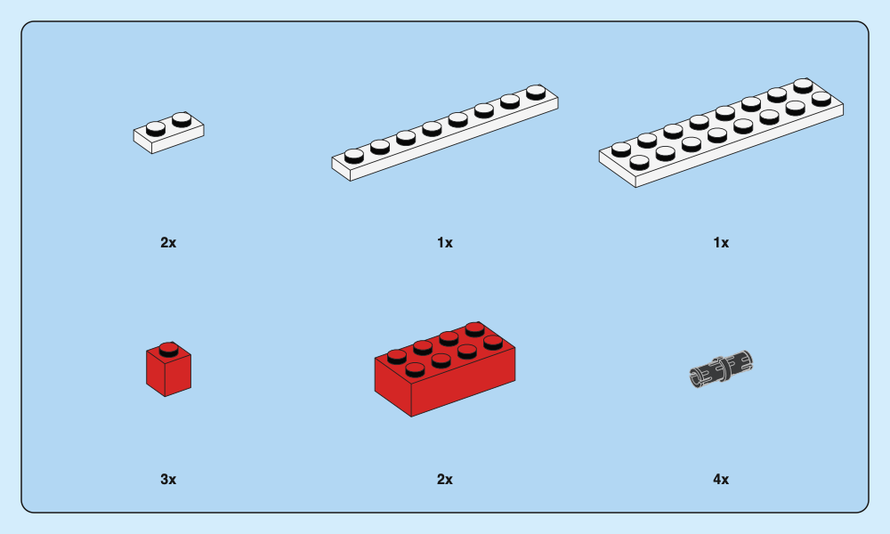
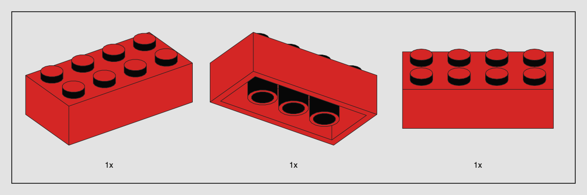
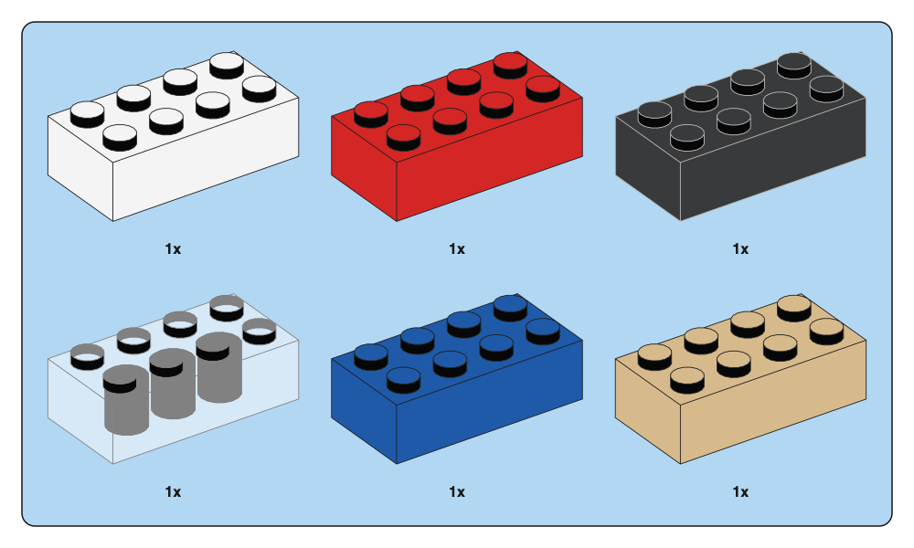
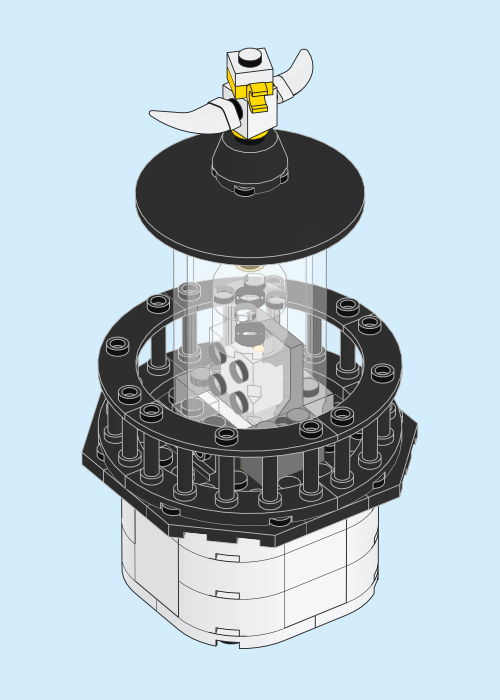
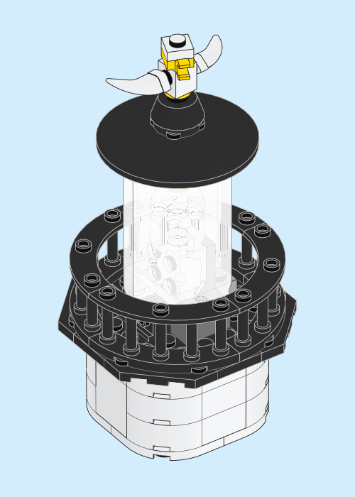

# How to show a part clearly

A good instruction image answers three questions: **which piece, which way round, and where it goes?** A polished material render alone does not answer the last two. This guide connects the [source atlas](INSTRUCTION-ATLAS.md) to working controls and remaining engineering work.

## 1. Preserve size relationships



The long plates, small brick and pin above share one points-per-LDraw-unit scale. Their quantities do not change their display size. Equal-sized grid cells are layout containers, not targets that each part independently fills.

```sh
python3 -m brick_blueprint tray examples/parts-tray.json \
  --library /path/to/ldraw --output output/parts \
  --preset modern-blue --columns 3 --width 500 --height 300 \
  --line-width 0.45
```

The manifest lists model references and quantities:

```json
{
  "items": [
    {"model": "parts/plate-1x2.ldr", "quantity": 2},
    {"model": "parts/plate-1x8.ldr", "quantity": 1},
    {"model": "parts/pin.ldr", "quantity": 4}
  ]
}
```

Paths resolve relative to the manifest. A model may be a single-part wrapper or a complete module. The composer computes a fitting scale for each reserved cell, takes the smallest, and renders **every item at that same scale**. It reserves the quantity baseline before projecting geometry. You can set `--scale` explicitly; if any item cannot fit, the entire operation fails without publishing a partial output directory.

This is a regular grid, not a space-optimal inventory packer. It does not automatically merge duplicate items or infer quantities from a finished model. Cross-panel comparisons also need an explicit shared `--scale`; automatic fit is shared within one tray only.

**Evidence:** The [quantitative scale study](SCALE-STUDY.md) finds consistent projected pitch for two different plates in Star Wars 75375 p20, with explicit pixel uncertainty. Additional evidence: Creator 31051 p18/22, Creator 31139 p11, Fortnite 77073 p12. A prior local manual measurement found about 26.3 and 26.2 px stud pitch for the two plate sizes in the Fortnite tray; the measurement uncertainty prevents a claim of exact publisher scale equality.

## 2. Pick a camera that identifies the geometry



A common three-quarter view works for ordinary bricks and plates. It shows stud count, footprint and height together. It is a default, not a law. Compare the underside view in Creator 31169 p9–10 and rotation cue in Botanicals 10343 p14.

| Part or operation | Useful identification view | Avoid |
| --- | --- | --- |
| Plate / brick | Top and two sides; visible stud grid | A nearly edge-on view hiding width or height |
| Axle / beam | Long axis and enough side view to count length/holes | Foreshortening that makes nearby lengths indistinguishable |
| Pin / connector | Show collar, slot and axle-versus-pin end | Enlarging it silently to the size of a beam |
| Sloped or handed part | Show slope direction and the asymmetric edge | Mirroring the drawing as if it were the same part |
| Underside attachment | A view exposing the receiving face | Keeping a pretty top view that hides the connection |
| Curved stem / organic part | Show the connection axes as well as curvature | Treating its screen silhouette as a reliable orientation specification |
| Printed face | Make the identifying print visible when supported | Pretending a missing texture is a verified exact part |

The tray manifest accepts `azimuth` and `elevation` per item. This changes orientation without changing physical scale. There is no automatic “best view” solver, and a perspective image cannot certify a connection. Prints represented by unsupported TEXMAP are rejected; vector/geometry-based details depend on the supplied library.

## 3. Separate material color from explanatory color



Material color says what a part is. An arrow or highlighted contour says what to do with it. Do not recolor a red brick blue merely because the current instruction step uses blue emphasis.

The renderer currently uses flat face colors, orientation-based shading and contrast-aware edge ink. Dark parts receive light edges so their shape remains legible; light parts use dark edges. It filters selected small annular details at the output scale and removes hidden lines through geometry visibility.

The six-material comparison is an actual output, including the clear-brick limitation: stud-cylinder walls are treated as opaque by the inherited paper-style rule, so transparent bricks can show strong interior cylinders. It is not physically accurate glass. The lantern is a more representative use of the present transparent-shell model. A material-specific revision should be validated against sources before this approximation is changed globally.

Current-step blue emphasis in 10343 p14/36, transparent context ghosting, selection colors and before/after fading are future annotation features. Their intended meaning must be stored separately from part materials.

## 4. Look through the lantern

Follow the axle inside this 66-part lighthouse lantern. A shell opacity of 0.35 leaves the axle and its housing visible. At 0.90 the housing nearly disappears behind the front pane. The roof, camera and line width are the same in both drawings. Open either SVG to inspect the glass at full size.

| Clearer shell · 0.35 | Milkier shell · 0.90 |
|:---:|:---:|
| [](images/lantern-clear.svg) | [](images/lantern-milky.svg) |

The setting applies to a single transparent surface. Where two surfaces of the same tint overlap, they cover more of what is behind them. At 0.35 each, their combined opacity is `1 − (1 − 0.35)² = 0.5775`. At 0.90 each, it reaches 0.99. Both values occur in the SVGs. [Model](../examples/lantern.ldr) · [Geometry, color samples and part credits](gallery/lantern-opacity.json)

```sh
for opacity in 0.35 0.90
do
  python3 -m brick_blueprint render examples/lantern.ldr \
    --library /path/to/ldraw --output "output/lantern-$opacity" \
    --camera-preset instruction --preset creator-blue --width 250 --height 350 \
    --line-width 0.45 --underpaint --glass-opacity "$opacity"
done
```

In the printed instruction, a yellow star marks the light in the close-up. The glass has already been drawn into opaque pixels, so the page cannot tell us which opacity the illustrator used. [Lighthouse Point 31051, page 74](https://www.lego.com/cdn/product-assets/product.bi.core.pdf/6167581.pdf#page=74) · [What the PDF contains](MATERIALS-AND-EMPHASIS.md)

## 5. Keep quantities, length badges and repetition counts distinct

- **Part quantity:** the number of that item needed, such as `4x` below a pin.
- **Subassembly repetition:** build the whole depicted mini-sequence multiple times, such as `2x` in 10343 p14.
- **Length badge:** identifies an axle/beam length; it is not a quantity. See 42167 p40 and 71832 p120.
- **1:1 reference:** a physical comparison at intended print size. It belongs to a separate view, often with a length badge.
- **Step number:** the order of operations, which may restart inside a subassembly or an alternate build.

The tool implements quantities and single-model subassembly counts. Other labels are documented design requirements. The 8 pt quantity default is not appropriate for every possible display role; the larger repetition labels in the source books are a future explicit typography role.

## 6. Give arrows a meaning before drawing them

| Graphic | Evidence | Required data for a reliable implementation |
| --- | --- | --- |
| Straight insertion arrow | 10343 p14/36, 42167 p40 | Moving part/subassembly, insertion axis, start/end positions |
| Thin routed leader | 31139 p25, 77240 p56 | Source inset and receiving region; avoid crossing unrelated geometry |
| Curved motion arrow | 77240 p72 | Rotation axis and direction; the arc alone is not an angle measurement |
| Model rotation icon | 10343 p14, 71488 p10/30 | Change in viewing orientation, separate from physical part movement |
| Strong narrative routing | 71488 p30/34 | Branch/assembly relationship; this is not a generic parts-tray outline |
| Exploded module separation | 31051 p78 | Rigid module membership, assembly order and explanatory offsets |

These graphics are not generated from a finished model automatically. A future scene format should carry assembly intent explicitly, not guess it from proximity. For example, a common axis is insufficient evidence that a bar is seated in an actual hole.

## 7. Choose the right panel role

The implemented roles are `parts` and `subassembly`. Round, square, four-corner chamfer and two-corner chamfer treatments are available through the measured presets. A user may independently override the page background without altering the inventory fill.

A white context card, a safety warning, a length guide and a light-function inset deserve separate semantic roles. They are not additional arbitrary colors of a parts tray. DREAMZzz additionally needs branch-specific textured page art, and Speed Champions has a tonal border treatment that the current flat-stroke approximation does not reproduce.

## 8. Check the delivered artifact, not just the preview

1. Compare all items at the intended printed size. Small inventory labels should be judged at actual scale, not a 300% screenshot.
2. Check that dark parts retain their light contours and pale parts separate from the tray.
3. Inspect overlap and hidden-line behavior around glass, holes and thin parts.
4. Confirm model and library hashes in `render.json`; an attractive image can still use the wrong geometry.
5. Confirm that PDF/SVG contain paths rather than screenshots. README PNGs are deliberately only previews.
6. Keep a grayscale proof for hierarchy and a printer-specific color proof for production. The included grayscale image is a screen check, not a certified print proof.

[Printing and performance notes](PRINTING.md) distinguish physical scale, display scale and vector complexity.

## Camera calibration evidence

The [camera study](CAMERA-STUDY.md) measures four views with explicit landmark uncertainty. Several estimates are near 35 degrees elevation, but small inventory parts do not establish an exact camera. The study also documents orientation changes between inventory and assembly views. Existing defaults are design choices, not a universal LEGO camera.

## Material and emphasis evidence

The [PDF material audit](MATERIALS-AND-EMPHASIS.md) separates glass, context fading, current-step contours and light symbols. Five inspected pages contain flattened opaque illustrations: their appearance does not expose an original 3D alpha setting or exact model stroke width. Proposed controls and current limitations are documented separately from source observations.

## Annotation grammar and specimens

The [annotation grammar](ANNOTATION-GRAMMAR.md) maps twelve source roles to required scene data, including a green insertion-arrow counterexample and the difference between quantity, repetition, length and physical-size labels. Its original vector legend is documentation artwork; automatic annotation generation remains future work.

The [large-grid audit](LARGE-GRID-STUDY.md) further tests the projection assumption itself. A projective fit predicts Architecture cap centers better than an affine one, so precise-looking orthographic angle estimates can still rest on the wrong camera model.
