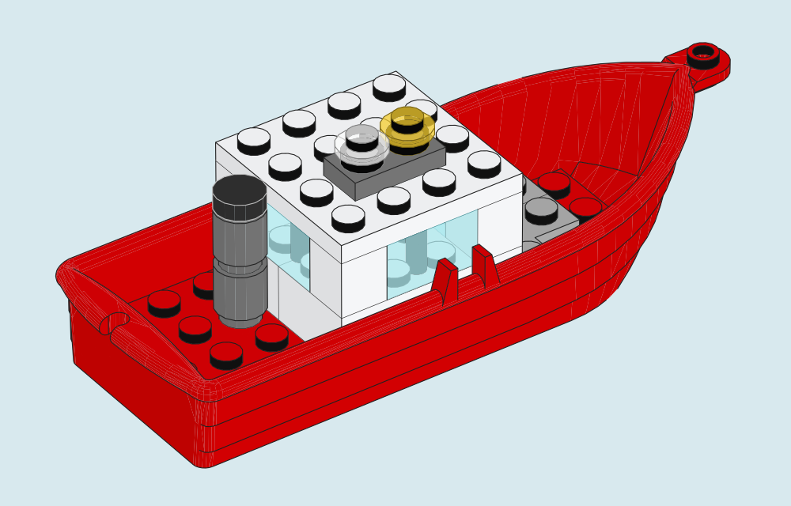
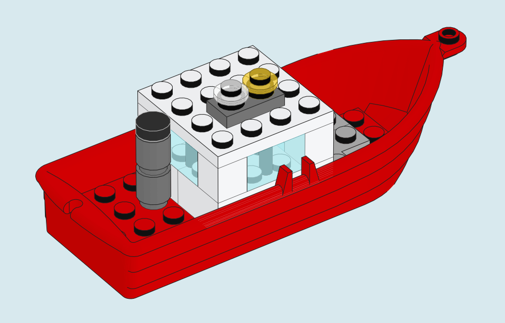

# The model plates

Each of the five illustrations uses the same 500 × 320 pt page, 0.55 pt outlines and the instruction camera with a 35° azimuth, 35° elevation and 2° vertical field of view. The shell opacity for transparent parts is 0.75. The renderer fits each complete model to its own page. The gallery therefore compares rendering features across subjects. Use a parts tray when physical scale should match between objects.

| Model | Placements | Detail to inspect | Source |
|---|---:|---|---|
| [Little Blue Kiosk](portfolio/kiosk.svg) | 41 | Glass under a deep canopy, with a separate roof subassembly | [MPD](../examples/kiosk/kiosk.mpd) |
| [Harbor Pilot](portfolio/harbor-pilot.svg) | 20 | Long curved hull, glazed cabin and signal lights | [LDraw](../examples/portfolio/harbor-pilot.ldr) |
| [Pocket Rangefinder](portfolio/rangefinder.svg) | 20 | Sideways barrel and lens | [LDraw](../examples/portfolio/rangefinder.ldr) |
| [Signal Rocket](portfolio/signal-rocket.svg) | 20 | Cones, rings and overlapping round boosters | [LDraw](../examples/portfolio/signal-rocket.ldr) |
| [Courtyard in Bloom](portfolio/courtyard.svg) | 25 | Fine foliage, petals and depth-tested edges | [LDraw](../examples/portfolio/courtyard.ldr) |

The models are original digital arrangements for this gallery, created with AI assistance. The measurements in the research paper come from separate experiments. These model plates illustrate the renderer. Physical construction has not been tested.

The [crossing gate](MOTION.md) shows two poses from a fixed camera. The [Quayside Shunter](SHUNTER.md) shows a complete instruction page with a parts box and two attachment arrows.

## Reproduce the plates

Use a complete LDraw library and two fresh directories.

```sh
python3 tools/render_portfolio.py --library /path/to/ldraw --output output/portfolio-renders
python3 tools/compose_portfolio.py output/portfolio-renders output/portfolio-edition
```

The first command creates a native SVG, PDF and receipt for every model. The second collects the five unaltered SVG files and sets the kiosk on a wider cover with a title. The checked-in edition was rendered with CPython 3.12.14 and Apple clang 21 on arm64. Compare `sources.json` for the interpreter, compiler, geometry dependencies and model and SVG hashes. Rendering with a different library can change the paths.

## Opaque surfaces at screen size

Look along the red hull beneath the cabin. At some zoom levels a viewer lets a hairline of page color through where two opaque paths meet. The gallery uses `--underpaint` to draw a slightly inset shape beneath each opaque part. The original faces and outlines still sit on top. The windows keep their own transparent layers.

| Original paths | Same paths over a base coat |
|:---:|:---:|
| [](images/harbor-pilot-standard.svg) | [](portfolio/harbor-pilot.svg) |

On the 500-pixel-wide PDF of this boat, **2,604** opaque-interior pixels visibly picked up the background color. The base coat brought that count to **zero**. To measure this, we changed only the page color from black to white and counted interior pixels that changed by at least 24 RGB levels. An image sampled at six times the display resolution defined the interior. Your viewer and zoom level can change the result.

Across five models at widths of 250, 500 and 1,000 pixels, the count fell in every SVG and PDF. The extra paths added 1.8–2.6% to the SVGs and 2.0–3.1% to the PDFs. Median local drawing time rose by 2.8% for SVG and 3.3% for PDF. A separate check kept all seven through-holes of a Technic beam open. On the X-wing PDF, fewer seams coincided with a small increase in average interior color error. [Per-model measurements, methods and viewer versions](portfolio/surface-coverage.json)

With NumPy, Pillow and Poppler installed, you can repeat the boat PDF measurement using the two vector files above.

```sh
python3 tools/measure_surface_seams.py docs/images/harbor-pilot-standard.svg docs/portfolio/harbor-pilot.svg --width 500
```

## Which parts library reproduces the pictures?

The portfolio was drawn with the 2026-08 library. On the same machine, the complete 2026-10 library reproduced all five models, three step trays and eight camera views byte for byte in SVG and PDF. The library palette file changed between releases. All geometry files used in these sixteen examples had identical contents.

To repeat this check, choose **Complete LDraw.org Library Zip archive** on the LDraw update page and pass the ZIP directly to `--library`. The rolling download may now contain a later edition. The 2026-10 ZIP used here has SHA-256 `023083918da2d3697c794fb4267975509584f3611b993095874206a803fa610f`. [Official download page](https://library.ldraw.org/updates?latest=) · [Per-render comparisons](portfolio/library-replay.json)

## Attribution

Geometry by the individual contributors to the [LDraw Parts Library](https://www.ldraw.org/). The plates transform, project, shade and outline their DAT geometry. The accompanying index lists each geometry file, contributor, SHA-256 and original license notice. The files used for these plates offer CC BY 4.0, including files that also offer CC BY 2.0. [File credits](portfolio/sources.json) · [CC BY 4.0](https://creativecommons.org/licenses/by/4.0/) · [Third-party notices](../THIRD_PARTY_NOTICES.md)

## Three independent parts trays

The README also includes three native parts lists. Each uses the parts and counts on one observed page and a shared target-plane scale within its own panel. The frames and colors of the paper follow the selected edition. Compare the silhouettes and quantity labels across Creator, Speed Champions and Botanicals. [Step identities and limits](ACTUAL-STEP-EXAMPLES.json) · [Tray receipts](portfolio/trays.json) · [Part credits](gallery/LDRAW-ATTRIBUTION.json)

```sh
python3 tools/render_tray_plates.py --library /path/to/ldraw --output output/tray-plates
```
