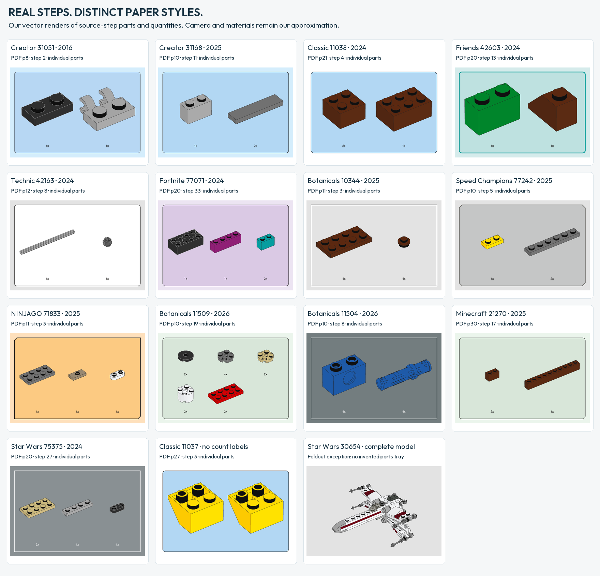
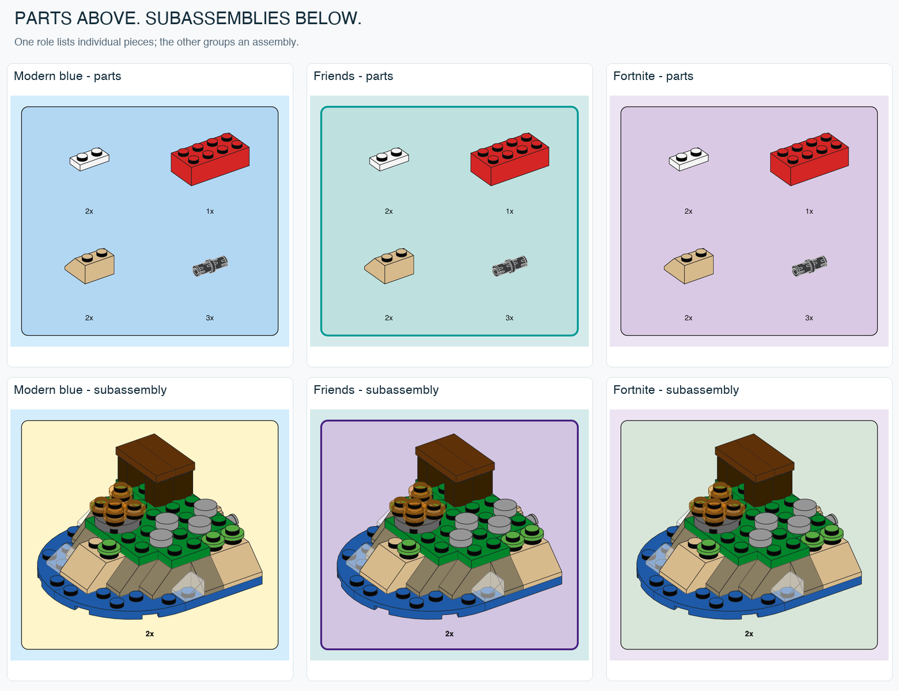

# Fifteen paper styles

[Back to the project](../README.md) · [Reproduction](GALLERY.md)

Theme, edition and page role all matter. The research now covers 38 official books, including 16 same-theme/year comparisons. Those controls revealed different quantity-label rules even within Classic 2024, and different page treatments within Creator 2016. The gallery below uses parts and quantities from specific instruction steps, rendered by our engine. Each card names its set, PDF page and step. Select a preset name in the table to open its full vector drawing. [Paired study](PAIRED-THEME-STUDY.md) · [Example manifests](ACTUAL-STEP-EXAMPLES.json).

| Preset | Based on | Page / parts tray | Distinctive treatment |
| --- | --- | --- | --- |
| [`creator-blue`](paper-styles/creator-blue.svg) | Creator 31051, 2016 | `#D4EDFC` / `#B7D7F3` | Fine dark frame |
| [`modern-blue`](paper-styles/modern-blue.svg) | Creator 31139/31169/31376 + City 60404, 2023–26 | `#D4EDFC` / `#B2D7F3` | Cream subassembly panel |
| [`classic-space`](paper-styles/classic-space.svg) | Classic 11037, 2024 | `#FFFFFF` / `#B2D7F3` | Repeated individual icons, no quantity labels |
| [`classic-white`](paper-styles/classic-white.svg) | Classic 11038, 2024 | `#FFFFFF` / `#B2D7F3` | White page, blue tray |
| [`friends-aqua`](paper-styles/friends-aqua.svg) | Friends 42604, 2024 | `#D5EBEB` / `#BEE1E0` | Strong teal frame; purple subassembly |
| [`technic-gray`](paper-styles/technic-gray.svg) | Technic 42167/42221, 2024–26 | `#E3E3E3` / `#FFFFFF` | Neutral page, white tray |
| [`fortnite-lilac`](paper-styles/fortnite-lilac.svg) | Fortnite 77073, 2024 | `#ECE4F2` / `#DAC9E4` | Green subassembly panel |
| [`starwars-foldout`](paper-styles/starwars-foldout.svg) | Star Wars 30654, 2023 | `#E3E3E3` / no separate tray | Orange **subassembly** panel |
| [`botanicals-gray`](paper-styles/botanicals-gray.svg) | Botanicals 10281 + 10343, 2021–25 | `#E3E3E3` / `#E3E3E3` | Square frame, lighter type |
| [`speed-chamfer`](paper-styles/speed-chamfer.svg) | Speed Champions 77240, 2025 | `#E3E3E3` / `#C5C6C6` | Four clipped corners |
| [`ninjago-peach`](paper-styles/ninjago-peach.svg) | NINJAGO 71832, 2025 | `#FEE0BC` / `#FCCA82` | Two clipped corners |
| [`botanicals-green`](paper-styles/botanicals-green.svg) | Daisies 11508, 2026 | `#EBF5EC` / `#D8E6D9` | Rounded; dark labels |
| [`botanicals-slate`](paper-styles/botanicals-slate.svg) | Adult Botanicals 11501/11504, 2026 | `#737D7F` / same slate | Square; white inventory labels |
| [`minecraft-green`](paper-styles/minecraft-green.svg) | Minecraft 21269, 2025 | `#EBF5EC` / `#D8E6D9` | Green inventory; lilac subassembly |
| [`display-slate`](paper-styles/display-slate.svg) | Architecture 21062 + Star Wars 75375, 2024–25 | `#899093` / same slate | White inventory labels; white assembly cards |

These describe sampled editions, not universal rules for a theme. Panel corners and spacing are normalized for this renderer. Quantity labels use regular/bold Helvetica substitutes; proprietary LEGOChalet60 and CeraPro fonts are not bundled. [Measurements and limitations](STYLE-RESEARCH.md) · [Set-by-set atlas](INSTRUCTION-ATLAS.md)

### Color also describes a role

A parts tray and a subassembly inset are different graphics. `--panel-role` preserves that distinction. The Star Wars foldout preset deliberately refuses a parts tray: none was observed in that source.

