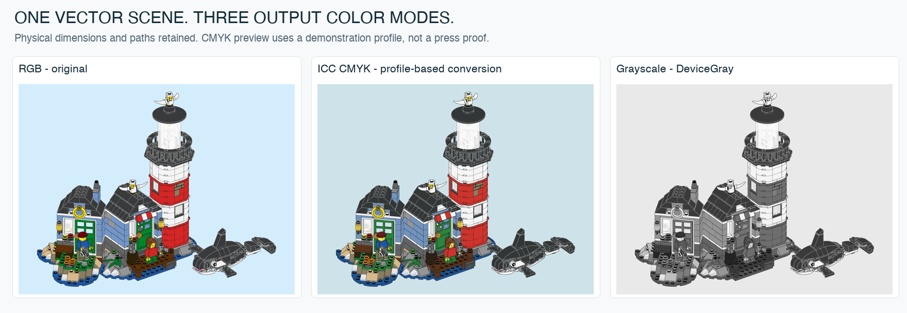
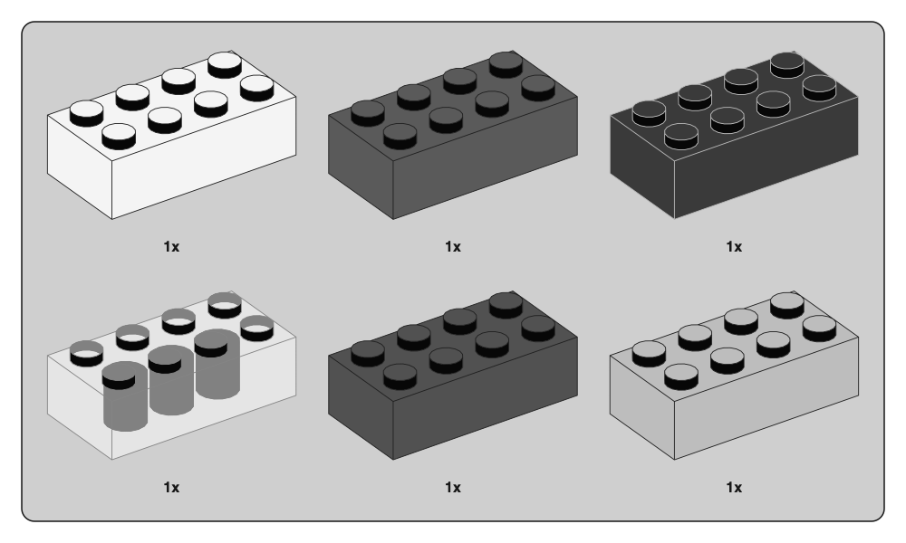

# Printing and vector delivery

The renderer writes PDF points: **72 pt = 1 inch**. SVG uses two internal units per PDF point and declares physical page dimensions. A 500 × 300 pt illustration is approximately 176.4 × 105.8 mm when printed at 100%.

## Export a print version

Print export reuses `model.svg` from this tool. It does not load the parts library, compile the geometry engine, or render the model again. It writes a new directory with `print.pdf` and `print.json`; the original SVG/PDF remains intact.



For monochrome output:

```sh
python3 -m brick_blueprint print output/my-model/model.svg \
  --mode gray --output output/my-model-gray
```

Grayscale uses linear-light sRGB luminance, re-encoded with the sRGB transfer curve into uncalibrated DeviceGray. It needs only Python's standard library. It retains colored page backgrounds as gray tones; it is not an automatic white-background or ink-saving layout. Color-only distinctions can disappear.

For a CMYK output condition, use Python 3.11+ and the optional Pillow 13+ environment:

```sh
python3 -m pip install -e '.[print]'
python3 -m brick_blueprint print output/my-model/model.svg \
  --mode cmyk --profile /path/to/chosen-output.icc \
  --intent relative --output output/my-model-cmyk
```

CMYK needs the optional Pillow/LittleCMS dependency and an explicitly supplied **CMYK output/printer-class ICC profile**. No default press/paper is guessed and no profile is bundled. The source color assumption is sRGB. The transform produces 8-bit CMYK channel values for each distinct vector paint color; it never rasterizes the page. The profile is embedded in an ICCBased PDF color space and also defines the transparency blending space. Profiles must support both conversion directions for the selected intent.

Available intents are `relative` (default), `perceptual`, `saturation` and `absolute`. Black-point compensation is not applied. The supplied profile determines separation and black generation; there is no custom total-ink cap, K-only text policy, or overprint/trapping adjustment. The receipt records profile hash/description, intent, LittleCMS version, page dimensions and the maximum sum of one converted paint color. That last number is **not** a separations audit of overlapping transparent paints.

`--mode rgb` produces the unchanged native RGB PDF from the same SVG. It is useful as a comparison/control. All modes preserve page points and live vector transparency. Existing output directories are refused, and unsupported SVG features are rejected rather than silently converted. This command is for the renderer's own SVG dialect, not arbitrary illustration software exports.

The example above uses a locally available generic CMYK profile only to demonstrate the feature. It is not a recommendation for a particular press, paper or printer. Screen previews are not calibrated print proofs. The selected ICC profile must be appropriate for the actual output condition.

## Three scales, three jobs

- **Physical model scale:** `--scale`, in points per LDraw unit. All items in a tray share it.
- **Illustration line width:** `--line-width`, in page points; independent of model size and panel frame thickness.
- **Viewer/print scaling:** zoom, fit-to-page or printer resizing; affects the entire delivered page.

Using the [LDraw specification’s nominal dimensions and approximate 0.4 mm/LDU conversion](https://www.ldraw.org/article/218.html), for a stud pitch of 20 LDU and nominal 8 mm, a nominal 1:1 orthographic side-on reference would use about **1.133858 pt/LDU**. This alone does not turn a three-quarter view into a 1:1 length guide: foreshortening, part end geometry, page scaling and printer settings still matter. The current tool does not certify measurement references.

## Source reference measurements

The [scale study](SCALE-STUDY.md) measures a Technic 1:1 beam at about 8.01 mm hole pitch, within the stated measurement sensitivity around nominal 8 mm. The original page is 195 × 259 mm; fitting it to another paper size changes the scale. A separate axle example shows why a length-class badge cannot simply be multiplied by stud pitch to infer the outer silhouette.

## Print checks



This is a grayscale preview of the material comparison. It reveals whether borders, quantities and outlines remain readable without hue; it is not a measured physical print. Similar red/blue/tan values can become less distinct in grayscale, so part color should not be the only clue in an accessible instruction.

Source hex colors are PDF/preview RGB values. CMYK export now supports an explicit output profile, but there is no chosen universal press condition, paper simulation, spot-color specification or physical printer proof in this project. Do not promise that the same RGB values will match an official booklet under all print conditions. For production, proof on the target printer and paper with automatic “fit” disabled where dimensions matter.

## Sharp output without an excessively heavy page

The renderer merges adjacent visible polygons, quantizes coordinates and compacts paths before exporting. The PDF uses vector paths and transparency groups, not an embedded full-page raster. That keeps zoom sharp, but vector complexity can still dominate viewer performance.

The staged 537-part lighthouse PDF is about 2.31 MB. Size and draw time are different metrics: a small compressed file can still contain many expensive paths. Repeated overlapping glass shells and extremely detailed geometry can be costly. Render receipts record polygon/vertex statistics and file size; no universal frame-rate claim is made.

The README therefore shows PNG previews. This improves GitHub page loading while preserving SVG/PDF as the actual renderer outputs. Thumbnails are not evidence that the exported PDF was rasterized. Native vectors, source hashes and dependency attribution are produced by the reproduction commands.

## Known output limits

PDF is version 1.4: DeviceRGB by default, DeviceGray in grayscale mode, or ICCBased CMYK with a supplied profile. Quantity labels use standard unembedded Helvetica references. It is not PDF/X, PDF/A, a tagged accessible document or a full prepress export. There is no PDF/X output-intent declaration, font embedding, bleed/crop-mark generation, page-size fitting or imposition. A press may require those additional preparations. A CMYK conversion alone is not a PDF/X certification. Browser font fallback can differ from PDF text. SVG uses the renderer's restricted geometry dialect; the PDF exporter is not a general-purpose SVG converter.

## Implementation references and validation

The conversion uses [Pillow ImageCms / LittleCMS](https://pillow.readthedocs.io/en/stable/reference/ImageCms.html). [ISO 32000-1](https://opensource.adobe.com/dc-acrobat-sdk-docs/pdfstandards/PDF32000_2008.pdf), sections 8.6 and 11.3.4, describes ICCBased color and transparency blending spaces. The PDF Association's [PDF/VT application notes, section on blending spaces](https://pdfa.org/wp-content/uploads/2016/01/PDFVT-Application-notes-FINAL-v1-151104a.pdf) explains why changing RGB/CMYK blending can change appearance. This exporter does not claim PDF/VT conformance.

Local verification compares native path/text placement operands, form geometry, alpha states and page boxes against the original RGB exports, checks the exact embedded ICC bytes and absence of raster images, and reviews the lighthouse in Poppler and macOS PDFKit. Across 27 existing gallery scenes, 17 RGB exports retain byte-for-byte parity; ten older PDFs differ only in an equivalent font resource alias, with identical decoded paint/path/text operations after resolving the font name. See [verification details](VERIFICATION.md).
