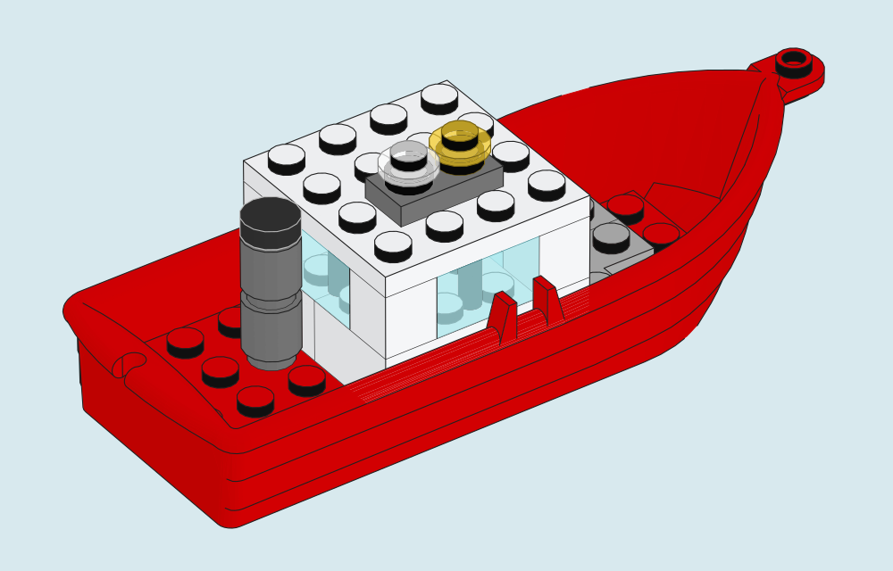
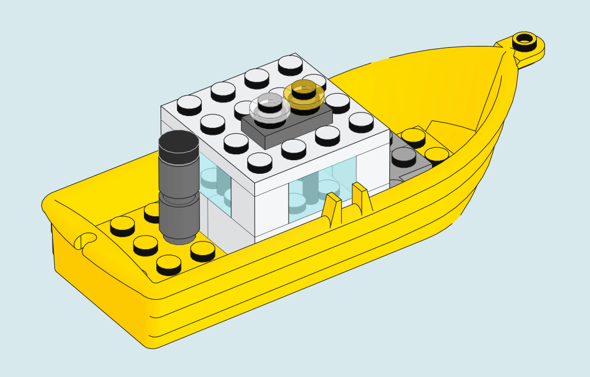

# From checkout to first picture

For instruction-like output, choose `camera_preset="instruction"` in Python or
`--camera-preset instruction` in the CLI. [Built-in recipes and evidence](CAMERA-PRESETS.md).

[Project](../README.md) · [CLI reference](CLI.md) · [Original kiosk](KIOSK.md)

## 1. Check the interpreter and compiler

Use Python 3.10 or newer. `python3 --version` shows the interpreter selected by
your shell; on some machines `python3.12` or another versioned command is needed.
Use that same command throughout this guide.

```sh
python3 -m brick_blueprint doctor
```

The core renderer needs an installed C++17 compiler (`clang++` or `g++`). To
verify the actual native build before choosing a model:

```sh
python3 -m brick_blueprint doctor --compile
```

The check does not install a compiler. `CXX` may name one executable, such as
`/path/to/clang++`; it is not a shell command with extra flags. Core rendering
needs no pip packages, GPU, display server or CAD application.

## 2. Make the self-contained smoke picture

Run commands from the checkout root:

```sh
python3 -m brick_blueprint render examples/demo.ldr \
  --library examples/library --output output/first-render
```

Inspect `output/first-render/model.pdf`. The SVG is also native vector artwork;
`render.json` records the inputs and result. This fixture contains 13 placements
of original abstract test geometry. It is intentionally small enough to diagnose
the installation before loading a real parts library.

Each output folder must be new. For a second run choose `output/first-render-2`.
Failed input preflight does not replace or erase previous results.

## 3. Supply real LDraw geometry

On the LDraw update page, choose **Complete LDraw.org Library Zip archive**. Pass the download directly to the renderer. An extracted library directory works too. The five portfolio models were tested with editions 2026-08 and 2026-10. [LDraw downloads and notices](https://library.ldraw.org/updates?latest=) · [Verified gallery builds](PORTFOLIO.md#which-parts-library-reproduces-the-pictures)

Accepted layouts:

```text
my-library/                 my-library.zip
  LDConfig.ldr                LDConfig.ldr       (or ldraw/LDConfig.ldr)
  parts/                      parts/             (or ldraw/parts/)
  p/                          p/                 (or ldraw/p/)
```

Point `--library` at the directory containing those entries, or at the ZIP file
itself. Keep paths containing spaces inside quotes.

```sh
python3 -m brick_blueprint doctor \
  --library "/path/to/my library.zip" --model examples/kiosk/kiosk.mpd

python3 -m brick_blueprint render examples/kiosk/kiosk.mpd \
  --library "/path/to/my library.zip" --output output/kiosk \
  --preset modern-blue --width 760 --height 600 \
  --line-width 0.55 --glass-opacity 0.75
```

The [kiosk guide](KIOSK.md) explains the model, full inventory, reproducible gallery
and limited geometric checks. The supplied library revision can change shapes,
colors or alpha; compare dependency and palette hashes when reproducing results.

## 4. Change the hull color

The Harbor Pilot has twenty placed pieces. The long boat hull is one of them. Copy the model so you can edit it in a text editor.

```sh
mkdir -p output
cp -n examples/portfolio/harbor-pilot.ldr output/yellow-pilot.ldr
```

In `output/yellow-pilot.ldr`, find the line ending in `2551.dat`. Its first two numbers are `1 4`. The first number means “place a part” and the second chooses its color. Change **only the second number** from `4` (red) to `14` (yellow), save the file and render it.

```sh
python3 -m brick_blueprint render output/yellow-pilot.ldr \
  --library "/path/to/my library.zip" --output output/yellow-pilot \
  --camera-preset instruction --width 500 --height 320 \
  --line-width 0.55 --glass-opacity 0.75 --underpaint --background '#d8e9ee'
```

| Gallery model · red hull | Your edit · yellow hull |
|:---:|:---:|
| [](portfolio/harbor-pilot.svg) | [](images/harbor-pilot-yellow.svg) |

Open `output/yellow-pilot/model.svg`. The wheelhouse, windows and lights keep their colors and positions. The same `2551.dat` describes both hulls. The edit changes the paint on that one placement. [Source model](../examples/portfolio/harbor-pilot.ldr) · [Render settings and file hashes](gallery/harbor-pilot-yellow.json)

## Optional package installation

Running from this checkout needs no package installation. For a command available
outside the checkout, install into your own virtual environment:

```sh
python3 -m venv .venv
.venv/bin/python -m pip install -e .
.venv/bin/brick-blueprint --help
```

Pip may fetch build tooling from your package index. A prebuilt wheel can instead
be installed with `pip install --no-index --no-deps /path/to/brick_blueprint.whl`.
Optional ICC CMYK printing and editorial PNG tools use Python 3.11+ with Pillow
13+/LittleCMS (`print` extra). Choose that interpreter before creating the optional
environment; Pillow 13 no longer supports Python 3.10. CMYK also needs an explicit
output profile. Core rendering/RGB/grayscale continue to support Python 3.10+.

## Common failures

| Message / symptom | What to check |
| --- | --- |
| `No module named brick_blueprint` | Run from the checkout root or use the interpreter where the wheel was installed. |
| Python check fails | Choose a Python 3.10+ executable; rerun both diagnosis and rendering with it. |
| Compiler missing / build failed | Check `doctor --compile`; select an installed C++17 compiler with `CXX`. |
| `Missing library data` | The library root must contain `LDConfig.ldr`, `parts/` and `p/`; avoid selecting their parent directory. |
| `Missing DAT dependency` | Use a complete library containing the exact referenced mold/subfiles; a filename alias alone does not guarantee the desired shape. |
| Output already exists | Choose a new output folder. Preserve the old receipt and picture for comparison. |
| Model does not fit at requested scale | Reduce `--scale`, enlarge the point canvas (up to 1000 per dimension), or let the renderer fit it. |
| Unsupported MPD / texture | Use assembly-only MPD; embedded custom DAT and TEXMAP are not implemented. See [MPD scope](MULTIPART-MODELS.md). |
| Complex glass render takes too long | Reduce the sample size/overlap complexity or choose a larger explicit native-stage timeout. Glass is a layered illustration approximation. |

For a reproducible issue retain the model hash, command/options, render receipt
and `doctor` output. Avoid posting a private model, personal paths or an entire
third-party parts library with a bug report.
