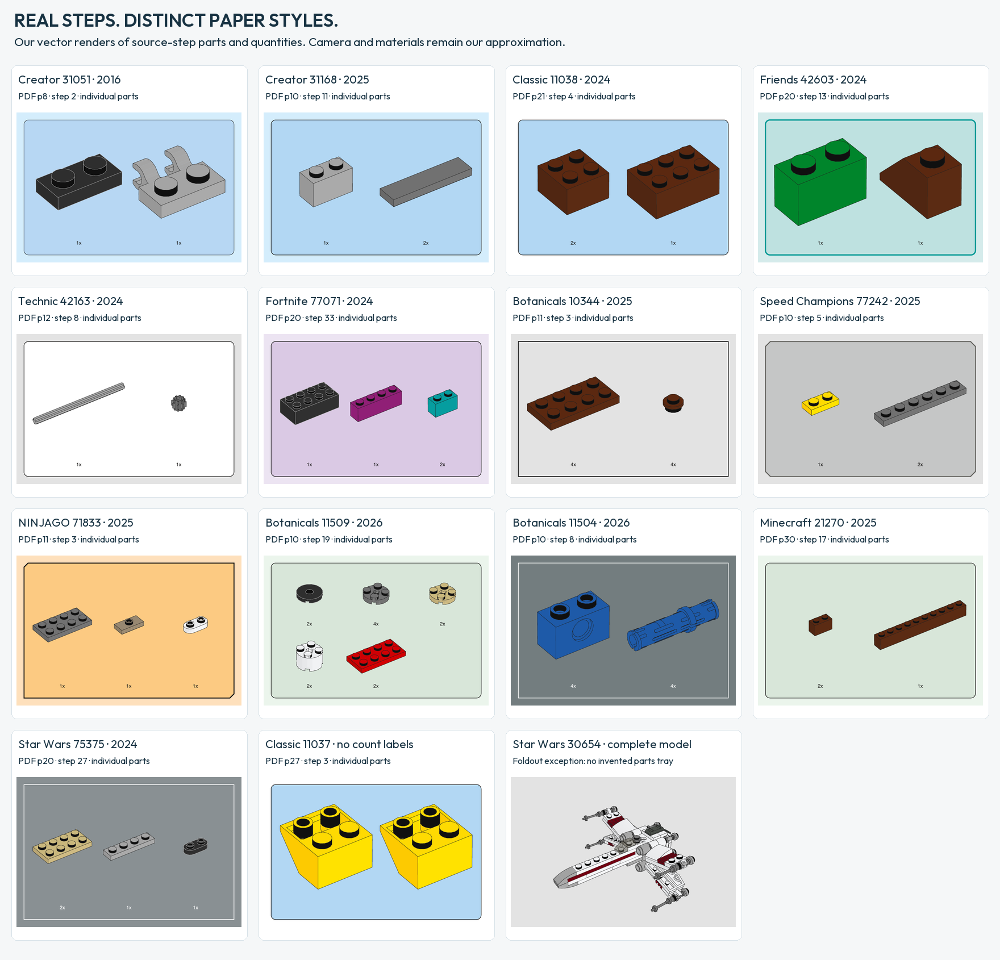

# What the instruction study changes

The renderer uses perspective and measured colors for eleven opaque materials. [Working camera angles](CAMERA-PRESETS.md) · [Material validation](MATERIAL-PROFILES.md)

The [research preprint](RESEARCH-PREPRINT.md) adds thirteen large views,
known-height body-corner camera fitting, fixed 35/35 held-out tests, top-surface
masks and a separate stud-wall study. [Volume camera](VOLUMETRIC-CAMERA.md) ·
[Materials](MATERIAL-PROFILES.md) · [Verification](VERIFICATION.md).

The sections below retain the dated style-study and seven-view stages. Their
sample sizes describe those experiments, not the cumulative current project.

[Expanded projection study](PROJECTION-EXPANSION.md): seven large step illustrations, six sets, five themes, with native-image landmarks and spatial holdout checks. These pages were already in the sampled corpus; this adds measurements, not new books.

The [quantitative FAQ](FAQ.md) summarizes thirteen questions with explicit sample boundaries, methods and limitations. [Machine-readable findings](FAQ-FINDINGS.json) link each result to hashed measurement records. This is a reorganization of the existing evidence, not an expanded sample.

The base atlas covers **23 official PDFs, 106 sampled pages and thirteen themes**, with editions spanning 2015–2026. It is a bounded comparison, not a recovered LEGO design specification. Source records preserve PDF URLs, hashes, one-based PDF page indices and extracted metadata. Fifteen sampled pages received visual feature review only; 91 also have native object extraction, including cases where text is not extractable. One historical Classic promotional page is explicitly labeled in the atlas; an unrelated Minecraft advertisement was excluded from the build-style sample.

The 23-book study identified fourteen presentation presets. The additional paired-edition study brought the corpus to 38 books and added the Classic Space parts-list variant. The renderer ships **fifteen presets**. [Paired editions](PAIRED-THEME-STUDY.md) · [All preset definitions](PRESETS.md)

## The useful conclusions

| Question | Finding | Consequence for this tool | Evidence and limits |
|---|---|---|---|
| Does each theme have one style? | No. Botanicals has gray, green and darker slate presentations in the sample. Star Wars foldout and large-book formats differ. | Select a source-linked preset; keep edition and page role visible. | [2026 comparison](EDITION-COMPARISON-2026.md), [cross-theme controls](THEME-CONTROLS.md). Not a census of all sets. |
| Can themes share a style? | Yes. Modern Creator/City share blue; Minecraft/Daisies share green inventory colors; Architecture/a large Star Wars book share a lighter slate. | Reuse measured primitives without assuming that all secondary roles also match. | Minecraft has verified lilac local cards; Daisies has no measured subassembly card in this sample. |
| Is a colored rectangle always a parts tray? | No. Parts inventories, repeated subassemblies, context cards and function insets are separate roles. | `--panel-role` chooses supported parts/subassembly presentations. Reject unsupported roles instead of inventing them. | [Annotation grammar](ANNOTATION-GRAMMAR.md); context/function roles are documented, not yet generated. |
| Should each part fill its own cell? | This destroys physical size relationships. The inventory examples support common scale within a tray. | One points-per-LDraw-unit scale for the entire manifest; per-item cameras can reveal a connector. | [Scale measurements](SCALE-STUDY.md) and [part guide](PART-ILLUSTRATION.md). No assertion that all illustrations across a page or book share scale. |
| Is there one instruction camera? | Several pilot estimates are near 35°; small views have weak constraints. A larger grid is predicted substantially better by a projective mapping than an affine one. | The later thirteen-view study supports perspective by default; source-camera fits are available separately. | [Camera measurements](CAMERA-STUDY.md) and [large-grid audit](LARGE-GRID-STUDY.md); explicit orthographic/no-roll assumptions and held-out fit checks. |
| Can PDF glass reveal the original alpha? | In the five audited pages, the relevant appearances are baked into opaque image pixels. | Treat glass as an artistic layered approximation. Keep glass, faded context and function symbols independent. | [Material audit](MATERIALS-AND-EMPHASIS.md): 43 image placements; bounded negative result, not all PDFs. |
| Can all line widths be measured from a PDF? | Native panel contours can be measured; flattened model illustrations do not expose their original stroke parameters. | Record exact panel evidence separately from normalized illustration ink. | [Style study](STYLE-RESEARCH.md), [material audit](MATERIALS-AND-EMPHASIS.md). Avoid apparent precision from enlarged raster edges. |
| Are arrows simply red? | Green insertion arrows occur, and movement/viewpoint symbols have different meanings. | Model semantic role and target before choosing color. | [Annotation grammar](ANNOTATION-GRAMMAR.md), NINJAGO 71832 p120 and Minecraft 21269 p20/40/70. Color selection rules remain unknown. |
| Does `2x` always count parts? | It can count a part or a repeated assembly. A length badge and a 1:1 reference are different again. | Scope counts explicitly; retain real units for any future 1:1 output. | [Annotation grammar](ANNOTATION-GRAMMAR.md), [printing notes](PRINTING.md). Auto annotation/layout is future work. |

## Matched part-color follow-up

[Four elements across five themes](PART-COLOR-STUDY.md), plus a brown-brick control in three actual step trays, support shared part colors with different backgrounds. Modern exact image reuse and matching interior colors are stronger evidence than comparing whole pages by eye. That historical control used 13 trays with the same four individual pieces. The paper-style gallery links fifteen specimens to their source pages. Fourteen show parts for individual steps, and one shows the X-wing from a foldout.

## What was added to the renderer

Four source-linked presets extend the original ten:

| Preset | Inventory | Subassembly | Type and normalization |
|---|---|---|---|
| `botanicals-green` | Pale green, rounded dark frame | Unmeasured; rejected | Bold substitute for observed CeraPro-Medium |
| `botanicals-slate` | Dark slate, square white frame and white count | White card, dark frame/count | Source text not extractable; regular Helvetica and frame width are explicit approximations |
| `minecraft-green` | Pale green, rounded dark frame | Lilac card | Bold substitute for observed CeraPro-Medium |
| `display-slate` | Lighter RGB slate, square white frame and white count | White card, dark frame/count | Regular substitute for observed CeraPro-Light; normalized frame width |

The initial controlled inventory comparisons used the same four individual parts, camera, material colors and physical scale. Assemblies appear only in explicitly labeled subassembly examples. Role-specific count contrast also works in shared-scale trays. The extension adds no theme-specific geometry or copied artwork. The annotation legend is original schematic vector art; it is not evidence of an implemented annotation API.

## Reading the evidence

Use the [source registry](STYLE-SOURCES.json) to identify the exact PDF, then the [atlas](INSTRUCTION-ATLAS.md) and focused report for the relevant page. A set release year is not necessarily the date of the downloaded PDF revision. Hex values are preview swatches: original RGB/CMYK measurements and conversion limitations remain in the reports.

The [scale study](SCALE-STUDY.md) adds a same-inventory comparison and native-size 1:1 measurements. It separates original-pixel uncertainty from exact PDF placement, and nominal length classes from drawn contours.

The [camera data](CAMERA-MEASUREMENTS.json) separates selected landmarks, computed angles and sensitivity ranges. The [material data](MATERIAL-FORENSICS.json) records object properties rather than inferring alpha from apparent brightness. Font names come from extractable PDF metadata where available; visual resemblance alone is never treated as font identification.

Local source screenshots and PDFs remain outside the candidate repository. Public documents contain measurements and links; gallery receipts preserve model/dependency hashes. [Verification](VERIFICATION.md) distinguishes local tests and installation checks from unrun GitHub CI.

## Questions worth the next research pass

1. **Camera precision:** extend the two-brick volumetric experiment to other themes, underside and Technic views. Keep local eye direction separate from optical-axis direction and field of view. Use source-independent validation rather than more threshold repetitions.
2. **Glass controls:** build an original test scene that separates shell fill, stud-wall opacity and internal line contrast. Compare legibility at actual print size; do not fit an unknowable source alpha.
3. **Step emphasis:** compare new-part outlines and faded old context on matched before/after pages. Define which geometry owns a contour at occlusion boundaries before adding a highlight switch.
4. **Annotations:** start with insertion arrows and scoped repeat counts, with explicit anchors. Keep viewpoint rotation separate from mechanical rotation; test arrowheads, occlusion and print-size legibility.
5. **Print reproduction:** check final physical-size output and monochrome legibility. A screen preview cannot verify a 1:1 guide or a CMYK press result.
6. **Corpus balance:** sample more books within each family before deriving an automatic style selector. Age marking, theme, model complexity and book format are correlated here; the study does not establish which causes a presentation choice.

The [large-grid follow-up](LARGE-GRID-STUDY.md) now includes an independent Star Wars inventory control: the projective advantage is much weaker there. The two illustrations do not establish a universal camera rule.

## Illustrated FAQ and free typography

[Thirteen answers](FAQ.md), five original vector diagrams and one OFL type specimen now link the evidence to common questions. [Font screening](FONT-STUDY.md) provisionally favors Jost Medium for modern quantities and Outfit Bold for the older bold sample; three labels per face do not establish whole-font equivalence. Renderer cameras and font output are unchanged. [FAQ-CONSTANTS.json](FAQ-CONSTANTS.json) separates observations, conditional estimates and implementation normalizations.

## FAQ revision: answer the production question first

The FAQ now leads with LEGO’s own statement that instructions are created using dedicated 3D software, then separates that production process from the flat images inside a delivered PDF. [Primary sources](PRODUCTION-SOURCES.json) are distinct from our image-based camera inference. Real brick and 41-part assembly renders replace abstract cubes in the introduction, with common-scale 30°/35° and reverse/underside views. Technical measurements remain in the linked studies. No camera default or accepted model was changed.
