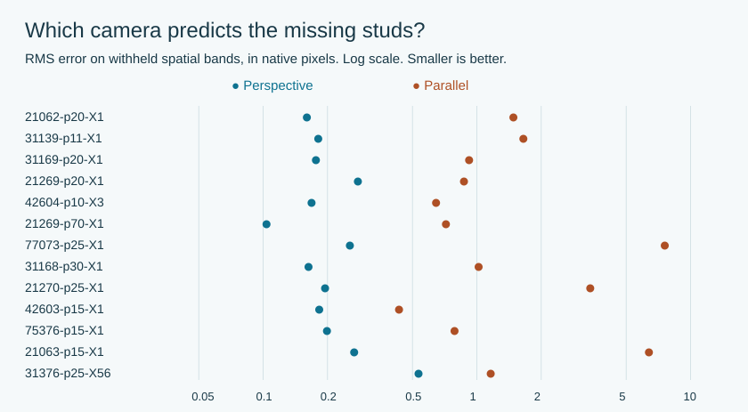
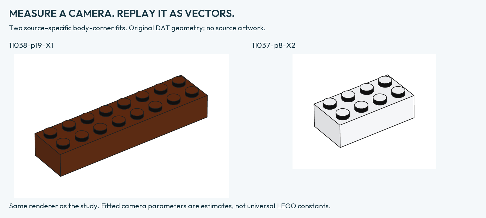
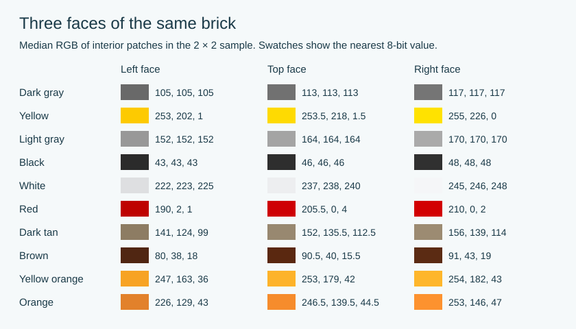
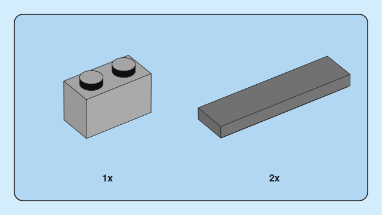
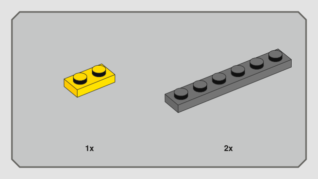
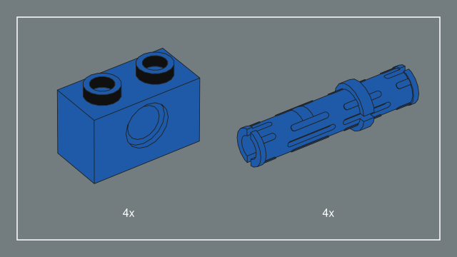
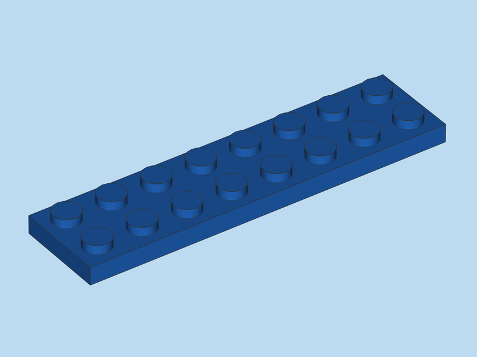
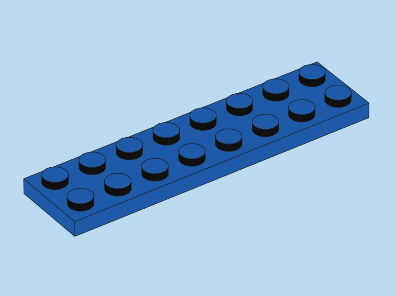

# Perspective, viewing direction and surface color in brick instructions

**Research preprint 0.22 · English edition · 4 November 2026**  
Implementation examined: Brick Blueprint 0.6.0.dev7. Prepared with AI assistance. This preprint has not been peer reviewed.

## Abstract

A perspective model predicted held-out stud positions better than an affine model in all 13 selected assembly views from 12 sets. Known brick height provided an additional constraint in two smaller illustrations. Their estimated eye directions were close to 35° around and 35° above the brick. Color behaved differently from geometry. A single gain per output face predicted the top and right faces from an observed left face with errors near one or two RGB levels per channel. Predicting all three faces from a nominal LDraw color produced substantially larger errors. This paper describes the samples, tests, implementation and limits of those results. [Short answers](RESEARCH-BRIEF.md) · [Illustrated FAQ](FAQ.md) · [Per-image results and color tables](research/MEASUREMENT-TABLES.md)

## 1. Perspective

Two spans of five stud intervals on the same chassis measure 143.4 and 156.5 pixels in the original image. A second row along the other side gives a similar difference of about 9.1%. An affine projection would preserve the length of equal parallel segments. This example gives a visible geometric test on a real assembly. [Fortnite 77073, PDF page 25](https://www.lego.com/cdn/product-assets/product.bi.core.pdf/6541111.pdf#page=25)

We tested 13 assembly views with a nominal total of 793 centers. On each selected physical plane we assigned integer grid coordinates to the centers of visible studs or hollow openings. A raised plate can share the orientation of the base while lying on a different plane, so only coplanar landmarks were pooled. We fitted a six-parameter affine model and an eight-parameter planar homography. Extra parameters can improve training error by construction. Our comparison therefore uses withheld centers, including a split that withholds contiguous spatial bands. Each image was processed at three thresholds and evaluated under both splits. The ordering held in all 39 image–threshold pairs under each split. [Source coordinates](research/PERSPECTIVE-DATA.json) · [Protocol](research/PERSPECTIVE-PROTOCOL.md)



The vertical location of a point in space cannot be recovered from a single flat grid without further assumptions. The grid constrains the direction of the optical axis along the plane. Primary estimates span 32.15° to 37.23°. Several combinations of elevation, focal length and image crop can project the same plane onto the same pixels. This ambiguity matters for reproducing a whole model, where bricks occupy different heights. [Fits, camera families and numerical controls](research/PERSPECTIVE-RESULTS.json)

### Three cameras that agree on the same plane

For grid coordinates `(u, v)`, an affine model predicts the image coordinates with two linear expressions. A homography divides both expressions by the same factor, `1 + pu + qv`. If the grid axes have equal physical pitch and the image follows a pinhole projection, the acute azimuth of the optical axis relative to our ordered axes is `atan2(|p|, |q|)`. Nine synthetic cameras with known orientations recovered their azimuths to within 3 × 10⁻¹² degrees. The small denominator coefficients typical of a weak perspective also make the ratio sensitive to subpixel errors in stud centers.

A worked example shows why elevation needs additional data. On the 1,198 × 661 pixel assembly illustration from Architecture 21062, a single homography admits all three calibrations in the table. Each has square pixels, zero skew and an orthogonal rotation. Their predictions coincide throughout the measured plane. Objects above that plane generally project to different positions. [Architecture 21062, PDF p. 20](https://www.lego.com/cdn/product-assets/product.bi.core.pdf/6566168.pdf#page=20)

| Elevation | Focal length in pixels | Principal point in the cropped image |
|---:|---:|---:|
| 19.999° | 7425.6 | (968.8, -1471.6) |
| 35.002° | 6472.9 | (944.6, 358.3) |
| 50.002° | 5079.1 | (924.5, 1879.1) |

The negative y coordinate in the first row places the principal point above the crop. A page layout can crop and reposition an image. Assuming that the crop center is the camera center would silently exclude valid solutions. Known points at different heights constrain this ambiguity directly. Several views of a plane can also help if there is evidence for shared intrinsics and a known relation between the crops. [Matrices and reconstruction errors](research/PERSPECTIVE-RESULTS.json) · [Zhang, plane-based camera calibration](https://www.microsoft.com/en-us/research/wp-content/uploads/2016/11/zhan99.pdf)

## 2. Recovering the view of an individual brick

We used seven visible body corners on each of two bricks of known height. A 2 × 8 has nominal body dimensions of 160 × 40 × 24 LDraw units. The 2 × 4 halves the long dimension. The extra height constrains the position of the camera relative to the brick. We fitted the body edges in native image pixels and left the stud caps out of the fit. Predicted cap centers then tested the camera on a separate feature within the same image.

| Brick | Source | Azimuth from center | Elevation from center |
|---|---|---:|---:|
| Brown 2 × 8 | [Classic 11038, p. 19](https://www.lego.com/cdn/product-assets/product.bi.core.pdf/6509312.pdf#page=19) | 34.876° | 35.102° |
| White 2 × 4 | [Classic 11037, p. 8](https://www.lego.com/cdn/product-assets/product.bi.core.pdf/6497651.pdf#page=8) | 34.884° | 34.669° |

The fitted cameras predicted the held-out caps to within 0.65–0.81 native pixels RMS. Holding both local angles at exactly 35° gave RMS below 0.86 pixels in both cases. These angles describe a ray from the center of the brick to the eye. The optical axis can point in a different direction when an illustration is cropped. Moving the contour threshold or omitting one body corner moved the estimates more than their displayed last decimal. [Corner fits and stud validation](VOLUMETRIC-CAMERA.md) · [Edge and resolution controls](CAMERA-EDGE-SENSITIVITY.md)



The inventory study measured 1,150 cap centers in 30 catalogue images from eight books. Its local grid angle is an orthographic equivalent for the small patch being observed. A control with a known camera varied image size, pixel alignment, JPEG encoding and detection threshold across 432 settings. The resulting variation quantifies sensitivity to those processing choices. Shared artwork and repeated measurements of a single image provide little additional evidence about variation between independent cameras. [Catalogue measurements](research/CAMERA-CATALOGUE-DATA.json) · [Detector calibration](research/CAMERA-CALIBRATION.json)

### Testing the 35° direction

For each brick the null hypothesis fixes both local angles at 35°. The alternative fits both freely. The corner measurements provide 14 coordinates, with seven free parameters under the null and nine under the alternative. We refitted both cameras to each of 1,999 simulated coordinate sets per source under the fitted null. This assumes independent Gaussian errors with the same variance in both image coordinates. The bootstrap tail probabilities were **0.943** for 11038 and **0.640** for 11037. Under that error model the two illustrations are consistent with the working direction. The seven corners share several measured edges, so correlated errors and systematic shifts remain possible. The p-values apply to these fits and this error model. A test of practical equivalence would also need a tolerance chosen in advance. [Protocol and simulation records](CAMERA-PVALUES.md) · [ASA statement on p-values](https://www.amstat.org/asa/files/pdfs/p-valuestatement.pdf) · [Lakens, equivalence testing](https://lakens.github.io/statistical_inferences/09-equivalencetest.html)

### Camera recipes

The instruction preset pairs 35°/35° with a 2° vertical field of view and fits distance to the chosen page. On a small part, that produces weak yet finite perspective. The depth preset uses 5°, and presentation uses 30°. These are practical recipes. Estimating focal length in millimeters also requires a sensor size or equivalent framing convention. The field of view of a cropped PDF image alone does not determine the source focal length. The camera-strength study includes the orthographic limit as a separate projection. [Controls, errors and recipes](CAMERA-PRESETS.md)

The table gives stud-center RMS in original-image pixels after fitting only a uniform scale and a translation to the seven body corners. The narrowest finite field is not necessarily best. For the white brick the 5° setting has the smallest error among the three finite presets shown. For both bricks the 2° result improves on the orthographic limit under every one of the nine paired cap and contour threshold choices.

| Projection in the specified frame | Brown 2 × 8 | White 2 × 4 |
|---|---:|---:|
| Orthographic limit | 1.022 px | 0.867 px |
| Perspective, 2° | 0.654 px | 0.705 px |
| Perspective, 5° | 1.487 px | 0.659 px |
| Perspective, 30° | 10.802 px | 3.446 px |

These two images contributed to recipe selection. An additional check on seven unique small brick illustrations covered Architecture, Minecraft, City and Friends. At their native resolutions the corner estimator itself shifted with threshold and part length. Those data do not identify four theme-specific camera angles. [Field-of-view sweep](research/CAMERA-STRENGTH.json) · [Cross-theme precision check](CAMERA-EDGE-SENSITIVITY.md)

## 3. From a nominal color to a printed face

An LDraw placement names a color code. Its palette definition supplies a nominal RGB value. A printed illustration adds a distinct color to each visible face and may also have passed through a color profile, image compression and layout. We tested two predictions separately. The first starts with the nominal RGB and must predict every face. The second starts with a face already measured in the instruction and predicts the other two.

We used interior pixel patches on bricks with identifiable colors. The initial 2 × 2 sample contains 14 images spanning ten visual colors in six books. All 14 carry the same embedded sRGB profile. Left and right refer to their positions in the source picture. The top patch lies on the planar body between studs. A separate patch samples a stud cap. We computed a median per channel within each patch and repeated the measurement after shifting the window by one pixel. [Measurements, windows and source hashes](THREE-FACE-SHADING.json)



**Predicting from nominal RGB.** In a nested test on 13 colors, we withheld each complete color before choosing among 54 models. The average absolute error was **15.75 RGB levels per channel**. On four subsequently measured materials, the frozen prediction gave **17.75**. Testing a different palette revision or adding Oklab candidates did not produce an acceptable general conversion in these experiments. The operational profile therefore stores three measured face colors for each of eleven materials. [Candidate models and all predictions](LDRAW-COLOR-TRANSFER.md) · [Material implementation](MATERIAL-PROFILES.md)

**Predicting from a measured left face.** For an opaque brick in the studied view, let L be one measured channel of its left face, in the range 0–255. Apply the same gain to red, green and blue:

```text
top   ≈ min(255, 1.0800 × L)
right ≈ min(255, 1.1144 × L)
```

For L = 105 the two predictions round to 113 and 117. Across the 17-color retrospective sample, average errors per channel were 1.52 and 1.17 before rounding. Refitting the gain each time on the other 16 colors gave **1.56** and **1.22** on the omitted color. MAE is the mean of absolute channel differences. For one RGB triplet, a channel error of (3, 0, 6) contributes (3 + 0 + 6) / 3 = 3 levels. The omission test leaves out whole colors, including all three channels. [Seventeen-color results](research/FACE-LAW-17.json)

A separate prospective check froze the ten-color gains before measuring four new materials. Top and right MAE were 1.20 and 1.14. That check addresses transfer to new observations. The 17-color refit summarizes the combined data. RGB rounding, clipping at 255 and saturation on bright colors limit the inverse problem. For example, multiple input values can map to a clipped output of 255. [Frozen tests and sensitivity](COLOR-LAW.md)

**Transfer across geometry.** A distinct set of twelve 2 × 4 images tests whether a measured face palette transfers from 2 × 2 bricks to another body shape. The mean face-patch error was 1.01 RGB levels. This comparison samples the interior of the body. It does not score silhouettes, edge width, transparent layers, studs or the accuracy of a complete picture. [Held-out geometry data](MATERIAL-TRANSFER.json)

### Larger surfaces and the walls of studs

To check the measured top color on a larger face, we used the fitted camera to locate the top plane of a brown 2 × 8 brick and a white 2 × 4 brick. We excluded the stud cylinders and their caps geometrically, then eroded the remaining mask by two native pixels to avoid ink on the edges. Color played no role in selecting the pixels.

| Body | Pixels remaining | Observed top RGB | Measured 2 × 2 reference |
|---|---:|---|---|
| Brown 2 × 8 | 2,422 | 89, 41, 17 | 90.5, 40, 15.5 |
| White 2 × 4 | 1,149 | 236, 239, 240 | 237, 238, 240 |

Changing the erosion margin to one or three pixels moved each median by at most one channel level. The largest discrepancy between observed top and reference was 1.5. The black-looking band below a stud cap is a separate surface. Its median RGB was (15, 16, 19) in the brown brick and (16, 16, 16) in the white one. We took the median of these six channel values as a fixed neutral reference, (16, 16, 16). On eight wall patches from one held-out pink plate, the mean error was 2.17 levels for this reference and 7.33 for a (7, 7, 7) control. All 72 one-pixel shifts preserved the ordering. Eight studs on the same plate share the same source image. [Top-plane masks](research/LARGE-TOP-TRANSFER.json) · [Wall measurements](research/STUD-SURFACE-STUDY.json)

### Inclined faces and transparent parts

The optional angular material profile starts with three measured directions: left-facing slopes at 26.565° and 45°, and a right-facing slope at 45°. It takes the color at either end of an interval, decodes each channel from sRGB, and interpolates using sine weights in linear light. White at 26.565° has its own measured calibration. The profile returns to encoded RGB after clipping. The method approximates how the recorded color changes as the surface tilts.

The selected profile passed the specified tolerance on 77 images. Of these, 69 contributed to method development, calibration or related repeats. The prospective portion contained eight controls on two new shapes. All eight were left-facing and all eight passed, although an alternative interpolation had smaller errors on three of the four white examples of part 85984. Eight repeated sloped elements allowed a cross-book check, with observed differences of at most one RGB level. Right-facing multicolor examples, opposite normals and diagonals need additional independent tests. [Equations and validation groups](ANGULAR-MATERIALS.md) · [Sloped-face sources](SLOPED-FACES.md)

The glass control in the renderer composites visible shells in depth order. Opacity is exposed as an illustration setting. An embedded image combines the background, glass, any ink and what lies behind it. The final pixels alone do not supply the original rendering opacity. [Glass, outlines and current-step emphasis](MATERIALS-AND-EMPHASIS.md)

## 4. Printed pages, shared scale and type

The paper-style corpus contains 38 books. The analysis compares editions within a theme and pairs of sets from the same year. The 15 presets distinguish the page, parts tray, subassembly panel and count label. In the measured pages, frames vary from roughly 0.5 to 2 pt and include rounded, square and clipped corners. A parts tray can differ from a subassembly panel on the same page. [Atlas](INSTRUCTION-ATLAS.md) · [Paired comparisons](PAIRED-THEME-STUDY.md) · [Preset table](PRESETS.md)

| Rounded panel | Clipped corners | Square frame |
|:---:|:---:|:---:|
| [](portfolio/modern-blue.svg) | [](portfolio/speed-chamfer.svg) | [](portfolio/botanicals-slate.svg) |
| 31168 · page 10 · step 11 | 77242 · page 10 · step 5 | 11504 · page 10 · step 8 |

Two measured plates in one tray are compatible with a shared scale. A separate printed 1:1 guide has a hole pitch of 8.009 mm against a nominal 8 mm. To preserve that measurement, print at the document's physical size. The quantity label appeared at 8 pt in six inspected runs. Among the four freely available font families examined, Outfit Bold and Jost Medium gave the nearest candidates for LEGOChalet60-Bold and CeraPro-Medium respectively. [Scale measurements](FAQ.md) · [Font comparisons](FONT-STUDY.md)

Recent sampled embedded images carried sRGB, while older Creator material included CMYK with ISO Coated v2. Screen measurements depend on the specific PDF object and its profile. Brick Blueprint keeps its drawing as paths through RGB, grayscale and ICC-based CMYK export. [Color and paper evidence](PART-COLOR-STUDY.md) · [Print workflow](PRINTING.md)

## 5. Reproducibility

The numerical appendices identify the book, PDF page, original pixel dimensions, image and document hashes, fitted parameters and evaluation splits. Each renderer receipt identifies the geometry dependencies, their authors, material profile and camera. Numeric replay starts from the saved measurements. Re-extracting centers from an original PDF also requires the documented plane selection and pixel windows. [Evidence index](INDEX.md) · [Research and renderer contract](research/RENDER-CONTRACT.json)

The numerical consistency check uses NumPy. The brief can be checked with the standard Python library.

```sh
python3 tools/check_research_sync.py
python3 tools/build_research_brief.py --check
```

## 6. Comparison with LDView

The blue 2 × 8 plate in Lighthouse Point offers a simple test. In LDView, the stud walls shade gradually. In Brick Blueprint, a dark band separates each blue cap from the top of the plate. Blue is outside the eleven measured body colors. Its flat faces use the library-based fallback, while the vertical stud walls use the measured neutral reference. The upper and lower edges of the long side align in the two views, so the shape can be compared at the same scale.

| LDView 4.7 | Official reference | Brick Blueprint |
|:---:|:---:|:---:|
| [](images/plate-ldview.png) | [31051 · page 18 · step 8](https://www.lego.com/cdn/product-assets/product.bi.core.pdf/6167581.pdf#page=18) | [](images/plate-blueprint.svg) |

Both renderers use DAT 3034 in LDraw blue, the same placement and palette, a 35°/35° local viewing direction, a 2° vertical field of view and a distance of 3,786.296 LDU. Both show the entire frame. LDView's snapshot has been uniformly reduced from 3,200 × 2,400 to 800 × 600 pixels. Brick Blueprint's SVG has the same 800 × 600 viewBox. The official image is a 112 × 59 pixel crop. Its original camera settings are unknown. [Model](../examples/parts/blue-plate-2x8.ldr) · [Settings, hashes and registration measurements](gallery/plate-ldview-control.json)

We disabled seams and primitive substitution in LDView and enabled quality studs, lighting and edge lines. The camera was checked on eight noncoplanar markers. The maximum registration difference was 0.091 pixels at a frame width of 800 pixels. A separate test of the stronger 30° field of view used 32 markers across four models and gave a maximum difference below 0.13 pixels. The first test validates the weak-perspective plate comparison. The second checks the engine over a wider depth range. [Finite-camera validation](research/PERSPECTIVE-IMPLEMENTATION.json)

The measured palette and the weak-perspective preset address two observable properties of printed illustrations. Their validation supports claims about positions of held-out landmarks and colors of held-out face patches. A whole-image ranking against LDView would require a separate metric and a broader evaluation set.
