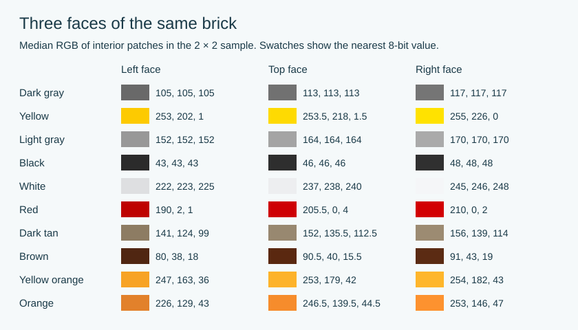

# Three-face shading: top, left and right

This study measures the two side faces, the horizontal surface between studs,
and a separate front-stud cap control in **14 images, ten visually distinct
colors and six books**. These fixed data underpin ten materials in the current
renderer; an independent new-color extension adds validated Tan 19 for eleven
runtime materials. A separate 2×4-brick check tests transfer to another shape.
The profile implements sampled axis colors, not a universal illumination law.
[Implementation and validation](MATERIAL-PROFILES.md).

**In all 14 sampled images, the top is brighter than the left face and darker
than the right face.** That ordering survives all nine one-pixel shifts of each
ROI. It is a finding for this view and sample, not every orientation or LEGO set.

## Fixed source pixels and color handling

Each source is a native 63×59 RGB image from an official PDF. PDF, encoded image,
decoded pixels and the embedded ICC stream are hashed. All 14 use the same
explicit sRGB IEC 61966-2.1 profile. Original side-face medians reproduce exactly.
No screenshot, interpolation, upscaling or color conversion enters measurement.

Coordinates are half-open native pixel boxes, with origin at the upper left:

| Surface | x0, y0, x1, y1 | Pixels |
| --- | --- | ---: |
| Left | 9, 33, 14, 38 | 25 |
| Top, between studs | 27, 16, 37, 19 | 30 |
| Right | 38, 37, 49, 42 | 55 |
| Front stud cap, separate control | 26, 22, 32, 25 | 18 |

All boxes are fixed across the sample. The top patch excludes stud walls and
outlines. The cap is not pooled into the top estimate. Medians are channel-wise;
half-integers arise from an even pixel count, not half-level accuracy. Relative
luminance is computed from each median using sRGB linearization and the
[standard coefficients](https://www.w3.org/WAI/WCAG22/Understanding/relative-luminance.html).

## Measurements

| Official source / PDF page | Visual color | Left RGB | Top RGB | Right RGB |
| --- | --- | --- | --- | --- |
| [11037 p18](https://www.lego.com/cdn/product-assets/product.bi.core.pdf/6497651.pdf#page=18) | dark gray | (105, 105, 105) | (113, 113, 113) | (117, 117, 117) |
| [11037 p27](https://www.lego.com/cdn/product-assets/product.bi.core.pdf/6497651.pdf#page=27) | yellow | (253, 202, 1) | (253.5, 218, 1.5) | (255, 226, 0) |
| [31168 p130](https://www.lego.com/cdn/product-assets/product.bi.core.pdf/6592820.pdf#page=130) | light gray | (152, 152, 152) | (164, 164, 164) | (170, 170, 170) |
| [21270 p42](https://www.lego.com/cdn/product-assets/product.bi.core.pdf/6586735.pdf#page=42) | black | (43, 43, 43) | (46, 46, 46) | (48, 48, 48) |
| [21270 p43](https://www.lego.com/cdn/product-assets/product.bi.core.pdf/6586735.pdf#page=43) | white | (222, 223, 225) | (237, 238, 240) | (245, 246, 248) |
| [21270 p47](https://www.lego.com/cdn/product-assets/product.bi.core.pdf/6586735.pdf#page=47) | red | (190, 2, 1) | (205.5, 0, 4) | (210, 0, 2) |
| [21270 p69](https://www.lego.com/cdn/product-assets/product.bi.core.pdf/6586735.pdf#page=69) | tan | (141, 124, 99) | (152, 135.5, 112.5) | (156, 139, 114) |
| [11038 p21](https://www.lego.com/cdn/product-assets/product.bi.core.pdf/6509312.pdf#page=21) | brown | (80, 38, 18) | (90.5, 40, 15.5) | (91, 43, 19) |
| [11038 p44](https://www.lego.com/cdn/product-assets/product.bi.core.pdf/6509312.pdf#page=44) | yellow orange | (247, 163, 36) | (253, 179, 42) | (254, 182, 43) |
| [21269 p10](https://www.lego.com/cdn/product-assets/product.bi.core.pdf/6556015.pdf#page=10) | dark gray | (105, 105, 105) | (113, 113, 113) | (117, 117, 117) |
| [21269 p18](https://www.lego.com/cdn/product-assets/product.bi.core.pdf/6556015.pdf#page=18) | light gray | (152, 152, 152) | (165, 165, 165) | (170, 170, 170) |
| [21269 p27](https://www.lego.com/cdn/product-assets/product.bi.core.pdf/6556015.pdf#page=27) | brown | (80, 38, 18) | (90.5, 40, 15.5) | (91, 43, 19) |
| [21269 p27](https://www.lego.com/cdn/product-assets/product.bi.core.pdf/6556015.pdf#page=27) | orange | (226, 129, 43) | (246.5, 139.5, 44.5) | (253, 146, 47) |
| [75375 p20](https://www.lego.com/cdn/product-assets/product.bi.core.pdf/6509377.pdf#page=20) | brown | (80, 38, 18) | (90.5, 40, 15.5) | (91, 43, 19) |

Dark gray is **105 / 113 / 117** and light gray **152 / 164 / 170** (left / top /
right). Across books, dark-gray top medians are identical; the light-gray repeat
is 165 instead of 164. Brown top medians `(90.5, 40, 15.5)` repeat in Classic,
Minecraft and Star Wars. These are repeated output colors, not independent
recoveries of a material shader.

## Can one multiplier predict the top?

As before, use ten fixed color representatives; four repeat images are reserved
as controls. Fit one scalar on nine colors, predict the omitted tenth, repeat for
every color. Errors below are encoded RGB channel levels on the 0–255 scale,
including predictions obtained via linear RGB.

| Transfer | Fitting space | k | Held-out mean absolute error | Worst channel error |
| --- | --- | ---: | ---: | ---: |
| top = k * right | encoded RGB | 0.9742 | 1.69 | 6.25 |
| top = k * right | linear RGB | 0.9477 | 1.80 | 5.77 |
| left = k * right | encoded RGB | 0.9129 | 3.43 | 21.93 |
| left = k * right | linear RGB | 0.8345 | 4.26 | 19.91 |

`top ≈ 0.9742 × right` is a rough output-color approximation in this fixed view;
it is not an exact lighting law. Top-ROI shifts change individual median channels
by up to **5 levels**. The largest primary cap/top difference is **6.5 levels**.
JPEG/color-boundary contamination is therefore material for the small top patch.
The scalar fit is descriptive and does not justify a p-value for an exact shader
coefficient. In particular, it neither establishes nor rules out a shared
underlying top/cap material after compression.

The earlier side result remains unchanged: neutral colors approach a 90%
encoded-RGB left/right transfer, while saturated yellow contradicts one exact
multiplier. A correct physical model also needs base-color calibration and more
surface orientations. Three visible directions at one pose cannot uniquely
recover illumination, tone mapping, clipping and editorial material rules.

[Three-face data, all ROI shifts, hashes and held-out predictions](THREE-FACE-SHADING.json)
· [Unchanged original two-face record](SHADING-STUDY.json)
· [Within-theme/year controls](PAIRED-PARTS.json)
· [Association and profile recheck](PAIRED-ASSOCIATION-RECHECK.json)

The separately checked catalogue controls still contain 17 exact image/profile
matches and two nonidentical Architecture assets among 19 comparisons. These comparisons use catalogue images. The face-shading sample above contains 14 step images in ten colors.

## Shared transfer across colors

Dark-to-light and dark-to-top clipped gains provide useful approximations.
The measured Sand Yellow sample corresponds to LDraw Dark Tan 28.
[Whole-color holdouts, nominal-library controls and all coefficients](COLOR-LAW.md).
