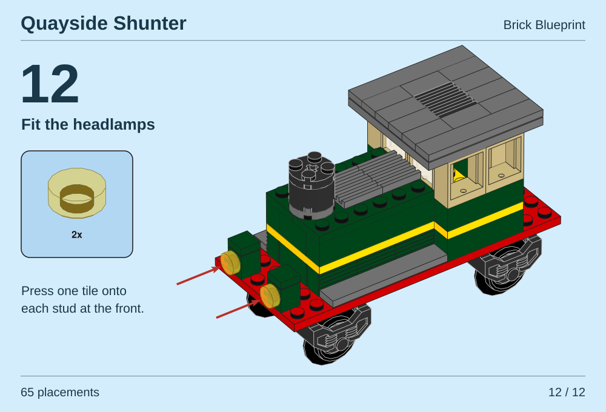

# An illustrated step for the Quayside Shunter

The last step of this original locomotive adds two transparent yellow headlamps. The round tile in the parts box is a separate render. Both red arrows follow the direction in which the tile slides onto its stud. Open the sheet to zoom in. [LDraw model](../examples/shunter/shunter.ldr) · [Parts for this step](../examples/shunter/lamps.json)

[](images/shunter-step-12.svg)

## Make the page

From the checkout root, supply a complete LDraw library and a new output directory.

```sh
python3 tools/render_shunter_step.py --library /path/to/complete.zip \
  --output output/shunter
```

Open `output/shunter/step-12.svg`. The `assembly` and `inventory` subdirectories contain the individual renders, their PDFs and their receipts. To make a print sheet too, install the optional pypdf and ReportLab packages and add `--pdf` to the command. The resulting `step-12.pdf` measures 500 × 340 points. Both illustrations remain vector paths and the labels remain selectable.

## Where the arrows point

The model has twelve steps and 65 LDraw placements. A complete wheel unit or glazed window counts as one placement. The first eleven steps build the chassis, hood and cab. The last two placements are LDraw part 98138 in color 46. Their mounting studs face forward. The recipe reads each tile's position and orientation, projects two points along its normal through the assembly camera, and draws the arrow between those points. The model and the parts box use the same 35°/35° instruction camera preset. The inventory enlarges the loose tile so its shape can be read.

In the digital seating check, six studs on each wheel unit align with the deck and both lamp tiles meet a sideways mounting stud. We sampled two offset grids at 0.75 LDU spacing across the model. Neither grid found intersecting solid interiors. Moving one lamp 8 LDU into its mount gave a detectable overlap on both. Physical construction has not been tested. [Geometry checks, camera, source hashes and part credits](gallery/shunter-step.json)

The model and layout were designed for Brick Blueprint with AI assistance. Geometry comes from the separately supplied LDraw Parts Library. Releases 2026-08 and 2026-10 produced byte-identical SVG and PDF sheets on the reference toolchain. [External geometry terms and credits](../THIRD_PARTY_NOTICES.md)
