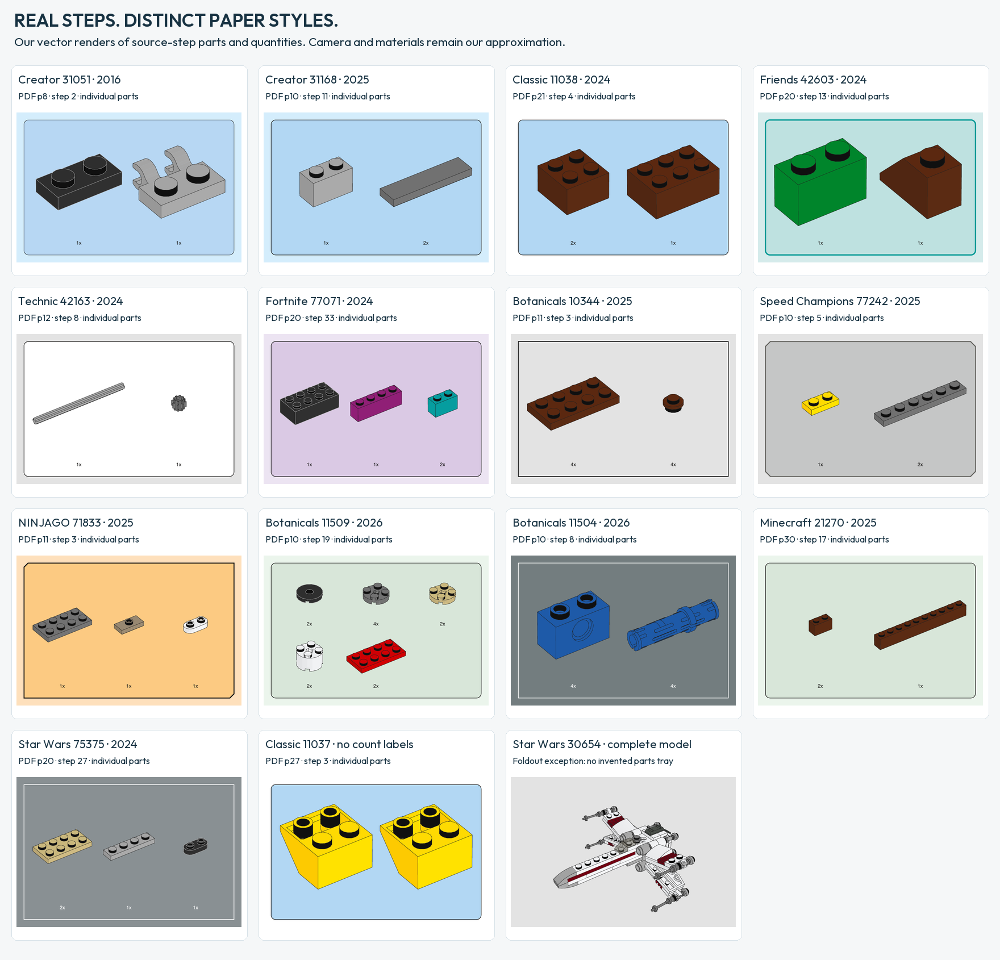
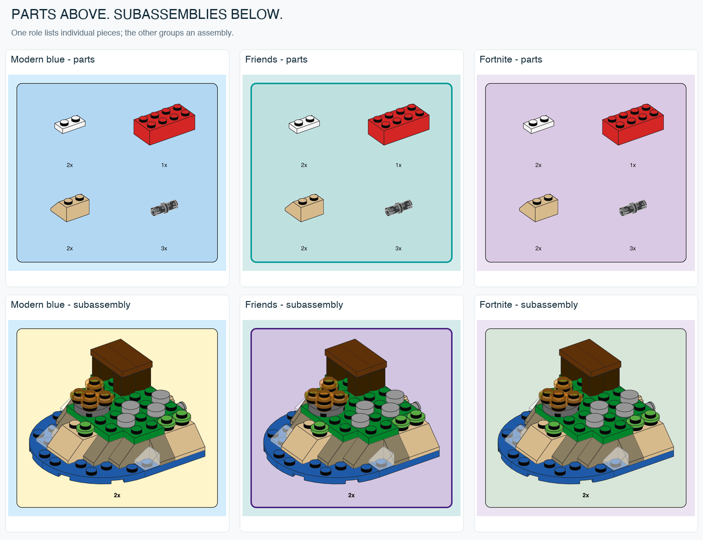

# Paper instruction style study

Twenty-three official instruction PDFs, 97 visually inspected pages across thirteen themes, researched 2026-10-25. Eighty-two pages also have native object extraction, including negative text-extraction results; fifteen additional pages were selected for visual feature checks. Editions span 2015–2026. This is not a claim about every set or a universal 2026 design standard. See the [2026 follow-up](EDITION-COMPARISON-2026.md) for five new books and green/slate Botanicals counterexamples.

[Detailed set-by-set atlas](INSTRUCTION-ATLAS.md) · [How to show a part](PART-ILLUSTRATION.md) · [Printing notes](PRINTING.md)

## What determines the appearance?

**Theme, edition and graphic role all matter.** Creator 31139 (2023) and City 60404 (2024) share a light-blue page and essentially the same parts-tray palette. Creator 31051 (2016) already uses that page blue, but has a different tray blue, thinner frame and different typography. Classic changes much more: the sampled 2015 book has a warm yellow textured background, while the 2024 book is white.

Format is a separate factor. The small Star Wars foldout fits several compact steps into columns and uses orange repeated-subassembly panels. It does not present the ordinary parts-tray header seen in the larger booklets. Treating that orange as a universal Star Wars parts color would be incorrect.

Complexity changes the explanatory graphics. Technic adds axle/beam length references, numeric badges and 1:1 guides. Friends uses stronger colored borders and colored assembly arrows. Progress strips and character markers occur in several newer books, but are not a requirement of every page.

These are observations and limited inferences from the selected pages, not a recovered LEGO design specification.

## Source-by-source findings

Page numbers below are one-based **PDF page indices**, which may differ from the printed page label. The linked PDFs are official sources; no instruction scans are bundled here. [Hashes and sampled font metadata](STYLE-SOURCES.json) preserve the exact evidence set.

| Source | Sampled pages | Page background | Parts tray | Other observed graphics |
| --- | --- | --- | --- | --- |
| [31051 Lighthouse Point · Creator · 2016](https://www.lego.com/cdn/product-assets/product.bi.core.pdf/6167581.pdf) | 18, 22, 74 | `#D4EDFC` | `#B7D7F3`, fine dark frame | Large black step numbers; red frame and yellow light symbol for the lighthouse function on p74 |
| [31139 Cozy House · Creator · 2023](https://www.lego.com/cdn/product-assets/product.bi.core.pdf/6456165.pdf) | 11, 25, 60 | `#D4EDFC` | `#B2D7F3` | Cream `#FFF5CB` subassembly panels; blue progress strip; white rotation card; red assembly arrows |
| [10692 Creative Bricks · Classic · 2015](https://www.lego.com/cdn/product-assets/product.bi.core.pdf/6117826.pdf) | 8, 12, 20 | Warm yellow texture/gradient | Light cyan `#ADEDFF` | Yellow footer `#FFD900`; p12 is a promotional page, not a build step; prepress marks outside the artwork |
| [11038 Vibrant Creative Brick Box · Classic · 2024](https://www.lego.com/cdn/product-assets/product.bi.core.pdf/6509312.pdf) | 8, 12, 20 | `#FFFFFF` | `#B2D7F3` | Thin vertical rules separate independent builds; no progress strip on the sampled pages |
| [30654 X-Wing Starfighter · Star Wars · 2023](https://www.lego.com/en-us/service/building-instructions/30654) | 1, 2 | `#E3E3E3` | No separate tray observed | Orange `#FCCA82` repeated-subassembly panels; white flow arrows, rotation symbols, dense foldout layout |
| [77073 Battle Bus · Fortnite · 2024](https://www.lego.com/cdn/product-assets/product.bi.core.pdf/6541111.pdf) | 12, 25, 50 | `#ECE4F2` | `#DAC9E4` | Green `#D8E6D9` assembly panels; purple progress strip; white context cards and completion bursts |
| [42167 Mack LR Electric Garbage Truck · Technic · 2024](https://www.lego.com/cdn/product-assets/product.bi.core.pdf/6495267.pdf) | 10, 20, 40 | `#E3E3E3` | `#FFFFFF` | Cream `#FFF5CB` subassembly panels; 1:1 guides, length badges, red insertion arrows and neutral progress strip |
| [42604 Heartlake City Shopping Mall · Friends · 2024, book 1](https://www.lego.com/cdn/product-assets/product.bi.core.pdf/6493646.pdf) | 10, 20, 40 | `#D5EBEB` | `#BEE1E0`, teal `#009A96` border | Purple `#D2C5E2` local subassembly inset with `#4A2282` border/arrow; white context cards; teal progress strip |
| [60404 Burger Truck · City · 2024, book 1](https://www.lego.com/cdn/product-assets/product.bi.core.pdf/6490981.pdf) | 10, 20, 40 | `#D4EDFC` | `#B2D7F3` | Blue progress strip, character marker and occasional vertical separation |
| [31169 Typewriter with Flowers · Creator · 2025](https://www.lego.com/cdn/product-assets/product.bi.core.pdf/6556274.pdf) | 9, 10, 20, 30, 40 | `#D4EDFC` | `#B2D7F3` | Underside views; cream inset; faded white context card; extends `modern-blue` |
| [10281 Bonsai Tree · Botanicals · set 2021, inspected PDF revision](https://www.lego.com/cdn/product-assets/product.bi.core.pdf/6532381.pdf) | 10, 20, 30, 40 | `#E3E3E3` | Same gray, square frame | LEGOChalet60-Light; white subassembly cards |
| [10343 Mini Orchid · Botanicals · 2025](https://www.lego.com/cdn/product-assets/product.bi.core.pdf/6555769.pdf) | 10, 14, 20, 30, 36, 40 | `#E3E3E3` | Same gray, square frame | CeraPro-Light; blue step emphasis, white repeated-assembly cards |
| [77240 Bugatti Centodieci · Speed Champions · 2025](https://www.lego.com/cdn/product-assets/product.bi.core.pdf/6598214.pdf) | 10, 20, 30, 40, 56, 72 | `#E3E3E3` | `#C5C6C6`, four clipped corners | Tonal/beveled border, pale `#FFFCE4` inset; curved yellow movement arrows |
| [71832 Thunderfang Dragon · NINJAGO · 2025](https://www.lego.com/cdn/product-assets/product.bi.core.pdf/6566338.pdf) | 10, 20, 30, 40, 100, 120 | `#FEE0BC` | `#FCCA82`, two clipped corners | Gray subassembly, white context; 1:1 mechanism reference |
| [71488 Bunchu · DREAMZzz · 2025](https://www.lego.com/cdn/product-assets/product.bi.core.pdf/6553546.pdf) | 10, 20, 30, 34, 38, 40, 66 | Textured warm/blue branches | Cream main-build trays | Strong yellow routing; story art; alternate-build restarts |

The Classic 2015 texture is deliberately **not** approximated as a flat-color preset. It remains evidence of an edition change. Modern Creator and City share one preset. The expanded 2025 sample adds square Botanicals panels, four-corner Speed Champions panels and two-corner NINJAGO panels: fourteen original presets, plus the new Classic Space variant, including the green and slate Botanicals variants from the 2026 follow-up and the Minecraft/display-book variants from the [cross-theme controls](THEME-CONTROLS.md). DREAMZzz remains research-only because its textured pages change with the narrative branch.

## Panel geometry and typography

Rounded corners recur across the sample, but the border treatment changes. Filled inner and outer contours in the PDFs allow border thickness to be measured even when no ordinary stroked rectangle exists.

| Observed family | Border width | Corner evidence | Source typography |
| --- | --- | --- | --- |
| Creator 31051, 2016 | About 0.5 pt | Inner path radius about 7.09 pt | LEGOChalet60-Bold; counts 8 pt, main step numbers 38 pt |
| Modern Creator, Classic, City, Technic, Fortnite | About 0.75 pt on sampled tray contours | Outer radius about 7.09 pt; inner about 6.71 pt where measurable | CeraPro-Medium; counts 8 pt in extractable examples, main steps generally 26 pt |
| Friends 42604 | About 2 pt | Outer about 7.09 pt, inner about 6.09 pt | CeraPro-Medium; counts 8 pt, main steps 26 pt |
| Star Wars 30654 foldout | About 0.75 pt | Orange inset corners around 7–8 pt | CeraPro-Medium; main steps 26 pt and smaller substeps/repetition labels |
| Classic 10692, 2015 | Fine dark frame | Approximately 7 pt rounded corners | LEGOChalet60-Bold; counts 8 pt, main steps 32 pt |

Font names come from PDF metadata, not a guess from a raster. Some text in the City sample is rasterized or not extractable; its step numbers are identified, but no independent count-font measurement is claimed for those pages. Source counts are not the same thing as large repetition labels for an entire subassembly.

**Implementation choices:** rounded presets use a normalized 7.087 pt rectangle radius, 14.17 pt inner padding, a 12 pt page inset and an 8 pt quantity label. These are a consistent reusable layout, not a pixel-exact reconstruction of every source panel. An SVG stroke is centered on its contour, so its outer radius is not identical to the source's filled outer contour. Count labels use standard PDF Helvetica regular/bold and the browser's Helvetica/Arial/sans-serif fallback; no CeraPro or Chalet font is extracted or distributed. The 8 pt subassembly count is also a tool normalization, not a claim about the foldout's repetition-label size.

The newer non-rounded presets use square corners (Botanicals), four clipped corners (Speed Champions) or top-left/bottom-right clipped corners (NINJAGO). Chamfer depth is normalized to 7.087 pt. The sampled Speed Champions color contour has an approximately 7.85 pt clip; the NINJAGO color contour is about 6.65 pt. The Speed Champions tonal border is simplified to a flat 1.5 pt gray stroke, and its cream inset is normalized to one sampled RGB fill. Botanicals uses a 0.75 pt square frame and regular Helvetica as a substitute for the source's light font. NINJAGO uses a normalized 1.5 pt dark border. These geometric differences are implemented, but not advertised as exact source reproductions.

The part illustration's line width is separately controlled. Panel border width must not silently thicken every line in the 3D model. All presets share the same geometry visibility, light-edge and transparent-shell rules; only measured presentation differs.

## Five graphics that should not be confused

1. **Parts tray:** inventory for a step, with quantities below or near each part. It describes what to use.
2. **Subassembly inset:** an intermediate construction or repeated unit. Its fill may differ from the tray even on the same page.
3. **Context/reuse card:** a previously assembled module, orientation or reminder, often on white.
4. **Measurement guide:** a length reference, such as Technic's 1:1 axle comparison. Its scale has physical meaning.
5. **Function inset:** shows an action or effect, such as the lighthouse light on p74. Its red frame is not a generic inventory border.

The tool supports the first two as **single-model callouts** with a quantity, plus a regular multi-item grid with shared scale; it has no automatic arrows, progress strips, function effects, step layout or 1:1 guide generator. Colors reserved for future progress/step features in the preset data are research metadata and do not draw those elements.

## What makes the illustration work on paper?

- **Stable scale within an inventory.** A prior local audit of several instruction callouts found matching projected stud pitch within a tray. Use one physical scale when comparing parts; independently fitting every part into a cell hides size relationships. This is a sampled observation, not proof about every LEGO instruction. The `tray` command now enforces a shared scale across its grid; compact automatic packing remains future work.
- **Readable edges, not an indiscriminate wireframe.** Occluded geometry is hidden. Light outlines keep seams visible on black parts, and dark outlines define light parts. Small details need filtering at the intended page size.
- **Flat material color with restrained shading.** Color distinguishes parts and their orientation. Photorealistic shadows and reflections would compete with the assembly information. No exact source shading formula was recovered from the embedded model rasters.
- **Controlled glass.** In the lighthouse instruction, the pane and interior are simplified for readability. Our shell-opacity control can make the glass milkier while retaining depth-tested outlines. It is an illustration setting, not a measurement of real material transparency.
- **Physical dimensions.** Border and text sizes are expressed in points. Print a PDF at actual size when evaluating an 8 pt quantity label; a browser screenshot or a fitted-page preview changes apparent size. True 1:1 guides would require separate calibration.
- **Contrast across backgrounds.** White, blue, gray and lilac pages all need legible dark text and outlines. Colored panels must still be distinguishable in a grayscale proof. No paper/printer or grayscale print proof has yet been performed.

## Method and limits

We read complete sampled pages, inspected native vector fills and contour paths, extracted available font metadata, and rendered the same pages through CoreGraphics to sRGB for visual checks. Hex values in the table are rounded PDF RGB values or confirmed preview values. Embedded illustration backgrounds sometimes differ slightly from the surrounding vector page fill.

The 2015 Classic file includes large white prepress margins, so its most frequent raster color is white even though the artwork's build-page background is yellow. `STYLE-SOURCES.json` preserves that raw statistic with an explicit warning; it must not be used as automatic style classification.

This is a small, purposeful sample. Years refer to the set/edition used, not a guarantee about every PDF revision. There is no press ICC conversion, measured paper stock, calibrated printer proof or perceptual color matching. Fonts, branded progress characters and official artwork are not bundled. The current gallery uses 14 actual-step parts trays and a separately labeled complete X-Wing, across 15 presets. Camera and materials are our approximation; the source selection and counts are recorded per card. See [the 16 paired comparisons](PAIRED-THEME-STUDY.md) for non-color parameters and within-year exceptions.

Implementation lives in `brick_blueprint/presets.json`, `presentation.py` and the native SVG/PDF pipeline. Source links and hashes are in [STYLE-SOURCES.json](STYLE-SOURCES.json); gallery receipts, model hashes and dependency attribution are linked from [GALLERY.md](GALLERY.md).

## Cross-theme controls

The [control study](THEME-CONTROLS.md) identifies shared Architecture/Star Wars display-book treatment and shared Minecraft/Daisies green inventory colors, while preserving differences in secondary panels and excluding advertising typography.

The [illustrated FAQ](FAQ.md) collects these measurements with projection, scale and typography controls. The [free-font study](FONT-STUDY.md) recommends provisional alternatives without changing the renderer defaults.

## Paired-source and shading follow-up

[16 same-theme/year presentation pairs](PAIRED-THEME-STUDY.md), [ten-color face shading](SHADING-STUDY.md), and [actual-step gallery evidence](ACTUAL-STEP-EXAMPLES.json) extend the earlier samples. Earlier page counts refer to their historical study, not the enlarged 38-book corpus.
