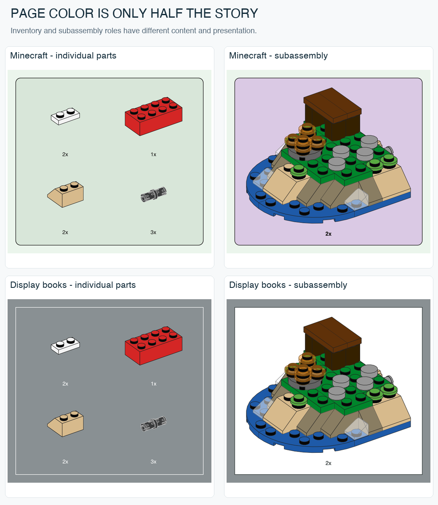

# Theme controls: similar books and misleading labels

Three more official books were sampled on 2026-10-25 to test whether the previous style names generalize. Twelve build/feature pages were inspected and measured. An additional Minecraft advertisement was deliberately excluded from the build-style sample. Exact hashes and sample lists are in [STYLE-SOURCES.json](STYLE-SOURCES.json).

## A large Star Wars book does not look like the small foldout

| Source | Page / inventory | Panel and labels | Local assembly |
|---|---|---|---|
| 30654 X-Wing, 2023 foldout | Light gray; no separate ordinary parts tray observed | Dense step flow, larger labels | Orange repeated-subassembly panels |
| 75375 Millennium Falcon, 2024 book | Slate `#899093`; same slate inventory | Square white inventory frame; white CeraPro-Light 8 pt counts and 26 pt steps | White cards, dark text, red insertion arrows, contrasting routed leaders |

[75375 official PDF](https://www.lego.com/cdn/product-assets/product.bi.core.pdf/6509377.pdf), pages 20, 40, 60 and 80. Page 40 has a numbered local operation in a white card and a thin pointer to the model. Page 60 combines a bag transition, a faded context card and a new inventory. Page 80 divides multiple steps into a grid using fine light rules. The main page is slate even though local assembly cards are white.

This confirms why `starwars-foldout` must remain format-specific. Its rejection of a parts tray applies to that preset, not to Star Wars as a theme. It would be wrong to map every Star Wars instruction to orange cards without inventory.

## Architecture shares the large display-book presentation

[21062 Trevi Fountain, 2025 official PDF](https://www.lego.com/cdn/product-assets/product.bi.core.pdf/6566168.pdf), pages 20, 40, 60 and 80, uses the same native page RGB `(0.537, 0.563, 0.578)` as the sampled 75375 book. The CoreGraphics preview alternates between neighboring values `#889093` and `#899093` through rounding; `#899093` is a normalized preview swatch.

Inventories are square and use the same slate fill, with white outlines and white CeraPro-Light 8 pt quantity text. Main steps are 26 pt. Page 80 additionally contains 22 pt local sequence numbers. Page 20 is a continuation view without a new inventory or main step label; do not force a header onto every assembly image. Thin rules, white destination pointers and red current-addition contours help organize large gray models.

The Architecture and Star Wars sample therefore supports sharing a **display-book presentation family across themes**. It does not mean their page layouts, models or instruction sequences are interchangeable.

This slate is also **not identical** to the adult Botanicals 2026 preview `#737D7F`. The latter has a native CMYK background and no extractable label text on the sampled pages. Similar appearance is not evidence of identical source color or typography. The existing `botanicals-slate` preset should not silently absorb this lighter RGB-based variant.

## Minecraft shares green with Daisies, but changes the secondary role

[21269 The Armadillo Mine Expedition, 2025 official PDF](https://www.lego.com/cdn/product-assets/product.bi.core.pdf/6556015.pdf), pages 20, 40, 60 and 70.

- Page and inventory fills are exactly the same native RGB triples as Daisies 11508: approximately `(0.922, 0.959, 0.925)` and `(0.847, 0.903, 0.85201)`, previewed as `#EBF5EC` and `#D8E6D9`.
- The dark rounded inventory frame and CeraPro-Medium 8 pt quantities / 26 pt main steps also agree.
- **Secondary cards are lilac**, native RGB approximately `(0.854, 0.789, 0.89301)`, preview `#DAC9E4`. Page 40 contains a three-operation local sequence; page 70 contains two separate local explanation cards.
- Both green and red insertion arrows occur in the sampled pages. Page 20/40 uses green arrows around brown/red material; page 70 uses red. The color-selection algorithm remains unestablished.
- Page 60 adds a green radial completion effect behind the spider. This is a separate editorial effect; it is not the page background, part material or a universal halo on all completed models.

Thus the green page/parts palette is reusable across themes, but the whole preset needs role-specific evidence. Daisies had no verified subassembly panel in our sample; Minecraft does. A generic `green = Botanicals` or `green = Minecraft` classifier would fail.

## A negative control for font and color extraction

The Minecraft comparison uses the building step on page 70. Page 80 is an advertisement with a saturated green background and the font `MinecraftTenv2-Regular`. It is excluded from the building-step palette and quantity-label measurements.

## Implementation status

Two evidence-linked presets are implemented: `minecraft-green` (green inventory, lilac subassembly) and `display-slate` (lighter slate page, white inventory labels, white subassembly with dark labels). There are now fourteen presets. Their model rendering is shared; these are presentation variations. Border widths and font substitutes are explicit normalized approximations.

Six native SVG/PDF proofs cover both roles and common-scale trays. Quantity text and colors were independently parsed from the PDFs; all six contain zero raster images. No downloaded source art or font program is included in the project.
