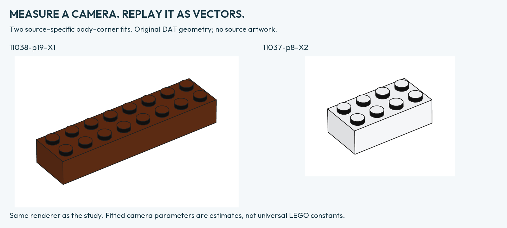

# Camera direction from a real three-dimensional brick

The plane-only study cannot uniquely recover the camera's elevation. A brick
body adds a known height and visible corners on two planes. We tested that
extra information on **two selected illustrations from two Classic 2024 books**:
[11038, PDF 19](https://www.lego.com/cdn/product-assets/product.bi.core.pdf/6509312.pdf#page=19)
and [11037, PDF 8](https://www.lego.com/cdn/product-assets/product.bi.core.pdf/6497651.pdf#page=8).
This is an exploratory pair, not a representative sample of themes.

## Two different meanings of “camera angle”

The **direction from the brick's center to the eye** is close to 35°/35° in both
examples. The **optical axis** can point elsewhere when the object is away from
the center of the original camera frame. Cropping the image does not tell us
where that optical center was. These directions must not be conflated.

| Source | Direction from brick center: azimuth / elevation | Range over three contour thresholds |
| --- | --- | --- |
| 11038 p19, 2×8 brown brick | **34.876° / 35.102°** | 34.462–35.629° / 34.992–35.236° |
| 11037 p8, 2×4 white brick | **34.884° / 34.669°** | 34.884–35.142° / 34.601–34.883° |

The extra decimals allow numerical replay; they are not claimed physical
accuracy. Across leave-one-corner-out checks and contour thresholds the local
azimuth ranges 34.12–35.92°, elevation 34.04–35.70°. These are sensitivity ranges,
not confidence intervals. Two source illustrations remain two observations.

Full optical parameters are less stable: fitted optical elevation ranges
26.52–38.88°, and the optical center can lie outside the cropped image. Those
numbers describe fitted models; they are not established original camera values.

## Measurement and fitting

- Count the visible 2×8 or 2×4 stud grid and use nominal body dimensions
  160×40×24 or 80×40×24 LDU. Corresponding DAT exterior faces confirm these
  dimensions. The measurement points are seven visible body corners.
- Fit nine guided straight contour segments in native pixels, excluding the
  chosen endpoints. Intersections give four top and three bottom corners.
  No corner is discarded based on camera residual.
- Correct native pixel aspect using the actual PDF placement. The y/x factors
  are **0.9954968111** and **0.9987784897**. Initial uncorrected fits are retained
  in the private audit. This is a known page transform, not an image registration.
- Fit a square-pixel, zero-skew pinhole camera with nine parameters: rotation,
  translation, focal scale and optical center. Four starting distances converge
  to the same fit. Three synthetic cameras with known parameters are recovered
  before interpreting the official images.
- Brown contours use thresholds 35/50/65. On the white brick, the first threshold
  produced no pixels on one antialiased edge. Native values there were 78–138;
  thresholds 120/145/170 were declared before any white camera fit.

Body-corner fitting RMS is 0.377 and 0.333 native-x-equivalent pixels for the
middle thresholds. Leaving out one corner raises prediction RMS to 1.253 and
1.031. The corresponding general affine 3D predictor gives 1.345 and 1.024:
the white case is effectively tied. The stronger thirteen-assembly perspective
result remains separate; this pair is not a new universal model-selection proof.

## Predicting points that were not fitted

The cameras were fitted to body edges only. We then predicted the centers of
**16 and 8 stud-top discs**, on a third height plane. A projected circle's area
centroid is used rather than assuming its 3D center projects to the ellipse
center. Source centers come from native thresholded cap interiors.

| Source | Pinhole RMS | General affine 3D RMS | Pinhole range across thresholds |
| --- | ---: | ---: | ---: |
| 11038 p19 | **0.809 px** | 1.283 px | 0.808–0.931 px |
| 11037 p8 | **0.649 px** | 0.863 px | 0.649–0.748 px |

Pinhole predicts these held-out caps better in all nine threshold combinations
per source. Those combinations share the same two illustrations. No new camera
parameter was selected from cap errors. CAD dimensions, rasterized contour
centers, JPEG and small polygons remain error sources.

## Replay these cameras through the renderer



Since **0.6.0.dev2**, `render` accepts explicit optical-center coordinates and
camera roll. They are applied during 3D projection, before vector visibility.
There is no post-render warp. A numerical replay of all fourteen fitted body
corners agrees with the renderer's camera to less than 3×10⁻¹³ page points.
This checks implementation, not source-image accuracy.

```sh
python3 tools/analyze_volume_camera.py --output output/camera-analysis.json
python3 tools/render_camera_calibrations.py --library /path/to/ldraw \
  --output output/calibrated-bricks
```

The numerical analysis needs NumPy. Rendering needs the ordinary core toolchain
and external DAT library. The source images are not included or downloaded.
The recipes bind a particular brick and coordinate frame; they are not universal
camera presets for arbitrary models.

`--principal-point=x,y` uses page points and requires `--camera-distance`.
`--camera-roll` rotates image axes. The principal point may lie outside the frame;
all geometry must still fit the output viewport. With a shifted optical center,
`--field-of-view` is the **centered-equivalent vertical angle specifying focal
length**. Receipts also give the actual shifted horizontal and vertical page
angular spans. Original uncropped LEGO field of view is not recovered.

The renderer's general 30° illustration setting is not the fitted setting of
these small bricks. To reproduce the research pictures, use the saved complete
camera recipes. A working 35°/35° direction alone does not reproduce perspective
strength, framing or the optical center.

[Numerical measurements and provenance](research/VOLUME-CAMERA-DATA.json) ·
[Results, cap controls and render recipes](research/VOLUME-CAMERA-RESULTS.json) ·
[Camera controls](CAMERA.md)

## Direct test of a fixed local 35°/35° direction

We fix the eye direction from the body center at 35°/35° and refit the seven
remaining nuisance parameters to the same body corners. No cap enters the fit.
Before computing residuals, the illustration criterion was declared: held-out
cap RMS at most one native-x-equivalent pixel in every threshold combination.

| Source | Free direction RMS | Fixed 35°/35° RMS | Fixed range |
| --- | ---: | ---: | ---: |
| Brown 11038 /19 |0.809|**0.766**|0.764–0.793|
| White 11037 /8 |0.649|**0.774**|0.774–0.858|

Both pass. The fixed model even slightly improves the brown held-out result;
constraining a model can help prediction. This supports 35°/35° as a working
local direction for these two illustrations. A separate conditional statistical
test gives bootstrap p-values **0.943 / 0.640** for the two local angles jointly
in each image, under independent Gaussian coordinate errors. It does not give
a probability of exact equality or establish a universal setting.
[P-values, the error model and numerical replay](CAMERA-PVALUES.md).
Focal scale and principal point are still fitted: the result does not establish
the general default FOV 30.

[Fixed-direction fits and all 18 residual comparisons](research/FIXED-DIRECTION-VALIDATION.json).
Run `python3 tools/check_fixed_camera_direction.py --output output/fixed-direction.json`
to repeat the fits and held-out comparisons from numerical data only.

## Perspective strength is separate from direction

A further descriptive sweep holds the centered local view at 35°/35°, roll 0,
body-center target and explicit frame size (source crop plus 30 pt padding per
side). Actual DAT geometry controls distance-only auto-fit. For each candidate,
only a uniform positive scale and translation are fitted to the seven body
corners; there is no rotation, nonuniform scaling or projective warp. The same
alignment predicts the previously measured cap centers.

| FOV in this declared frame | Brown cap RMS, px | White cap RMS, px |
| ---: | ---: | ---: |
|30°|10.802|3.446|
|15°|5.395|1.640|
|5°|1.487|0.659|
|2°|0.654|0.705|
|1°|0.741|0.776|
|0.1°|0.989|0.857|
|0° — orthographic|1.022|0.867|

The zero label denotes the exact orthographic limit at fixed image scale,
not a zero-degree pinhole camera. These two controls use the renderer's
`orthographic` mode, the same 35°/35° direction and frame, and the same
body-only alignment. Its held-out cap error exceeds the 2° result for both
bricks, in all nine edge/cap threshold combinations per source. This supports
weak perspective over orthography for these two fixed-view examples; it does
not establish a universal optimal FOV.

These two examples informed the choice of 2° for the instruction preset. The paper-style gallery uses that preset angle for its individual parts trays. The general rendering default and the full-model foldout example use 30°. Six native PDF replays verify the actual camera geometry used for the
comparison. Full source-specific cameras remain the more complete replay.

FOV depends on frame size and occupancy. These values do not identify LEGO's
original uncropped field of view; other themes and aspect ratios need fresh
validation. [Protocol and all threshold comparisons](research/CAMERA-STRENGTH.json).

## Cross-theme replication and the precision limit

A targeted extension examines seven unique small brick images from four more
themes. The eight-edge estimator gives descriptive fits, but known-camera
native raster controls expose bias and instability. The results do not justify
exact theme-specific camera angles or a change to the working 35°/35° view.
This is a separate estimator and source-resolution regime from the two larger
Classic bricks above. [Sources, controls and reproducible data](CAMERA-EDGE-SENSITIVITY.md).
